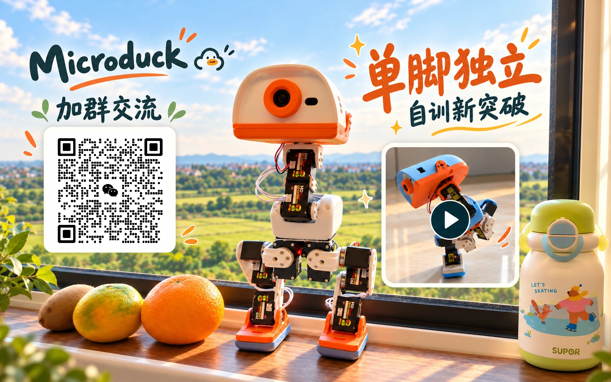

[简体中文](README.md) | **English**

# 🦆 Microduck Feetech HD1910 Replica · Build a walking robot duck

From a collection of parts to a walking, forward-rolling robot duck. This working Feetech HD1910 replica of [Pollen Robotics Microduck](https://github.com/pollen-robotics/microduck) includes a **system image, Chinese Robot Console, DIY HAT / IMU boards and complete 3D printing files**.

**No training is required for a normal build. Use the supplied movement models after assembly, flashing and calibration.**

> [!WARNING]
> **Hardware compatibility and commercial authorization**
>
> **HAT, IMU and HUB versions outside the designs published in this repository are incompatible with this repository’s system and may prevent it from operating normally.**
>
> **This repository has not authorized any commercial organization.** If you find pirated copies, impersonation or unauthorized commercial use, please contact the author. Sharing this work takes effort; please do not misappropriate it.
>
> **Scam warning: Do not trust private sales messages from anyone other than the group owner. Group members have already been scammed.**
>
> [Contact the author](https://github.com/kissqy/Microduck-kissqy/blob/main/docs/assets/purchase-wechat-qr.jpg) · [License scope](https://github.com/kissqy/Microduck-kissqy/blob/main/LICENSE). The repository’s existing licenses determine the scope of this notice.

<table>
  <tr>
    <td width="50%" align="left"><a href="https://kissqy.github.io/Microduck-kissqy/build/budget.html"><b>① Budget and shopping</b></a> Choose a budget, then follow its matching parts list.</td>
    <td width="50%" align="left"><a href="https://kissqy.github.io/Microduck-kissqy/build/assembly.html"><b>② How do I assemble it?</b></a> Parts, 3D structure and wiring.</td>
  </tr>
  <tr>
    <td align="left"><a href="https://kissqy.github.io/Microduck-kissqy/build/start.html"><b>③ How do I make it walk?</b></a> Flash, connect, calibrate and use the supplied models.</td>
    <td align="left"><a href="https://kissqy.github.io/Microduck-kissqy/build/advanced.html"><b>④ Advanced play (optional)</b></a> <b>No training needed for a normal build.</b> Explore this only to train new movements or learn the training process.</td>
  </tr>
</table>

The three build stages and optional advanced guide are in Chinese. [English build guide](docs/MICRODUCK-BUILD-GUIDE.en.md) · [🎮 Robot Console demo](https://kissqy.github.io/Microduck-kissqy/) · [📖 Console tutorial (中文)](https://kissqy.github.io/Microduck-kissqy/console-guide.html) · [❓ FAQ](docs/MICRODUCK-FAQ.en.md)

## 🏆 One-legged balance · A new training milestone

The group QR code is valid before November 1, 2026.

## 🎬 More real-robot videos

<table>
<tr>
  <td width="10%"><video src="https://github.com/user-attachments/assets/0ec5b46b-1ec0-483a-a95d-3b3f307e155f" controls></video></td>
  <td width="10%"><video src="https://github.com/user-attachments/assets/d09a6bfe-7a28-4266-ba90-de2b331472ad" controls></video></td>
  <td width="10%"><video src="https://github.com/user-attachments/assets/a604c0e0-af01-413f-ab00-99ccd26db8d5" controls></video></td>
  <td width="10%"><video src="https://github.com/user-attachments/assets/4508d91c-e91c-40f4-8c3e-5ca5a3f959c3" controls></video></td>
  <td width="10%"><video src="https://github.com/user-attachments/assets/fd0dfafd-dd02-4852-940c-33706c287e9d" controls></video></td>
  <td width="10%"><video src="https://github.com/user-attachments/assets/693a3272-d814-42f6-86b3-be5cb3b35b0f" controls></video></td>
</tr>
</table>

[🎬 Watch all real-robot videos →](https://kissqy.github.io/Microduck-kissqy/one-leg-balance.html#more-videos)

These clips show the real robot. The console demos below use simulated data; they cannot connect to a robot or run training.

## ✨ Walk, roll and explore more movements

This little duck can **walk, sit, pick things up, kick a ball, and roll forward**. Add rollers to explore **swizzling, crouching, spinning, and standing up after a fall**. Use a physical gamepad and the supplied models to explore the existing movements with the Chinese Robot Console.

**System Image R1 has passed a fresh-card installation test.** It includes the official system, this project's robot services and motion models. Flash it onto a Radxa ZERO 3W, connect to Wi-Fi, and open the console without compiling firmware from source.

## 🧭 Build your duck in three stages

**[① Budget and shopping](https://kissqy.github.io/Microduck-kissqy/build/budget.html) → [② Assembly and wiring](https://kissqy.github.io/Microduck-kissqy/build/assembly.html) → [③ First walk](https://kissqy.github.io/Microduck-kissqy/build/start.html)** · Guided pages in Chinese.

These three stages prepare your duck to use the supplied movements. Continue from your current progress. [Advanced play](https://kissqy.github.io/Microduck-kissqy/build/advanced.html) is optional, for training new movements or learning the training process.

## Downloads and versions

Follow the [first-walk guide (中文)](https://kissqy.github.io/Microduck-kissqy/build/start.html); each stage provides its required download.

[📥 System Image R1](https://kissqy.github.io/Microduck-kissqy/build/start.html#flash) · [📥 Robot Console R17 V167](https://kissqy.github.io/Microduck-kissqy/build/start.html#connect) · [Firmware and DIY IMU flashing](release-assets/README.en.md)

## 🎮 Chinese Robot Console

Connect and calibrate the robot, inspect live 3D pose, joint / IMU feedback and camera, operate with a physical gamepad or web controls, and maintain its firmware.

**[Live interface demo](https://kissqy.github.io/Microduck-kissqy/) · [Illustrated console tutorial (中文)](https://kissqy.github.io/Microduck-kissqy/console-guide.html)**

The online demo uses simulated data. Download and run Robot Console locally to connect to a real robot.

## 🖨️ Complete printing set · FrankenDuck

Community improvements and the author's real-robot modifications are collected into a **complete set of structural models and reference plate layouts**. Explore standard feet and roller setups, from printing and assembly to a working robot.

[Printing files, plate previews and assembly notes →](hardware/3d-print-frankenduck/README.en.md)

## 🔧 DIY HAT and IMU

The author designs and lays out the HAT and independent torso IMU, with extended real-robot use and iterative validation. Assembled boards are **SMT-manufactured by JLCPCB**, integrating the functions needed for replication to reduce separate sourcing and DIY fabrication costs. PCB projects, parts lists and build records are provided for DIY assembly or the author's assembled boards.

**The assembled IMU comes with FT6 firmware pre-flashed; no additional flashing is needed on arrival. Calibrate it for your robot after installation.** The author's separately licensable original design material is for personal noncommercial replication; commercial reproduction, manufacture, sale or integration requires prior written permission. [Board design license](hardware/LICENSE)

[Hardware projects and build guides](hardware/README.en.md) · [IMU build video](https://www.bilibili.com/video/BV1qapz6PERs/) · [Buy assembled boards](https://item.taobao.com/item.htm?id=1095121548583)

## ❤️ Sharing the project and crediting its creators

This is an individual replica and development project based on the official Microduck, with AI-assisted programming. I hope these materials help you get your own duck moving sooner. Stars ⭐, discussion and feedback are welcome. [The author's learning journey](docs/AUTHOR-JOURNEY.en.md)

Original consoles, tools, documentation and HD1910 self-trained models explicitly covered by the personal noncommercial terms require written permission for commercial or organizational use. Other material, including the author's adaptations already released under Apache, retains its applicable license. [Software and model rights](microduck-hd1910/docs/SOFTWARE-MODEL-RIGHTS.en.md) · [Model provenance](microduck-hd1910/docs/MODEL-PROVENANCE.en.md) · [Component licenses](LICENSE) · [Personal noncommercial terms](microduck-hd1910/LICENSES/Personal-NonCommercial.txt) · [Third-party credits](microduck-hd1910/docs/THIRD-PARTY.en.md)

## 🧠 Advanced play (optional) · Train your own movements

**Normal builds and daily use require no training; use the supplied models.** Choose the separate Training Studio only if you want to train new movements or learn reinforcement learning: choose tasks and recipes, inspect rewards, evaluate in simulation and export models for real-robot testing.

[Training Studio R1.5.27 guide](microduck-hd1910/training-console/USER-GUIDE.en.md) · [Online demo](https://kissqy.github.io/Microduck-kissqy/training/) · [Download Training Studio](https://github.com/kissqy/Microduck-kissqy/raw/refs/heads/main/release-assets/Microduck-Training-Studio-R1.5.27.zip)

<table align="center">
  <tr>
    <td align="center" valign="top" width="50%">
      <b>❤️ Support the author</b>  
      
    </td>
    <td align="center" valign="top" width="50%">
      <b>💬 Contact the author</b>  
       
      Scan in WeChat to contact the author. Click the QR code for the original image.
    </td>
  </tr>
</table>
