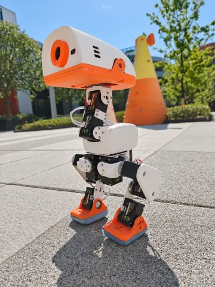
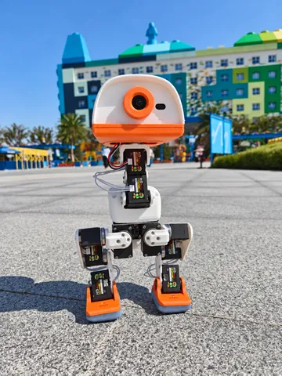
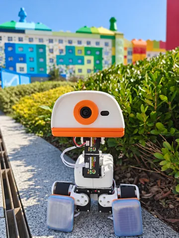
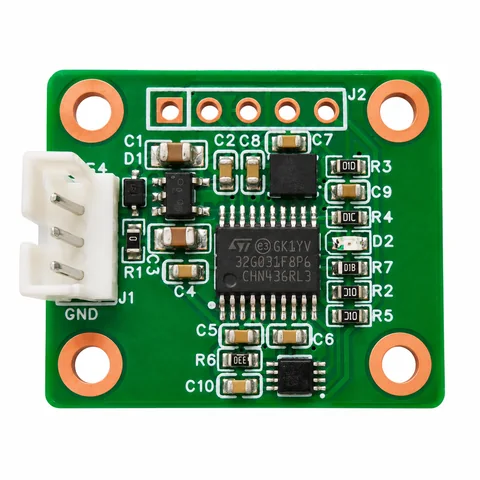

[简体中文](README.md) | **English** · [Gitee repository](https://gitee.com/kissqy/microduck-kissqy)

# 🦆 Microduck · Feetech HD1910 Replica

**Build a walking robot duck, try supplied movements, then explore Chinese AI and training.**

Radxa ZERO 3W · 15 × Feetech HD1910 · Matching HAT / IMU / HUB

**Microduck-kissqy** is kissqy's personal Feetech HD1910 biped robot duck replica, based on [Pollen Robotics Microduck](https://github.com/pollen-robotics/microduck) **0.15.1**.

- **Building and operation:** system image, Chinese Robot Console, supplied ONNX motion policies, DIY HAT / torso IMU / HUB and HD1910-adapted 3D printing files (STL / 3MF).
- **Interaction and research:** Chinese AI voice, camera vision and action calls, plus a separate reinforcement-learning Training Studio.

[Real robots](#real-robot-videos-and-photos) · [Why kissqy](#why-choose-microduck-kissqy) · [Build](#build-your-duck) · [Downloads](#downloads-and-versions) · [Hardware / printing](#hardware-and-printing) · [Console / AI](#chinese-robot-console-and-ai) · [Training](#train-your-own-movements) · [Usage](#usage-and-licensing)

---

## Real-robot videos and photos

### 🏆 One-legged balance · A new training milestone

The author’s self-trained one-legged balance has been demonstrated on a physical HD1910 robot. The video below shows the real robot; build, calibration and training references are available in this repository.

The Group 4 QR code is valid before November 20, 2026.

### 🎬 More real-robot videos

<!-- Nonbreaking spacer keeps GitHub video columns at a consistent minimum width. -->
<table>
<tr>
  <td width="360" valign="top"><video src="https://github.com/user-attachments/assets/008bb58b-7bbd-4de7-9687-9b6ef2d42ed7" controls></video>&nbsp;&nbsp;&nbsp;&nbsp;&nbsp;&nbsp;&nbsp;&nbsp;&nbsp;&nbsp;&nbsp;&nbsp;&nbsp;&nbsp;&nbsp;&nbsp;&nbsp;&nbsp;&nbsp;&nbsp;&nbsp;&nbsp;&nbsp;&nbsp;&nbsp;&nbsp;&nbsp;&nbsp;&nbsp;&nbsp;&nbsp;&nbsp;&nbsp;&nbsp;&nbsp;&nbsp;&nbsp;&nbsp;&nbsp;&nbsp;&nbsp;&nbsp;&nbsp;&nbsp;&nbsp;&nbsp;&nbsp;&nbsp;&nbsp;&nbsp;&nbsp;&nbsp;&nbsp;&nbsp;&nbsp;&nbsp;&nbsp;&nbsp;&nbsp;&nbsp;&nbsp;&nbsp;&nbsp;&nbsp;&nbsp;&nbsp;&nbsp;&nbsp;&nbsp;&nbsp;&nbsp;&nbsp;&nbsp;&nbsp;&nbsp;&nbsp;&nbsp;&nbsp;&nbsp;&nbsp;&nbsp;&nbsp;&nbsp;&nbsp;&nbsp;&nbsp;&nbsp;&nbsp;&nbsp;&nbsp;</td>
  <td width="360" valign="top"><video src="https://github.com/user-attachments/assets/0a3edb38-0c25-429a-b552-94ea04881bf3" controls></video>&nbsp;&nbsp;&nbsp;&nbsp;&nbsp;&nbsp;&nbsp;&nbsp;&nbsp;&nbsp;&nbsp;&nbsp;&nbsp;&nbsp;&nbsp;&nbsp;&nbsp;&nbsp;&nbsp;&nbsp;&nbsp;&nbsp;&nbsp;&nbsp;&nbsp;&nbsp;&nbsp;&nbsp;&nbsp;&nbsp;&nbsp;&nbsp;&nbsp;&nbsp;&nbsp;&nbsp;&nbsp;&nbsp;&nbsp;&nbsp;&nbsp;&nbsp;&nbsp;&nbsp;&nbsp;&nbsp;&nbsp;&nbsp;&nbsp;&nbsp;&nbsp;&nbsp;&nbsp;&nbsp;&nbsp;&nbsp;&nbsp;&nbsp;&nbsp;&nbsp;&nbsp;&nbsp;&nbsp;&nbsp;&nbsp;&nbsp;&nbsp;&nbsp;&nbsp;&nbsp;&nbsp;&nbsp;&nbsp;&nbsp;&nbsp;&nbsp;&nbsp;&nbsp;&nbsp;&nbsp;&nbsp;&nbsp;&nbsp;&nbsp;&nbsp;&nbsp;&nbsp;&nbsp;&nbsp;&nbsp;</td>
  <td width="360" valign="top"><video src="https://github.com/user-attachments/assets/0ec5b46b-1ec0-483a-a95d-3b3f307e155f" controls></video>&nbsp;&nbsp;&nbsp;&nbsp;&nbsp;&nbsp;&nbsp;&nbsp;&nbsp;&nbsp;&nbsp;&nbsp;&nbsp;&nbsp;&nbsp;&nbsp;&nbsp;&nbsp;&nbsp;&nbsp;&nbsp;&nbsp;&nbsp;&nbsp;&nbsp;&nbsp;&nbsp;&nbsp;&nbsp;&nbsp;&nbsp;&nbsp;&nbsp;&nbsp;&nbsp;&nbsp;&nbsp;&nbsp;&nbsp;&nbsp;&nbsp;&nbsp;&nbsp;&nbsp;&nbsp;&nbsp;&nbsp;&nbsp;&nbsp;&nbsp;&nbsp;&nbsp;&nbsp;&nbsp;&nbsp;&nbsp;&nbsp;&nbsp;&nbsp;&nbsp;&nbsp;&nbsp;&nbsp;&nbsp;&nbsp;&nbsp;&nbsp;&nbsp;&nbsp;&nbsp;&nbsp;&nbsp;&nbsp;&nbsp;&nbsp;&nbsp;&nbsp;&nbsp;&nbsp;&nbsp;&nbsp;&nbsp;&nbsp;&nbsp;&nbsp;&nbsp;&nbsp;&nbsp;&nbsp;&nbsp;</td>
  <td width="360" valign="top"><video src="https://github.com/user-attachments/assets/d09a6bfe-7a28-4266-ba90-de2b331472ad" controls></video>&nbsp;&nbsp;&nbsp;&nbsp;&nbsp;&nbsp;&nbsp;&nbsp;&nbsp;&nbsp;&nbsp;&nbsp;&nbsp;&nbsp;&nbsp;&nbsp;&nbsp;&nbsp;&nbsp;&nbsp;&nbsp;&nbsp;&nbsp;&nbsp;&nbsp;&nbsp;&nbsp;&nbsp;&nbsp;&nbsp;&nbsp;&nbsp;&nbsp;&nbsp;&nbsp;&nbsp;&nbsp;&nbsp;&nbsp;&nbsp;&nbsp;&nbsp;&nbsp;&nbsp;&nbsp;&nbsp;&nbsp;&nbsp;&nbsp;&nbsp;&nbsp;&nbsp;&nbsp;&nbsp;&nbsp;&nbsp;&nbsp;&nbsp;&nbsp;&nbsp;&nbsp;&nbsp;&nbsp;&nbsp;&nbsp;&nbsp;&nbsp;&nbsp;&nbsp;&nbsp;&nbsp;&nbsp;&nbsp;&nbsp;&nbsp;&nbsp;&nbsp;&nbsp;&nbsp;&nbsp;&nbsp;&nbsp;&nbsp;&nbsp;&nbsp;&nbsp;&nbsp;&nbsp;&nbsp;&nbsp;</td>
  <td width="360" valign="top"><video src="https://github.com/user-attachments/assets/a604c0e0-af01-413f-ab00-99ccd26db8d5" controls></video>&nbsp;&nbsp;&nbsp;&nbsp;&nbsp;&nbsp;&nbsp;&nbsp;&nbsp;&nbsp;&nbsp;&nbsp;&nbsp;&nbsp;&nbsp;&nbsp;&nbsp;&nbsp;&nbsp;&nbsp;&nbsp;&nbsp;&nbsp;&nbsp;&nbsp;&nbsp;&nbsp;&nbsp;&nbsp;&nbsp;&nbsp;&nbsp;&nbsp;&nbsp;&nbsp;&nbsp;&nbsp;&nbsp;&nbsp;&nbsp;&nbsp;&nbsp;&nbsp;&nbsp;&nbsp;&nbsp;&nbsp;&nbsp;&nbsp;&nbsp;&nbsp;&nbsp;&nbsp;&nbsp;&nbsp;&nbsp;&nbsp;&nbsp;&nbsp;&nbsp;&nbsp;&nbsp;&nbsp;&nbsp;&nbsp;&nbsp;&nbsp;&nbsp;&nbsp;&nbsp;&nbsp;&nbsp;&nbsp;&nbsp;&nbsp;&nbsp;&nbsp;&nbsp;&nbsp;&nbsp;&nbsp;&nbsp;&nbsp;&nbsp;&nbsp;&nbsp;&nbsp;&nbsp;&nbsp;&nbsp;</td>
  <td width="360" valign="top"><video src="https://github.com/user-attachments/assets/4508d91c-e91c-40f4-8c3e-5ca5a3f959c3" controls></video>&nbsp;&nbsp;&nbsp;&nbsp;&nbsp;&nbsp;&nbsp;&nbsp;&nbsp;&nbsp;&nbsp;&nbsp;&nbsp;&nbsp;&nbsp;&nbsp;&nbsp;&nbsp;&nbsp;&nbsp;&nbsp;&nbsp;&nbsp;&nbsp;&nbsp;&nbsp;&nbsp;&nbsp;&nbsp;&nbsp;&nbsp;&nbsp;&nbsp;&nbsp;&nbsp;&nbsp;&nbsp;&nbsp;&nbsp;&nbsp;&nbsp;&nbsp;&nbsp;&nbsp;&nbsp;&nbsp;&nbsp;&nbsp;&nbsp;&nbsp;&nbsp;&nbsp;&nbsp;&nbsp;&nbsp;&nbsp;&nbsp;&nbsp;&nbsp;&nbsp;&nbsp;&nbsp;&nbsp;&nbsp;&nbsp;&nbsp;&nbsp;&nbsp;&nbsp;&nbsp;&nbsp;&nbsp;&nbsp;&nbsp;&nbsp;&nbsp;&nbsp;&nbsp;&nbsp;&nbsp;&nbsp;&nbsp;&nbsp;&nbsp;&nbsp;&nbsp;&nbsp;&nbsp;&nbsp;&nbsp;</td>
  <td width="360" valign="top"><video src="https://github.com/user-attachments/assets/fd0dfafd-dd02-4852-940c-33706c287e9d" controls></video>&nbsp;&nbsp;&nbsp;&nbsp;&nbsp;&nbsp;&nbsp;&nbsp;&nbsp;&nbsp;&nbsp;&nbsp;&nbsp;&nbsp;&nbsp;&nbsp;&nbsp;&nbsp;&nbsp;&nbsp;&nbsp;&nbsp;&nbsp;&nbsp;&nbsp;&nbsp;&nbsp;&nbsp;&nbsp;&nbsp;&nbsp;&nbsp;&nbsp;&nbsp;&nbsp;&nbsp;&nbsp;&nbsp;&nbsp;&nbsp;&nbsp;&nbsp;&nbsp;&nbsp;&nbsp;&nbsp;&nbsp;&nbsp;&nbsp;&nbsp;&nbsp;&nbsp;&nbsp;&nbsp;&nbsp;&nbsp;&nbsp;&nbsp;&nbsp;&nbsp;&nbsp;&nbsp;&nbsp;&nbsp;&nbsp;&nbsp;&nbsp;&nbsp;&nbsp;&nbsp;&nbsp;&nbsp;&nbsp;&nbsp;&nbsp;&nbsp;&nbsp;&nbsp;&nbsp;&nbsp;&nbsp;&nbsp;&nbsp;&nbsp;&nbsp;&nbsp;&nbsp;&nbsp;&nbsp;&nbsp;</td>
  <td width="360" valign="top"><video src="https://github.com/user-attachments/assets/693a3272-d814-42f6-86b3-be5cb3b35b0f" controls></video>&nbsp;&nbsp;&nbsp;&nbsp;&nbsp;&nbsp;&nbsp;&nbsp;&nbsp;&nbsp;&nbsp;&nbsp;&nbsp;&nbsp;&nbsp;&nbsp;&nbsp;&nbsp;&nbsp;&nbsp;&nbsp;&nbsp;&nbsp;&nbsp;&nbsp;&nbsp;&nbsp;&nbsp;&nbsp;&nbsp;&nbsp;&nbsp;&nbsp;&nbsp;&nbsp;&nbsp;&nbsp;&nbsp;&nbsp;&nbsp;&nbsp;&nbsp;&nbsp;&nbsp;&nbsp;&nbsp;&nbsp;&nbsp;&nbsp;&nbsp;&nbsp;&nbsp;&nbsp;&nbsp;&nbsp;&nbsp;&nbsp;&nbsp;&nbsp;&nbsp;&nbsp;&nbsp;&nbsp;&nbsp;&nbsp;&nbsp;&nbsp;&nbsp;&nbsp;&nbsp;&nbsp;&nbsp;&nbsp;&nbsp;&nbsp;&nbsp;&nbsp;&nbsp;&nbsp;&nbsp;&nbsp;&nbsp;&nbsp;&nbsp;&nbsp;&nbsp;&nbsp;&nbsp;&nbsp;&nbsp;</td>
</tr>
</table>

[🎬 Watch all real-robot videos →](https://kissqy.github.io/Microduck-kissqy/one-leg-balance.html#more-videos)

<b>📷 Out with Microduck</b> · <a href="https://kissqy.github.io/Microduck-kissqy/one-leg-balance.html#photo-gallery">7 photos · Click to browse the gallery →</a>

<table>
<tr>
<td></td>
<td></td>
<td></td>
<td></td>
<td></td>
<td></td>
<td></td>
</tr>
</table>

These clips show the real robot. The console demos below use simulated data; they cannot connect to a robot or run training.

---

<!-- replica-choice:start -->
## Why choose Microduck-kissqy?

**A complete duck-building route, from zero to advanced play.**

Software, hardware, ready-to-use motion policies, **Feetech HD1910-adapted printing parts**, tutorials and a separate Training Studio are provided together—from purchasing, printing and assembly through flashing, networking and calibration, then everyday use, Chinese AI and training new movements.

<table width="100%">
  <tr>
    <td width="400" valign="top"><b>🦆 Supplied movements, no initial training</b>  Walking, sit/stand, picking, forward rolls, left/right kicks and roller swizzle, crouch, spin and get-up resources.  Assemble, flash and calibrate your own robot before using its matching release policies.</td>
    <td width="400" valign="top"><b>🎮 Chinese console and AI interaction</b>  Graphical connection, servo/IMU calibration, live 3D pose, joint feedback, camera, gamepad and firmware maintenance. R2 / V260 adds conversation, image recognition, voices/personas and action calls.  AI requires service credentials and network access.</td>
  </tr>
  <tr>
    <td width="400" valign="top"><b>🔧 Coordinated hardware and software</b>  HAT / IMU / HUB designs, parts lists, printing, wiring, image and firmware are provided together. Fabricate the boards or choose assembled ones.  Reference configuration: ZERO 3W and 15 HD1910 servos; other boards and mechanical changes require compatibility checks.</td>
    <td width="400" valign="top"><b>🧠 Author-trained results and training tools</b>  Model provenance and physical demonstrations, plus a separate Training Studio for task recipes, queues, reward curves, simulation evaluation and ONNX export.  Complete a reference duck with existing results, then research new skills when needed.</td>
  </tr>
</table>

**This project is a major source of HD1910 motion resources in the community.**

fanhao's image model notice credits **10 models to kissqy** and records retaining their original weights. [Read the attribution](https://github.com/fanhao375/microduck-replica/blob/master/software/image/overlay/usr/share/doc/microduck/%E6%A8%A1%E5%9E%8B%E8%AF%B4%E6%98%8E.txt).

**[Our advantages first, then what other repositories are missing →](https://kissqy.github.io/Microduck-kissqy/compare/en.html?v=20261118-advantages-first)**

[Text edition and evidence](docs/MICRODUCK-COMPARISON.en.md) · Official Microduck, Luwu XGO-Duck, AI-FanGe, fanhao375, OpenMicroDuck and this project.
<!-- replica-choice:end -->

---

## Build your duck

**A normal build does not require training your own policy.** Assemble, flash and calibrate, then use the matching supplied models.

<table width="100%">
  <tr>
    <td width="400" valign="top"><a href="https://kissqy.github.io/Microduck-kissqy/build/budget.html"><b>① Budget and shopping</b></a>  Choose a budget and prepare its servos, controller, boards and parts. What should I buy?</td>
    <td width="400" valign="top"><a href="https://kissqy.github.io/Microduck-kissqy/build/assembly.html"><b>② How do I assemble it?</b></a>  Follow the 3D structure, component assembly, servo orientation and connections. Assembly and wiring</td>
  </tr>
  <tr>
    <td width="400" valign="top"><a href="https://kissqy.github.io/Microduck-kissqy/build/start.html"><b>③ Get the duck moving</b></a>  Flash, connect to Wi-Fi, calibrate and use the matching supplied policies. Flash and first walk</td>
    <td width="400" valign="top"><a href="https://kissqy.github.io/Microduck-kissqy/build/advanced.html"><b>④ Advanced play (optional)</b></a>  Explore this when training a new movement or learning reinforcement learning. Normal builds require no initial training</td>
  </tr>
</table>

Skip stages you have already completed. **The first three stages complete a normal build; stage 4 is optional.**

[Three-stage route (中文)](https://kissqy.github.io/Microduck-kissqy/build/) · [English build guide and FAQ](https://kissqy.github.io/Microduck-kissqy/guides/en.html) · [Written guide](docs/MICRODUCK-BUILD-GUIDE.en.md) · [Shopping list](DUCK-SHOPPING-LIST.en.md) · [FAQ](docs/MICRODUCK-FAQ.en.md)

The stage pages above are Chinese; the English guide provides the corresponding instructions. China access: [Gitee](https://gitee.com/kissqy/microduck-kissqy) · [R2 China release](https://gitee.com/kissqy/microduck-kissqy/releases/tag/console-studio-v260).

---

## Downloads and versions

**Current stable publication: System Image R2 + Console Studio V260 / control.102, boot-time Wi-Fi R10.**

R2 is for new or reflashed Radxa ZERO 3W systems. It includes upstream Microduck 0.15.1, control.102, 11 runtime ONNX models and R10 boot-time Wi-Fi setup. Connect to Wi-Fi and use V260 without compiling the firmware yourself.

R2 / V260 publication information updated November 13, 2026.

| Need | Matching version | Download | Documentation / source |
| --- | --- | --- | --- |
| **New system image** | R2 · control.102 · Wi-Fi R10 | [Download .img.xz](https://github.com/kissqy/Microduck-kissqy/releases/download/console-studio-v260/microduck-kissqy-zero3w-R2.img.xz) | [Image release notes](https://github.com/kissqy/Microduck-kissqy/releases/tag/console-studio-v260) |
| **Stable console and firmware** | Studio V260 · control.102 | [Runtime and firmware downloads](https://github.com/kissqy/Microduck-kissqy/releases/tag/console-studio-v260) | [Version files, guide and source](versions/v260/README.en.md) |
| **Console pre-release** | V297 BATE · control.102 | [Download console ZIP](https://github.com/kissqy/Microduck-kissqy/releases/download/console-studio-v297-bate/Microduck-Console-Studio-V297-BATE.zip) | [Features page](https://kissqy.github.io/Microduck-kissqy/console-bate/en.html) · [Version files](versions/v297-bate/README.en.md) |
| **Separate Training Studio · optional** | R1.5.27 | [Download ZIP](https://github.com/kissqy/Microduck-kissqy/raw/refs/heads/main/versions/v167/release-assets/Microduck-Training-Studio-R1.5.27.zip) | [Training guide](microduck-hd1910/training-console/README.en.md) |

### V167 users: upgrade to V260 without reflashing

Fully extract V260, connect to ZERO and install the bundled firmware from the console. Follow the [upgrade guide](versions/v260/README.en.md) to retain robot-specific calibration and settings. Use R2 for a new system or when you intend to reflash.

### V297 BATE: servo numbering through HAT

**Assign servo IDs and calibrate their midpoint without a URT2 programming board.** The pre-release provides four workspaces, HAT numbering and separate hardware tests.

[Console features and instructions](https://kissqy.github.io/Microduck-kissqy/console-bate/en.html) · [Release and downloads](https://github.com/kissqy/Microduck-kissqy/releases/tag/console-studio-v297-bate)

Existing R2 / control.102 users only replace the desktop console. Physical acceptance is pending; V260 remains stable. Obtain the actual runtime from Release Assets.

### Version and validation scope

Training Studio R1.5.27 is a separate tool; its version is independent of Robot Console V167, V260 and V297. Version trees are in main under `versions/`, without switching branches. V260 console and firmware source are in [versions/v260/](versions/v260/).

Check your robot's mechanics, servos and IMU calibration before its first movement. [Release baseline and verification scope](microduck-hd1910/docs/BASELINE.en.md). Documentation changes do not extend physical Known-Good. R1 flashing records and old V167 source/runtime addresses remain available.

Historical releases: R1 / V167

- [System Image R1](https://github.com/kissqy/Microduck-kissqy/releases/download/public-image-r1/microduck-zero3w-0.15.1-R1.img.xz) includes control.40 and first-boot Wi-Fi R5.
- [Robot Console R17 V167](https://github.com/kissqy/Microduck-kissqy/raw/refs/heads/main/versions/v167/release-assets/Microduck-Console-R17-V167.zip) includes control.43; [historical firmware guide](versions/v167/release-assets/README.en.md).
- V167 firmware and console source are grouped under [versions/v167/](versions/v167/README.en.md); V260 source is under [versions/v260/](versions/v260/). The original root source path remains for compatibility; the former root `release-assets/` directory is retired in favor of the V167 version archive.

---

## Hardware and printing

### 🔧 DIY HAT, IMU and HUB

Designed and laid out by the author, refined through real-robot use and **SMT assembled by JLCPCB**. Design projects, parts lists and fabrication records are available.

<table width="100%">
  <thead>
    <tr>
      <th width="25%" align="center">HAT</th>
      <th width="25%" align="center">HUB</th>
      <th width="25%" align="center">IMU</th>
      <th width="25%" align="center">Banana power board</th>
    </tr>
  </thead>
  <tbody>
    <tr>
      <td align="center"></td>
      <td align="center"></td>
      <td align="center"></td>
      <td align="center">&nbsp;</td>
    </tr>
  </tbody>
</table>

| Board | Purpose and configuration |
| --- | --- |
| **HAT** | Connects ZERO 3W and the servo bus; provides power, communication and audio peripherals. |
| **Torso IMU** | Body-orientation feedback. Assembled IMUs are preflashed with FT6; robot-specific calibration is still required. |
| **Power-distribution HUB** | Branches servo and power connections, with a 1000 µF buffer capacitor. Every HUB V3 connector uses AMP2.0. |
| **Banana power board** | AMP2.0 and matching power harness; its image slot remains empty. Availability follows the assembled-board listing. |

**Matching assembled boards and cables support plug-in assembly without soldering.** Use the assembled HAT / IMU / HUB V3, matching pre-made cables and banana power board as one configuration.

[Hardware and fabrication](hardware/README.en.md) · [Complete HUB V3 project](hardware/ProPrj_DXL_HUB_V3_2026-11-14.epro2) · [DIY IMU firmware and flashing](hardware/IMU-FIRMWARE.en.md) · [IMU fabrication video](https://www.bilibili.com/video/BV1qapz6PERs/) · [Assembled HAT / IMU / HUB](https://item.taobao.com/item.htm?id=1095121548583)

### 🖨️ Complete printing set · FrankenDuck

Community improvements and the author's real-robot modifications are collected into a **complete set of structural models and reference plate layouts**. Explore standard feet and roller setups, from printing and assembly to a working robot.

[MakerWorld model and print profile →](https://makerworld.com.cn/zh/models/3258815-microduck-kissqykai-yuan-feng-he-guai-ban#profileId-3849553) · [Printing files, plate previews and assembly notes →](hardware/3d-print-frankenduck/README.en.md)

[STL / 3MF file directory](hardware/3d-print-frankenduck/)

---

## Chinese Robot Console and AI

The Robot Console connects and calibrates the physical duck, displays feedback, operates movements and maintains firmware. The current interface is Chinese; guides explain its actual button labels and workflow.

| Feature | Use |
| --- | --- |
| **Connection and calibration** | ZERO 3W image / hotspot setup, IP discovery, servo midpoint and direction, joint and IMU calibration. |
| **Motion and feedback** | Live 3D pose, joint / IMU feedback, physical gamepad and web controls. |
| **Camera and vision** | IMX219, local WebRTC video and on-demand image recognition. |
| **Chinese AI** | Doubao voice conversation, voices/personas and calls to existing movements. |
| **Maintenance** | Matching firmware upgrades, Wi-Fi management and device status. |

**For a real robot, download and run the local Robot Console.** [Connection, networking, calibration and operation tutorial (中文)](https://kissqy.github.io/Microduck-kissqy/console-guide.html)

[Online console demo](https://kissqy.github.io/Microduck-kissqy/) · [R2 / V260 AI features and setup](https://github.com/kissqy/Microduck-kissqy/releases/tag/console-studio-v260)

The online demo uses simulated data. AI requires service credentials and connectivity from ZERO; it is not a local offline large language model.

---

## Train your own movements

**The separate reinforcement-learning Training Studio is for new movements and learning the training workflow.** Supplied models cover a normal build and everyday operation.

Choose tasks and recipes, manage training queues and reward curves, evaluate checkpoints in simulation, then export ONNX for physical validation. Establish the matching reference configuration before verifying one new variable at a time.

[Training Studio R1.5.27 overview](microduck-hd1910/training-console/README.en.md) · [User guide](microduck-hd1910/training-console/USER-GUIDE.en.md) · [Online training demo](https://kissqy.github.io/Microduck-kissqy/training/) · [Download Training Studio](https://github.com/kissqy/Microduck-kissqy/raw/refs/heads/main/versions/v167/release-assets/Microduck-Training-Studio-R1.5.27.zip)

A task or recipe does not prove that every movement has completed long training and hardware acceptance. See [model provenance and scope](microduck-hd1910/docs/MODEL-PROVENANCE.en.md).

---

## Usage and licensing

**Supported hardware: only the published HAT, IMU and HUB versions in this repository.** Other boards, servos or mechanical changes require compatibility checks.

No commercial organization has been authorized. For commercial use, [contact the author](docs/assets/purchase-wechat-qr.jpg) and follow the [component licenses](LICENSE).

- **Original software and trained policies:** original consoles, tools, documents and HD1910-trained weights expressly covered by the personal noncommercial terms are for personal learning, research and noncommercial use. Commercial / organizational use needs written authorization.
- **Original board designs:** the author's owned designs and engineering material are for personal noncommercial reproduction; commercial manufacture, sale or integration needs prior written authorization. See [board license](hardware/LICENSE).
- **Upstream and third-party material:** other components, including adaptation code already published by the author under Apache, retain their respective licenses. This page does not change them.

[Software and model rights](microduck-hd1910/docs/SOFTWARE-MODEL-RIGHTS.en.md) · [Model provenance](microduck-hd1910/docs/MODEL-PROVENANCE.md) · [Personal noncommercial terms](microduck-hd1910/LICENSES/Personal-NonCommercial.txt) · [Third-party notices](microduck-hd1910/docs/THIRD-PARTY.en.md)

### Author notes and community

This is the author's personal replica and development project based on official Microduck, including AI-assisted programming. The resources aim to help you get your own duck moving. Stars, discussion and feedback are welcome. [Author learning journal](docs/AUTHOR-JOURNEY.en.md)

[FAQ](docs/MICRODUCK-FAQ.en.md) · [Historical issue / PR archive](docs/GitHub-Issues-PR-Archive-20261116.md)

<table align="center">
  <tr>
    <td align="center" valign="top" width="50%">
      <b>❤️ Support the author</b>  
      
    </td>
    <td align="center" valign="top" width="50%">
      <b>💬 Contact the author</b>  
       
      Scan in WeChat to contact the author. Click the QR code for the original image.
    </td>
  </tr>
</table>
