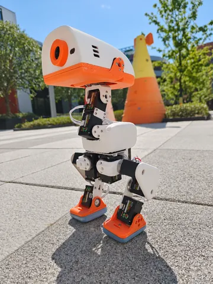
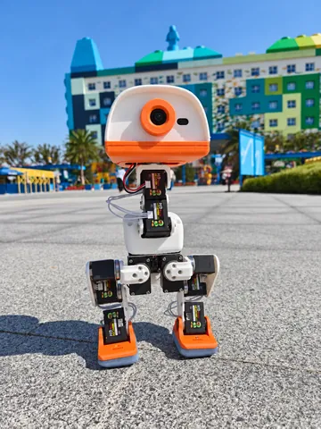
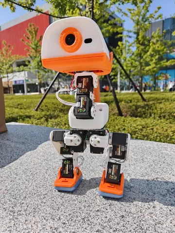
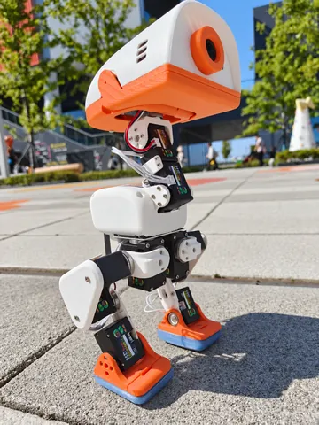
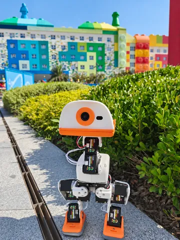
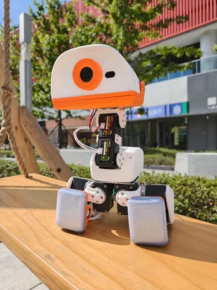
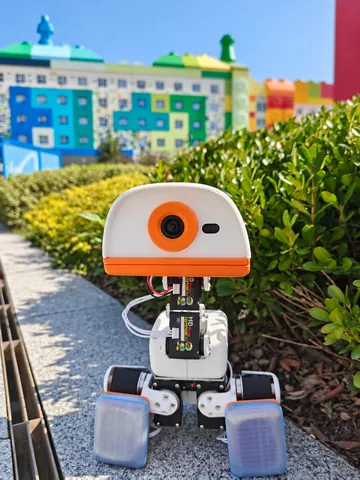

[简体中文](README.md) | **English**

# 🦆 Microduck Feetech HD1910 Replica · Build a walking robot duck

**Microduck-kissqy is kissqy’s working Feetech HD1910 biped robot duck replica, based on [Pollen Robotics Microduck](https://github.com/pollen-robotics/microduck) 0.15.1.** The reference hardware uses a **Radxa ZERO 3W and 15 Feetech HD1910 servos**. The project includes a system image, Chinese Robot Console, ready-to-use ONNX motion models, an independent reinforcement-learning Training Studio, DIY HAT / torso IMU / HUB boards and complete 3D printing files.

**No training is required for a normal build. Use the supplied movement models after assembly, flashing and calibration.**

<table>
  <tr>
    <td width="50%" align="left"><a href="https://kissqy.github.io/Microduck-kissqy/build/budget.html"><b>① Budget and shopping</b></a> Choose a budget, then follow its matching parts list.</td>
    <td width="50%" align="left"><a href="https://kissqy.github.io/Microduck-kissqy/build/assembly.html"><b>② How do I assemble it?</b></a> Parts, 3D structure and wiring.</td>
  </tr>
  <tr>
    <td align="left"><a href="https://kissqy.github.io/Microduck-kissqy/build/start.html"><b>③ How do I make it walk?</b></a> Flash, connect, calibrate and use the supplied models.</td>
    <td align="left"><a href="https://kissqy.github.io/Microduck-kissqy/build/advanced.html"><b>④ Advanced play (optional)</b></a> <b>No training needed for a normal build.</b> Explore this only to train new movements or learn the training process.</td>
  </tr>
</table>

The three build stages and optional advanced guide are in Chinese. [English build guide and FAQ](https://kissqy.github.io/Microduck-kissqy/guides/en.html) · [🎮 Robot Console demo](https://kissqy.github.io/Microduck-kissqy/) · [📖 Console tutorial (中文)](https://kissqy.github.io/Microduck-kissqy/console-guide.html) · [❓ FAQ](docs/MICRODUCK-FAQ.en.md)

## 🏆 One-legged balance · A new training milestone

The author’s self-trained one-legged balance has been demonstrated on a physical HD1910 robot. The video below shows the real robot; build, calibration and training references are available in this repository.

The Group 4 QR code is valid before November 20, 2026.

## 🎬 More real-robot videos

<!-- Nonbreaking spacer keeps GitHub video columns at a consistent minimum width. -->
<table>
<tr>
  <td width="360" valign="top"><video src="https://github.com/user-attachments/assets/008bb58b-7bbd-4de7-9687-9b6ef2d42ed7" controls></video>&nbsp;&nbsp;&nbsp;&nbsp;&nbsp;&nbsp;&nbsp;&nbsp;&nbsp;&nbsp;&nbsp;&nbsp;&nbsp;&nbsp;&nbsp;&nbsp;&nbsp;&nbsp;&nbsp;&nbsp;&nbsp;&nbsp;&nbsp;&nbsp;&nbsp;&nbsp;&nbsp;&nbsp;&nbsp;&nbsp;&nbsp;&nbsp;&nbsp;&nbsp;&nbsp;&nbsp;&nbsp;&nbsp;&nbsp;&nbsp;&nbsp;&nbsp;&nbsp;&nbsp;&nbsp;&nbsp;&nbsp;&nbsp;&nbsp;&nbsp;&nbsp;&nbsp;&nbsp;&nbsp;&nbsp;&nbsp;&nbsp;&nbsp;&nbsp;&nbsp;&nbsp;&nbsp;&nbsp;&nbsp;&nbsp;&nbsp;&nbsp;&nbsp;&nbsp;&nbsp;&nbsp;&nbsp;&nbsp;&nbsp;&nbsp;&nbsp;&nbsp;&nbsp;&nbsp;&nbsp;&nbsp;&nbsp;&nbsp;&nbsp;&nbsp;&nbsp;&nbsp;&nbsp;&nbsp;&nbsp;</td>
  <td width="360" valign="top"><video src="https://github.com/user-attachments/assets/0a3edb38-0c25-429a-b552-94ea04881bf3" controls></video>&nbsp;&nbsp;&nbsp;&nbsp;&nbsp;&nbsp;&nbsp;&nbsp;&nbsp;&nbsp;&nbsp;&nbsp;&nbsp;&nbsp;&nbsp;&nbsp;&nbsp;&nbsp;&nbsp;&nbsp;&nbsp;&nbsp;&nbsp;&nbsp;&nbsp;&nbsp;&nbsp;&nbsp;&nbsp;&nbsp;&nbsp;&nbsp;&nbsp;&nbsp;&nbsp;&nbsp;&nbsp;&nbsp;&nbsp;&nbsp;&nbsp;&nbsp;&nbsp;&nbsp;&nbsp;&nbsp;&nbsp;&nbsp;&nbsp;&nbsp;&nbsp;&nbsp;&nbsp;&nbsp;&nbsp;&nbsp;&nbsp;&nbsp;&nbsp;&nbsp;&nbsp;&nbsp;&nbsp;&nbsp;&nbsp;&nbsp;&nbsp;&nbsp;&nbsp;&nbsp;&nbsp;&nbsp;&nbsp;&nbsp;&nbsp;&nbsp;&nbsp;&nbsp;&nbsp;&nbsp;&nbsp;&nbsp;&nbsp;&nbsp;&nbsp;&nbsp;&nbsp;&nbsp;&nbsp;&nbsp;</td>
  <td width="360" valign="top"><video src="https://github.com/user-attachments/assets/0ec5b46b-1ec0-483a-a95d-3b3f307e155f" controls></video>&nbsp;&nbsp;&nbsp;&nbsp;&nbsp;&nbsp;&nbsp;&nbsp;&nbsp;&nbsp;&nbsp;&nbsp;&nbsp;&nbsp;&nbsp;&nbsp;&nbsp;&nbsp;&nbsp;&nbsp;&nbsp;&nbsp;&nbsp;&nbsp;&nbsp;&nbsp;&nbsp;&nbsp;&nbsp;&nbsp;&nbsp;&nbsp;&nbsp;&nbsp;&nbsp;&nbsp;&nbsp;&nbsp;&nbsp;&nbsp;&nbsp;&nbsp;&nbsp;&nbsp;&nbsp;&nbsp;&nbsp;&nbsp;&nbsp;&nbsp;&nbsp;&nbsp;&nbsp;&nbsp;&nbsp;&nbsp;&nbsp;&nbsp;&nbsp;&nbsp;&nbsp;&nbsp;&nbsp;&nbsp;&nbsp;&nbsp;&nbsp;&nbsp;&nbsp;&nbsp;&nbsp;&nbsp;&nbsp;&nbsp;&nbsp;&nbsp;&nbsp;&nbsp;&nbsp;&nbsp;&nbsp;&nbsp;&nbsp;&nbsp;&nbsp;&nbsp;&nbsp;&nbsp;&nbsp;&nbsp;</td>
  <td width="360" valign="top"><video src="https://github.com/user-attachments/assets/d09a6bfe-7a28-4266-ba90-de2b331472ad" controls></video>&nbsp;&nbsp;&nbsp;&nbsp;&nbsp;&nbsp;&nbsp;&nbsp;&nbsp;&nbsp;&nbsp;&nbsp;&nbsp;&nbsp;&nbsp;&nbsp;&nbsp;&nbsp;&nbsp;&nbsp;&nbsp;&nbsp;&nbsp;&nbsp;&nbsp;&nbsp;&nbsp;&nbsp;&nbsp;&nbsp;&nbsp;&nbsp;&nbsp;&nbsp;&nbsp;&nbsp;&nbsp;&nbsp;&nbsp;&nbsp;&nbsp;&nbsp;&nbsp;&nbsp;&nbsp;&nbsp;&nbsp;&nbsp;&nbsp;&nbsp;&nbsp;&nbsp;&nbsp;&nbsp;&nbsp;&nbsp;&nbsp;&nbsp;&nbsp;&nbsp;&nbsp;&nbsp;&nbsp;&nbsp;&nbsp;&nbsp;&nbsp;&nbsp;&nbsp;&nbsp;&nbsp;&nbsp;&nbsp;&nbsp;&nbsp;&nbsp;&nbsp;&nbsp;&nbsp;&nbsp;&nbsp;&nbsp;&nbsp;&nbsp;&nbsp;&nbsp;&nbsp;&nbsp;&nbsp;&nbsp;</td>
  <td width="360" valign="top"><video src="https://github.com/user-attachments/assets/a604c0e0-af01-413f-ab00-99ccd26db8d5" controls></video>&nbsp;&nbsp;&nbsp;&nbsp;&nbsp;&nbsp;&nbsp;&nbsp;&nbsp;&nbsp;&nbsp;&nbsp;&nbsp;&nbsp;&nbsp;&nbsp;&nbsp;&nbsp;&nbsp;&nbsp;&nbsp;&nbsp;&nbsp;&nbsp;&nbsp;&nbsp;&nbsp;&nbsp;&nbsp;&nbsp;&nbsp;&nbsp;&nbsp;&nbsp;&nbsp;&nbsp;&nbsp;&nbsp;&nbsp;&nbsp;&nbsp;&nbsp;&nbsp;&nbsp;&nbsp;&nbsp;&nbsp;&nbsp;&nbsp;&nbsp;&nbsp;&nbsp;&nbsp;&nbsp;&nbsp;&nbsp;&nbsp;&nbsp;&nbsp;&nbsp;&nbsp;&nbsp;&nbsp;&nbsp;&nbsp;&nbsp;&nbsp;&nbsp;&nbsp;&nbsp;&nbsp;&nbsp;&nbsp;&nbsp;&nbsp;&nbsp;&nbsp;&nbsp;&nbsp;&nbsp;&nbsp;&nbsp;&nbsp;&nbsp;&nbsp;&nbsp;&nbsp;&nbsp;&nbsp;&nbsp;</td>
  <td width="360" valign="top"><video src="https://github.com/user-attachments/assets/4508d91c-e91c-40f4-8c3e-5ca5a3f959c3" controls></video>&nbsp;&nbsp;&nbsp;&nbsp;&nbsp;&nbsp;&nbsp;&nbsp;&nbsp;&nbsp;&nbsp;&nbsp;&nbsp;&nbsp;&nbsp;&nbsp;&nbsp;&nbsp;&nbsp;&nbsp;&nbsp;&nbsp;&nbsp;&nbsp;&nbsp;&nbsp;&nbsp;&nbsp;&nbsp;&nbsp;&nbsp;&nbsp;&nbsp;&nbsp;&nbsp;&nbsp;&nbsp;&nbsp;&nbsp;&nbsp;&nbsp;&nbsp;&nbsp;&nbsp;&nbsp;&nbsp;&nbsp;&nbsp;&nbsp;&nbsp;&nbsp;&nbsp;&nbsp;&nbsp;&nbsp;&nbsp;&nbsp;&nbsp;&nbsp;&nbsp;&nbsp;&nbsp;&nbsp;&nbsp;&nbsp;&nbsp;&nbsp;&nbsp;&nbsp;&nbsp;&nbsp;&nbsp;&nbsp;&nbsp;&nbsp;&nbsp;&nbsp;&nbsp;&nbsp;&nbsp;&nbsp;&nbsp;&nbsp;&nbsp;&nbsp;&nbsp;&nbsp;&nbsp;&nbsp;&nbsp;</td>
  <td width="360" valign="top"><video src="https://github.com/user-attachments/assets/fd0dfafd-dd02-4852-940c-33706c287e9d" controls></video>&nbsp;&nbsp;&nbsp;&nbsp;&nbsp;&nbsp;&nbsp;&nbsp;&nbsp;&nbsp;&nbsp;&nbsp;&nbsp;&nbsp;&nbsp;&nbsp;&nbsp;&nbsp;&nbsp;&nbsp;&nbsp;&nbsp;&nbsp;&nbsp;&nbsp;&nbsp;&nbsp;&nbsp;&nbsp;&nbsp;&nbsp;&nbsp;&nbsp;&nbsp;&nbsp;&nbsp;&nbsp;&nbsp;&nbsp;&nbsp;&nbsp;&nbsp;&nbsp;&nbsp;&nbsp;&nbsp;&nbsp;&nbsp;&nbsp;&nbsp;&nbsp;&nbsp;&nbsp;&nbsp;&nbsp;&nbsp;&nbsp;&nbsp;&nbsp;&nbsp;&nbsp;&nbsp;&nbsp;&nbsp;&nbsp;&nbsp;&nbsp;&nbsp;&nbsp;&nbsp;&nbsp;&nbsp;&nbsp;&nbsp;&nbsp;&nbsp;&nbsp;&nbsp;&nbsp;&nbsp;&nbsp;&nbsp;&nbsp;&nbsp;&nbsp;&nbsp;&nbsp;&nbsp;&nbsp;&nbsp;</td>
  <td width="360" valign="top"><video src="https://github.com/user-attachments/assets/693a3272-d814-42f6-86b3-be5cb3b35b0f" controls></video>&nbsp;&nbsp;&nbsp;&nbsp;&nbsp;&nbsp;&nbsp;&nbsp;&nbsp;&nbsp;&nbsp;&nbsp;&nbsp;&nbsp;&nbsp;&nbsp;&nbsp;&nbsp;&nbsp;&nbsp;&nbsp;&nbsp;&nbsp;&nbsp;&nbsp;&nbsp;&nbsp;&nbsp;&nbsp;&nbsp;&nbsp;&nbsp;&nbsp;&nbsp;&nbsp;&nbsp;&nbsp;&nbsp;&nbsp;&nbsp;&nbsp;&nbsp;&nbsp;&nbsp;&nbsp;&nbsp;&nbsp;&nbsp;&nbsp;&nbsp;&nbsp;&nbsp;&nbsp;&nbsp;&nbsp;&nbsp;&nbsp;&nbsp;&nbsp;&nbsp;&nbsp;&nbsp;&nbsp;&nbsp;&nbsp;&nbsp;&nbsp;&nbsp;&nbsp;&nbsp;&nbsp;&nbsp;&nbsp;&nbsp;&nbsp;&nbsp;&nbsp;&nbsp;&nbsp;&nbsp;&nbsp;&nbsp;&nbsp;&nbsp;&nbsp;&nbsp;&nbsp;&nbsp;&nbsp;&nbsp;</td>
</tr>
</table>

[🎬 Watch all real-robot videos →](https://kissqy.github.io/Microduck-kissqy/one-leg-balance.html#more-videos)

<b>📷 Out with Microduck</b> · <a href="https://kissqy.github.io/Microduck-kissqy/one-leg-balance.html#photo-gallery">7 photos · Click to browse the gallery →</a>

<table>
<tr>
<td></td>
<td></td>
<td></td>
<td></td>
<td></td>
<td></td>
<td></td>
</tr>
</table>

These clips show the real robot. The console demos below use simulated data; they cannot connect to a robot or run training.

> [!WARNING]
> Only the **HAT, IMU and HUB** versions published in this repository are supported.
>
> No commercial organization has been authorized. For commercial use, [contact the author](https://github.com/kissqy/Microduck-kissqy/blob/main/docs/assets/purchase-wechat-qr.jpg) and follow the [license terms](https://github.com/kissqy/Microduck-kissqy/blob/main/LICENSE).

## ✨ Walk, roll and explore more movements

This little duck can **walk, sit, pick things up, kick a ball, and roll forward**. Add rollers to explore **swizzling, crouching, spinning, and standing up after a fall**. Use a physical gamepad and the supplied models to explore the existing movements with the Chinese Robot Console.

**System Image R2 is the current download**, with Microduck 0.15.1, control.102, motion models and R10 Wi-Fi setup preinstalled. Flash it onto a Radxa ZERO 3W, connect to Wi-Fi, and use Console Studio V260 without compiling firmware from source. The earlier R1 installation-test record remains available in the historical release.

## 🧭 Build your duck in three stages

**[① Budget and shopping](https://kissqy.github.io/Microduck-kissqy/build/budget.html) → [② Assembly and wiring](https://kissqy.github.io/Microduck-kissqy/build/assembly.html) → [③ First walk](https://kissqy.github.io/Microduck-kissqy/build/start.html)** · Guided pages in Chinese.

These three stages prepare your duck to use the supplied movements. Continue from your current progress. [Advanced play](https://kissqy.github.io/Microduck-kissqy/build/advanced.html) is optional, for training new movements or learning the training process.

## What the project includes

| Component | Resources |
| --- | --- |
| Physical HD1910 robot and motion models | Walking, sit/stand, picking, kicking, forward rolls and roller movements; [real-robot videos and one-legged balance](https://kissqy.github.io/Microduck-kissqy/one-leg-balance.html), [model provenance and validation scope](microduck-hd1910/docs/MODEL-PROVENANCE.md) |
| System image and Chinese Robot Console | ZERO 3W imaging, Wi-Fi setup, servo / IMU calibration, live 3D pose, IMX219 camera and WebRTC, gamepad control and firmware maintenance; [console guide (中文)](https://kissqy.github.io/Microduck-kissqy/console-guide.html) |
| Independent reinforcement-learning Training Studio | Task recipes, queues, reward curves, simulation evaluation and ONNX export; [training documentation](microduck-hd1910/training-console/README.en.md) |
| DIY boards and assembly resources | HAT power / communication / audio board, torso IMU and power-distribution HUB; [hardware projects](hardware/README.en.md), [parts list](DUCK-SHOPPING-LIST.en.md), [STL / 3MF printing files](hardware/3d-print-frankenduck/) and [assembly guide (中文)](https://kissqy.github.io/Microduck-kissqy/build/assembly.html) |

## Downloads and versions

**Current release: System Image R2 + Console Studio V260 / control.102, first-boot Wi-Fi R10.** Updated November 13, 2026. Both versions are available under `versions/` on main; no branch switching is needed. Original V167 source and package URLs remain compatible.

| Version directory | Firmware | System image | Entry |
| --- | --- | --- | --- |
| V260 · current release | control.102 | R2 · Wi-Fi R10 | [versions/v260/](versions/v260/) |
| V167 · historical release | control.43 | R1 includes control.40; V167 bundles control.43 | [versions/v167/](versions/v167/README.en.md) |

Training Studio R1.5.27 remains a separate tool; its version number is independent of the Robot Console.

| Current release | Purpose and download |
| --- | --- |
| System Image R2 · Microduck 0.15.1 / control.102 | New ZERO 3W installations: [download .img.xz](https://github.com/kissqy/Microduck-kissqy/releases/download/console-studio-v260/microduck-kissqy-zero3w-R2.img.xz) · [release notes](https://github.com/kissqy/Microduck-kissqy/releases/tag/console-studio-v260) |
| Robot Console Studio V260 · bundled control.102 | Connect, calibrate and control the robot: [release downloads](https://github.com/kissqy/Microduck-kissqy/releases/tag/console-studio-v260) · [package guide](https://github.com/kissqy/Microduck-kissqy/blob/main/versions/v260/README.md) |
| V260 console and firmware source | [Independent source tree](https://github.com/kissqy/Microduck-kissqy/tree/main/versions/v260) · [runtime and source guide](https://github.com/kissqy/Microduck-kissqy/blob/main/versions/v260/README.md) |
| Training Studio R1.5.27 · optional | Train and evaluate new movements: [download ZIP](https://github.com/kissqy/Microduck-kissqy/raw/refs/heads/main/versions/v167/release-assets/Microduck-Training-Studio-R1.5.27.zip) |

**Upgrading from V167 to V260 does not require reflashing the system or microSD card.** Download and fully extract Console V260, connect to ZERO, then install its bundled firmware directly through Console V260. Use the R2 image for a fresh installation or when reflashing is needed.

R2 includes control.102 and 11 ONNX runtime models. Verify your own mechanics and IMU calibration before movement. [Release baseline and validation scope](microduck-hd1910/docs/BASELINE.en.md); publishing this release does not extend the recorded real-robot Known-Good scope.

Historical releases: R1 / V167

- [System Image R1](https://github.com/kissqy/Microduck-kissqy/releases/download/public-image-r1/microduck-zero3w-0.15.1-R1.img.xz) includes control.40 and first-boot Wi-Fi R5.
- [Robot Console R17 V167](https://github.com/kissqy/Microduck-kissqy/raw/refs/heads/main/versions/v167/release-assets/Microduck-Console-R17-V167.zip) includes control.43; [historical firmware guide](versions/v167/release-assets/README.en.md).
- V167 firmware and console source are grouped under [versions/v167/](versions/v167/README.en.md); V260 source is under [versions/v260/](versions/v260/). The original root source path remains for compatibility; the former root `release-assets/` directory is retired in favor of the V167 version archive.

Follow the [first-walk guide (中文)](https://kissqy.github.io/Microduck-kissqy/build/start.html); each stage provides its required download.

[📥 System Image R2](https://github.com/kissqy/Microduck-kissqy/releases/download/console-studio-v260/microduck-kissqy-zero3w-R2.img.xz) · [📥 Robot Console V260](https://github.com/kissqy/Microduck-kissqy/releases/tag/console-studio-v260) · [V260 firmware downloads](versions/v260/README.md) · [DIY IMU flashing](hardware/IMU-FIRMWARE.en.md)

## 🎮 Chinese Robot Console

Connect and calibrate the robot, inspect live 3D pose, joint / IMU feedback and camera, operate with a physical gamepad or web controls, and maintain its firmware.

**[Live interface demo](https://kissqy.github.io/Microduck-kissqy/) · [Illustrated console tutorial (中文)](https://kissqy.github.io/Microduck-kissqy/console-guide.html)**

The online demo uses simulated data. Download and run Robot Console locally to connect to a real robot.

## 🖨️ Complete printing set · FrankenDuck

Community improvements and the author's real-robot modifications are collected into a **complete set of structural models and reference plate layouts**. Explore standard feet and roller setups, from printing and assembly to a working robot.

[Printing files, plate previews and assembly notes →](hardware/3d-print-frankenduck/README.en.md)

## 🔧 DIY HAT and IMU

Designed and laid out by the author, refined through extended real-robot use and **SMT assembled by JLCPCB**.

**The assembled IMU comes preflashed with FT6; no initial flashing is needed.** The author's separately licensable original design material is for personal noncommercial replication; commercial reproduction, manufacture, sale or integration requires prior written permission. [Board design license](hardware/LICENSE)

[Hardware projects and build guides](hardware/README.en.md) · [IMU build video](https://www.bilibili.com/video/BV1qapz6PERs/) · [Buy assembled HAT / IMU / HUB boards](https://item.taobao.com/item.htm?id=1095121548583)

## ❤️ Sharing the project and crediting its creators

This is an individual replica and development project based on the official Microduck, with AI-assisted programming. I hope these materials help you get your own duck moving sooner. Stars ⭐, discussion and feedback are welcome. [The author's learning journey](docs/AUTHOR-JOURNEY.en.md)

Original consoles, tools, documentation and HD1910 self-trained models explicitly covered by the personal noncommercial terms require written permission for commercial or organizational use. Other material, including the author's adaptations already released under Apache, retains its applicable license. [Software and model rights](microduck-hd1910/docs/SOFTWARE-MODEL-RIGHTS.en.md) · [Model provenance](microduck-hd1910/docs/MODEL-PROVENANCE.en.md) · [Component licenses](LICENSE) · [Personal noncommercial terms](microduck-hd1910/LICENSES/Personal-NonCommercial.txt) · [Third-party credits](microduck-hd1910/docs/THIRD-PARTY.en.md)

## 🧠 Advanced play (optional) · Train your own movements

**Normal builds and daily use require no training; use the supplied models.** Choose the separate Training Studio only if you want to train new movements or learn reinforcement learning: choose tasks and recipes, inspect rewards, evaluate in simulation and export models for real-robot testing.

[Training Studio R1.5.27 guide](microduck-hd1910/training-console/USER-GUIDE.en.md) · [Online demo](https://kissqy.github.io/Microduck-kissqy/training/) · [Download Training Studio](https://github.com/kissqy/Microduck-kissqy/raw/refs/heads/main/versions/v167/release-assets/Microduck-Training-Studio-R1.5.27.zip)

<table align="center">
  <tr>
    <td align="center" valign="top" width="50%">
      <b>❤️ Support the author</b>  
      
    </td>
    <td align="center" valign="top" width="50%">
      <b>💬 Contact the author</b>  
       
      Scan in WeChat to contact the author. Click the QR code for the original image.
    </td>
  </tr>
</table>
