**简体中文** | [English](README.en.md) · [Gitee 国内仓库](https://gitee.com/kissqy/microduck-kissqy)

# 🦆 Microduck 飞特 HD1910 复刻

**从零做一只会走的机器人鸭，先体验现成动作，再探索中文 AI 与训练。**

Radxa ZERO 3W · 15 × 飞特 HD1910 · 配套 HAT / IMU / HUB

**Microduck-kissqy** 是 kissqy 基于 [Pollen Robotics Microduck](https://github.com/pollen-robotics/microduck) **0.15.1** 完成的飞特 HD1910 双足机器人鸭个人复刻项目。

- **制作与运行：** 系统镜像、中文机器人中控、配套现成 ONNX 动作模型、自制 HAT／独立躯干 IMU／HUB 和飞特 HD1910 适配的全套 3D 打印资料（STL／3MF）。
- **交互与进阶：** 中文 AI 语音、摄像头视觉与动作调用，以及独立强化学习训练中控。

[实机展示](#实机视频与照片) · [为什么选我们](#为什么选择-microduck-kissqy) · [从零复刻](#从零复刻) · [下载与版本](#下载与版本) · [硬件与打印](#硬件与打印资料) · [中控与AI](#中文中控与-ai) · [训练](#训练自己的动作) · [使用范围](#使用范围与授权)

---

## 实机视频与照片

### 🏆 单脚独立 · 自训新突破

作者自训的单脚平衡动作已在飞特 HD1910 实机上演示。下方视频展示真实机器人表现；训练、装配和标定资料均可从本仓库继续查阅。

<table><tr><td align="center"><strong>微信交流群 · 开源四群</strong> </td><td><strong>单脚独立 · 自训实机展示</strong> <a href="https://kissqy.github.io/Microduck-kissqy/one-leg-balance.html?v=20261119-gallery">查看单脚独立实机视频 →</a> 微信扫码加入开源四群，交流复刻、装配与使用。</td></tr></table>

四群二维码在 2026 年 11 月 29 日前有效。

### 🎬 更多实机视频

<!-- Nonbreaking spacer keeps GitHub video columns at a consistent minimum width. -->
<table>
<tr>
  <td width="360" valign="top"><video aria-label="新增实机视频 1" src="https://github.com/user-attachments/assets/02fb6868-f065-410f-9eaa-304ac3960e17" controls></video>&nbsp;&nbsp;&nbsp;&nbsp;&nbsp;&nbsp;&nbsp;&nbsp;&nbsp;&nbsp;&nbsp;&nbsp;&nbsp;&nbsp;&nbsp;&nbsp;&nbsp;&nbsp;&nbsp;&nbsp;&nbsp;&nbsp;&nbsp;&nbsp;&nbsp;&nbsp;&nbsp;&nbsp;&nbsp;&nbsp;&nbsp;&nbsp;&nbsp;&nbsp;&nbsp;&nbsp;&nbsp;&nbsp;&nbsp;&nbsp;&nbsp;&nbsp;&nbsp;&nbsp;&nbsp;&nbsp;&nbsp;&nbsp;&nbsp;&nbsp;&nbsp;&nbsp;&nbsp;&nbsp;&nbsp;&nbsp;&nbsp;&nbsp;&nbsp;&nbsp;&nbsp;&nbsp;&nbsp;&nbsp;&nbsp;&nbsp;&nbsp;&nbsp;&nbsp;&nbsp;&nbsp;&nbsp;&nbsp;&nbsp;&nbsp;&nbsp;&nbsp;&nbsp;&nbsp;&nbsp;&nbsp;&nbsp;&nbsp;&nbsp;&nbsp;&nbsp;&nbsp;&nbsp;&nbsp;&nbsp;</td>
  <td width="360" valign="top"><video aria-label="新增实机视频 2" src="https://github.com/user-attachments/assets/3cee1526-86f9-4763-92ae-706c8816d8e4" controls></video>&nbsp;&nbsp;&nbsp;&nbsp;&nbsp;&nbsp;&nbsp;&nbsp;&nbsp;&nbsp;&nbsp;&nbsp;&nbsp;&nbsp;&nbsp;&nbsp;&nbsp;&nbsp;&nbsp;&nbsp;&nbsp;&nbsp;&nbsp;&nbsp;&nbsp;&nbsp;&nbsp;&nbsp;&nbsp;&nbsp;&nbsp;&nbsp;&nbsp;&nbsp;&nbsp;&nbsp;&nbsp;&nbsp;&nbsp;&nbsp;&nbsp;&nbsp;&nbsp;&nbsp;&nbsp;&nbsp;&nbsp;&nbsp;&nbsp;&nbsp;&nbsp;&nbsp;&nbsp;&nbsp;&nbsp;&nbsp;&nbsp;&nbsp;&nbsp;&nbsp;&nbsp;&nbsp;&nbsp;&nbsp;&nbsp;&nbsp;&nbsp;&nbsp;&nbsp;&nbsp;&nbsp;&nbsp;&nbsp;&nbsp;&nbsp;&nbsp;&nbsp;&nbsp;&nbsp;&nbsp;&nbsp;&nbsp;&nbsp;&nbsp;&nbsp;&nbsp;&nbsp;&nbsp;&nbsp;&nbsp;</td>
  <td width="360" valign="top"><video aria-label="新增实机视频 3" src="https://github.com/user-attachments/assets/bc18f817-871f-45aa-9c91-64fe6f04ee5f" controls></video>&nbsp;&nbsp;&nbsp;&nbsp;&nbsp;&nbsp;&nbsp;&nbsp;&nbsp;&nbsp;&nbsp;&nbsp;&nbsp;&nbsp;&nbsp;&nbsp;&nbsp;&nbsp;&nbsp;&nbsp;&nbsp;&nbsp;&nbsp;&nbsp;&nbsp;&nbsp;&nbsp;&nbsp;&nbsp;&nbsp;&nbsp;&nbsp;&nbsp;&nbsp;&nbsp;&nbsp;&nbsp;&nbsp;&nbsp;&nbsp;&nbsp;&nbsp;&nbsp;&nbsp;&nbsp;&nbsp;&nbsp;&nbsp;&nbsp;&nbsp;&nbsp;&nbsp;&nbsp;&nbsp;&nbsp;&nbsp;&nbsp;&nbsp;&nbsp;&nbsp;&nbsp;&nbsp;&nbsp;&nbsp;&nbsp;&nbsp;&nbsp;&nbsp;&nbsp;&nbsp;&nbsp;&nbsp;&nbsp;&nbsp;&nbsp;&nbsp;&nbsp;&nbsp;&nbsp;&nbsp;&nbsp;&nbsp;&nbsp;&nbsp;&nbsp;&nbsp;&nbsp;&nbsp;&nbsp;&nbsp;</td>
  <td width="360" valign="top"><video aria-label="新增实机视频 4" src="https://github.com/user-attachments/assets/2d98e2c5-3135-4316-ab43-ffc6b0b2101f" controls></video>&nbsp;&nbsp;&nbsp;&nbsp;&nbsp;&nbsp;&nbsp;&nbsp;&nbsp;&nbsp;&nbsp;&nbsp;&nbsp;&nbsp;&nbsp;&nbsp;&nbsp;&nbsp;&nbsp;&nbsp;&nbsp;&nbsp;&nbsp;&nbsp;&nbsp;&nbsp;&nbsp;&nbsp;&nbsp;&nbsp;&nbsp;&nbsp;&nbsp;&nbsp;&nbsp;&nbsp;&nbsp;&nbsp;&nbsp;&nbsp;&nbsp;&nbsp;&nbsp;&nbsp;&nbsp;&nbsp;&nbsp;&nbsp;&nbsp;&nbsp;&nbsp;&nbsp;&nbsp;&nbsp;&nbsp;&nbsp;&nbsp;&nbsp;&nbsp;&nbsp;&nbsp;&nbsp;&nbsp;&nbsp;&nbsp;&nbsp;&nbsp;&nbsp;&nbsp;&nbsp;&nbsp;&nbsp;&nbsp;&nbsp;&nbsp;&nbsp;&nbsp;&nbsp;&nbsp;&nbsp;&nbsp;&nbsp;&nbsp;&nbsp;&nbsp;&nbsp;&nbsp;&nbsp;&nbsp;&nbsp;</td>
  <td width="360" valign="top"><video aria-label="新增实机视频 5" src="https://github.com/user-attachments/assets/fc265461-3bab-4ecd-8a82-e4981d8194c4" controls></video>&nbsp;&nbsp;&nbsp;&nbsp;&nbsp;&nbsp;&nbsp;&nbsp;&nbsp;&nbsp;&nbsp;&nbsp;&nbsp;&nbsp;&nbsp;&nbsp;&nbsp;&nbsp;&nbsp;&nbsp;&nbsp;&nbsp;&nbsp;&nbsp;&nbsp;&nbsp;&nbsp;&nbsp;&nbsp;&nbsp;&nbsp;&nbsp;&nbsp;&nbsp;&nbsp;&nbsp;&nbsp;&nbsp;&nbsp;&nbsp;&nbsp;&nbsp;&nbsp;&nbsp;&nbsp;&nbsp;&nbsp;&nbsp;&nbsp;&nbsp;&nbsp;&nbsp;&nbsp;&nbsp;&nbsp;&nbsp;&nbsp;&nbsp;&nbsp;&nbsp;&nbsp;&nbsp;&nbsp;&nbsp;&nbsp;&nbsp;&nbsp;&nbsp;&nbsp;&nbsp;&nbsp;&nbsp;&nbsp;&nbsp;&nbsp;&nbsp;&nbsp;&nbsp;&nbsp;&nbsp;&nbsp;&nbsp;&nbsp;&nbsp;&nbsp;&nbsp;&nbsp;&nbsp;&nbsp;&nbsp;</td>
  <td width="360" valign="top"><video src="https://github.com/user-attachments/assets/5cc34fe4-1858-485c-ae48-40f5e1c6180d" controls></video>&nbsp;&nbsp;&nbsp;&nbsp;&nbsp;&nbsp;&nbsp;&nbsp;&nbsp;&nbsp;&nbsp;&nbsp;&nbsp;&nbsp;&nbsp;&nbsp;&nbsp;&nbsp;&nbsp;&nbsp;&nbsp;&nbsp;&nbsp;&nbsp;&nbsp;&nbsp;&nbsp;&nbsp;&nbsp;&nbsp;&nbsp;&nbsp;&nbsp;&nbsp;&nbsp;&nbsp;&nbsp;&nbsp;&nbsp;&nbsp;&nbsp;&nbsp;&nbsp;&nbsp;&nbsp;&nbsp;&nbsp;&nbsp;&nbsp;&nbsp;&nbsp;&nbsp;&nbsp;&nbsp;&nbsp;&nbsp;&nbsp;&nbsp;&nbsp;&nbsp;&nbsp;&nbsp;&nbsp;&nbsp;&nbsp;&nbsp;&nbsp;&nbsp;&nbsp;&nbsp;&nbsp;&nbsp;&nbsp;&nbsp;&nbsp;&nbsp;&nbsp;&nbsp;&nbsp;&nbsp;&nbsp;&nbsp;&nbsp;&nbsp;&nbsp;&nbsp;&nbsp;&nbsp;&nbsp;&nbsp;</td>
  <td width="360" valign="top"><video src="https://github.com/user-attachments/assets/3f519ac0-e443-4638-9ad6-9476ee76a386" controls></video>&nbsp;&nbsp;&nbsp;&nbsp;&nbsp;&nbsp;&nbsp;&nbsp;&nbsp;&nbsp;&nbsp;&nbsp;&nbsp;&nbsp;&nbsp;&nbsp;&nbsp;&nbsp;&nbsp;&nbsp;&nbsp;&nbsp;&nbsp;&nbsp;&nbsp;&nbsp;&nbsp;&nbsp;&nbsp;&nbsp;&nbsp;&nbsp;&nbsp;&nbsp;&nbsp;&nbsp;&nbsp;&nbsp;&nbsp;&nbsp;&nbsp;&nbsp;&nbsp;&nbsp;&nbsp;&nbsp;&nbsp;&nbsp;&nbsp;&nbsp;&nbsp;&nbsp;&nbsp;&nbsp;&nbsp;&nbsp;&nbsp;&nbsp;&nbsp;&nbsp;&nbsp;&nbsp;&nbsp;&nbsp;&nbsp;&nbsp;&nbsp;&nbsp;&nbsp;&nbsp;&nbsp;&nbsp;&nbsp;&nbsp;&nbsp;&nbsp;&nbsp;&nbsp;&nbsp;&nbsp;&nbsp;&nbsp;&nbsp;&nbsp;&nbsp;&nbsp;&nbsp;&nbsp;&nbsp;&nbsp;</td>
  <td width="360" valign="top"><video src="https://github.com/user-attachments/assets/008bb58b-7bbd-4de7-9687-9b6ef2d42ed7" controls></video>&nbsp;&nbsp;&nbsp;&nbsp;&nbsp;&nbsp;&nbsp;&nbsp;&nbsp;&nbsp;&nbsp;&nbsp;&nbsp;&nbsp;&nbsp;&nbsp;&nbsp;&nbsp;&nbsp;&nbsp;&nbsp;&nbsp;&nbsp;&nbsp;&nbsp;&nbsp;&nbsp;&nbsp;&nbsp;&nbsp;&nbsp;&nbsp;&nbsp;&nbsp;&nbsp;&nbsp;&nbsp;&nbsp;&nbsp;&nbsp;&nbsp;&nbsp;&nbsp;&nbsp;&nbsp;&nbsp;&nbsp;&nbsp;&nbsp;&nbsp;&nbsp;&nbsp;&nbsp;&nbsp;&nbsp;&nbsp;&nbsp;&nbsp;&nbsp;&nbsp;&nbsp;&nbsp;&nbsp;&nbsp;&nbsp;&nbsp;&nbsp;&nbsp;&nbsp;&nbsp;&nbsp;&nbsp;&nbsp;&nbsp;&nbsp;&nbsp;&nbsp;&nbsp;&nbsp;&nbsp;&nbsp;&nbsp;&nbsp;&nbsp;&nbsp;&nbsp;&nbsp;&nbsp;&nbsp;&nbsp;</td>
  <td width="360" valign="top"><video src="https://github.com/user-attachments/assets/0a3edb38-0c25-429a-b552-94ea04881bf3" controls></video>&nbsp;&nbsp;&nbsp;&nbsp;&nbsp;&nbsp;&nbsp;&nbsp;&nbsp;&nbsp;&nbsp;&nbsp;&nbsp;&nbsp;&nbsp;&nbsp;&nbsp;&nbsp;&nbsp;&nbsp;&nbsp;&nbsp;&nbsp;&nbsp;&nbsp;&nbsp;&nbsp;&nbsp;&nbsp;&nbsp;&nbsp;&nbsp;&nbsp;&nbsp;&nbsp;&nbsp;&nbsp;&nbsp;&nbsp;&nbsp;&nbsp;&nbsp;&nbsp;&nbsp;&nbsp;&nbsp;&nbsp;&nbsp;&nbsp;&nbsp;&nbsp;&nbsp;&nbsp;&nbsp;&nbsp;&nbsp;&nbsp;&nbsp;&nbsp;&nbsp;&nbsp;&nbsp;&nbsp;&nbsp;&nbsp;&nbsp;&nbsp;&nbsp;&nbsp;&nbsp;&nbsp;&nbsp;&nbsp;&nbsp;&nbsp;&nbsp;&nbsp;&nbsp;&nbsp;&nbsp;&nbsp;&nbsp;&nbsp;&nbsp;&nbsp;&nbsp;&nbsp;&nbsp;&nbsp;&nbsp;</td>
  <td width="360" valign="top"><video src="https://github.com/user-attachments/assets/0ec5b46b-1ec0-483a-a95d-3b3f307e155f" controls></video>&nbsp;&nbsp;&nbsp;&nbsp;&nbsp;&nbsp;&nbsp;&nbsp;&nbsp;&nbsp;&nbsp;&nbsp;&nbsp;&nbsp;&nbsp;&nbsp;&nbsp;&nbsp;&nbsp;&nbsp;&nbsp;&nbsp;&nbsp;&nbsp;&nbsp;&nbsp;&nbsp;&nbsp;&nbsp;&nbsp;&nbsp;&nbsp;&nbsp;&nbsp;&nbsp;&nbsp;&nbsp;&nbsp;&nbsp;&nbsp;&nbsp;&nbsp;&nbsp;&nbsp;&nbsp;&nbsp;&nbsp;&nbsp;&nbsp;&nbsp;&nbsp;&nbsp;&nbsp;&nbsp;&nbsp;&nbsp;&nbsp;&nbsp;&nbsp;&nbsp;&nbsp;&nbsp;&nbsp;&nbsp;&nbsp;&nbsp;&nbsp;&nbsp;&nbsp;&nbsp;&nbsp;&nbsp;&nbsp;&nbsp;&nbsp;&nbsp;&nbsp;&nbsp;&nbsp;&nbsp;&nbsp;&nbsp;&nbsp;&nbsp;&nbsp;&nbsp;&nbsp;&nbsp;&nbsp;&nbsp;</td>
  <td width="360" valign="top"><video src="https://github.com/user-attachments/assets/d09a6bfe-7a28-4266-ba90-de2b331472ad" controls></video>&nbsp;&nbsp;&nbsp;&nbsp;&nbsp;&nbsp;&nbsp;&nbsp;&nbsp;&nbsp;&nbsp;&nbsp;&nbsp;&nbsp;&nbsp;&nbsp;&nbsp;&nbsp;&nbsp;&nbsp;&nbsp;&nbsp;&nbsp;&nbsp;&nbsp;&nbsp;&nbsp;&nbsp;&nbsp;&nbsp;&nbsp;&nbsp;&nbsp;&nbsp;&nbsp;&nbsp;&nbsp;&nbsp;&nbsp;&nbsp;&nbsp;&nbsp;&nbsp;&nbsp;&nbsp;&nbsp;&nbsp;&nbsp;&nbsp;&nbsp;&nbsp;&nbsp;&nbsp;&nbsp;&nbsp;&nbsp;&nbsp;&nbsp;&nbsp;&nbsp;&nbsp;&nbsp;&nbsp;&nbsp;&nbsp;&nbsp;&nbsp;&nbsp;&nbsp;&nbsp;&nbsp;&nbsp;&nbsp;&nbsp;&nbsp;&nbsp;&nbsp;&nbsp;&nbsp;&nbsp;&nbsp;&nbsp;&nbsp;&nbsp;&nbsp;&nbsp;&nbsp;&nbsp;&nbsp;&nbsp;</td>
  <td width="360" valign="top"><video src="https://github.com/user-attachments/assets/a604c0e0-af01-413f-ab00-99ccd26db8d5" controls></video>&nbsp;&nbsp;&nbsp;&nbsp;&nbsp;&nbsp;&nbsp;&nbsp;&nbsp;&nbsp;&nbsp;&nbsp;&nbsp;&nbsp;&nbsp;&nbsp;&nbsp;&nbsp;&nbsp;&nbsp;&nbsp;&nbsp;&nbsp;&nbsp;&nbsp;&nbsp;&nbsp;&nbsp;&nbsp;&nbsp;&nbsp;&nbsp;&nbsp;&nbsp;&nbsp;&nbsp;&nbsp;&nbsp;&nbsp;&nbsp;&nbsp;&nbsp;&nbsp;&nbsp;&nbsp;&nbsp;&nbsp;&nbsp;&nbsp;&nbsp;&nbsp;&nbsp;&nbsp;&nbsp;&nbsp;&nbsp;&nbsp;&nbsp;&nbsp;&nbsp;&nbsp;&nbsp;&nbsp;&nbsp;&nbsp;&nbsp;&nbsp;&nbsp;&nbsp;&nbsp;&nbsp;&nbsp;&nbsp;&nbsp;&nbsp;&nbsp;&nbsp;&nbsp;&nbsp;&nbsp;&nbsp;&nbsp;&nbsp;&nbsp;&nbsp;&nbsp;&nbsp;&nbsp;&nbsp;&nbsp;</td>
  <td width="360" valign="top"><video src="https://github.com/user-attachments/assets/4508d91c-e91c-40f4-8c3e-5ca5a3f959c3" controls></video>&nbsp;&nbsp;&nbsp;&nbsp;&nbsp;&nbsp;&nbsp;&nbsp;&nbsp;&nbsp;&nbsp;&nbsp;&nbsp;&nbsp;&nbsp;&nbsp;&nbsp;&nbsp;&nbsp;&nbsp;&nbsp;&nbsp;&nbsp;&nbsp;&nbsp;&nbsp;&nbsp;&nbsp;&nbsp;&nbsp;&nbsp;&nbsp;&nbsp;&nbsp;&nbsp;&nbsp;&nbsp;&nbsp;&nbsp;&nbsp;&nbsp;&nbsp;&nbsp;&nbsp;&nbsp;&nbsp;&nbsp;&nbsp;&nbsp;&nbsp;&nbsp;&nbsp;&nbsp;&nbsp;&nbsp;&nbsp;&nbsp;&nbsp;&nbsp;&nbsp;&nbsp;&nbsp;&nbsp;&nbsp;&nbsp;&nbsp;&nbsp;&nbsp;&nbsp;&nbsp;&nbsp;&nbsp;&nbsp;&nbsp;&nbsp;&nbsp;&nbsp;&nbsp;&nbsp;&nbsp;&nbsp;&nbsp;&nbsp;&nbsp;&nbsp;&nbsp;&nbsp;&nbsp;&nbsp;&nbsp;</td>
  <td width="360" valign="top"><video src="https://github.com/user-attachments/assets/fd0dfafd-dd02-4852-940c-33706c287e9d" controls></video>&nbsp;&nbsp;&nbsp;&nbsp;&nbsp;&nbsp;&nbsp;&nbsp;&nbsp;&nbsp;&nbsp;&nbsp;&nbsp;&nbsp;&nbsp;&nbsp;&nbsp;&nbsp;&nbsp;&nbsp;&nbsp;&nbsp;&nbsp;&nbsp;&nbsp;&nbsp;&nbsp;&nbsp;&nbsp;&nbsp;&nbsp;&nbsp;&nbsp;&nbsp;&nbsp;&nbsp;&nbsp;&nbsp;&nbsp;&nbsp;&nbsp;&nbsp;&nbsp;&nbsp;&nbsp;&nbsp;&nbsp;&nbsp;&nbsp;&nbsp;&nbsp;&nbsp;&nbsp;&nbsp;&nbsp;&nbsp;&nbsp;&nbsp;&nbsp;&nbsp;&nbsp;&nbsp;&nbsp;&nbsp;&nbsp;&nbsp;&nbsp;&nbsp;&nbsp;&nbsp;&nbsp;&nbsp;&nbsp;&nbsp;&nbsp;&nbsp;&nbsp;&nbsp;&nbsp;&nbsp;&nbsp;&nbsp;&nbsp;&nbsp;&nbsp;&nbsp;&nbsp;&nbsp;&nbsp;&nbsp;</td>
  <td width="360" valign="top"><video src="https://github.com/user-attachments/assets/693a3272-d814-42f6-86b3-be5cb3b35b0f" controls></video>&nbsp;&nbsp;&nbsp;&nbsp;&nbsp;&nbsp;&nbsp;&nbsp;&nbsp;&nbsp;&nbsp;&nbsp;&nbsp;&nbsp;&nbsp;&nbsp;&nbsp;&nbsp;&nbsp;&nbsp;&nbsp;&nbsp;&nbsp;&nbsp;&nbsp;&nbsp;&nbsp;&nbsp;&nbsp;&nbsp;&nbsp;&nbsp;&nbsp;&nbsp;&nbsp;&nbsp;&nbsp;&nbsp;&nbsp;&nbsp;&nbsp;&nbsp;&nbsp;&nbsp;&nbsp;&nbsp;&nbsp;&nbsp;&nbsp;&nbsp;&nbsp;&nbsp;&nbsp;&nbsp;&nbsp;&nbsp;&nbsp;&nbsp;&nbsp;&nbsp;&nbsp;&nbsp;&nbsp;&nbsp;&nbsp;&nbsp;&nbsp;&nbsp;&nbsp;&nbsp;&nbsp;&nbsp;&nbsp;&nbsp;&nbsp;&nbsp;&nbsp;&nbsp;&nbsp;&nbsp;&nbsp;&nbsp;&nbsp;&nbsp;&nbsp;&nbsp;&nbsp;&nbsp;&nbsp;&nbsp;</td>
</tr>
</table>

[🎬 查看全部实机视频 · 抖音 →](https://www.douyin.com/user/MS4wLjABAAAAreAIt9HOU709zTxGNJO0eClwbaTKpDbItTruNTEnfiGiXNJjB2y7YdNndIN6mlk-)

<b>📷 小鸭出游</b> · <a href="https://kissqy.github.io/Microduck-kissqy/one-leg-balance.html?v=20261119-gallery#photo-gallery">7 张照片 · 点击进入滑动相册 →</a>

<table>
<tr>
<td><a href="https://kissqy.github.io/Microduck-kissqy/one-leg-balance.html?v=20261119-gallery#photo-04">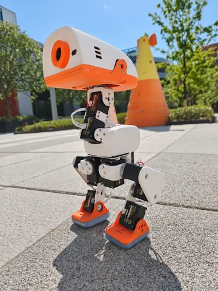</a></td>
<td><a href="https://kissqy.github.io/Microduck-kissqy/one-leg-balance.html?v=20261119-gallery#photo-07">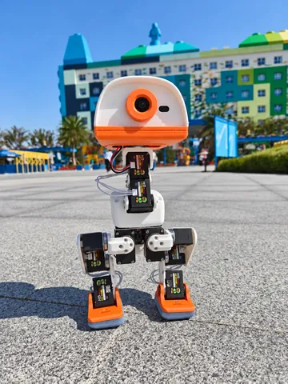</a></td>
<td><a href="https://kissqy.github.io/Microduck-kissqy/one-leg-balance.html?v=20261119-gallery#photo-03">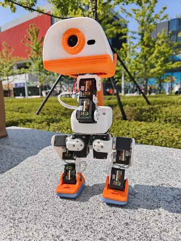</a></td>
<td><a href="https://kissqy.github.io/Microduck-kissqy/one-leg-balance.html?v=20261119-gallery#photo-05">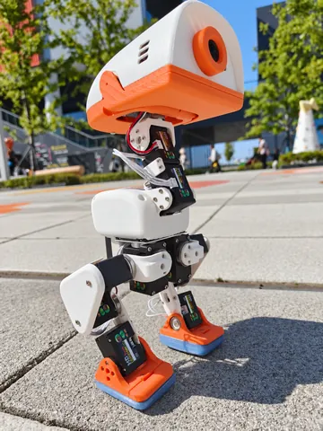</a></td>
<td><a href="https://kissqy.github.io/Microduck-kissqy/one-leg-balance.html?v=20261119-gallery#photo-02">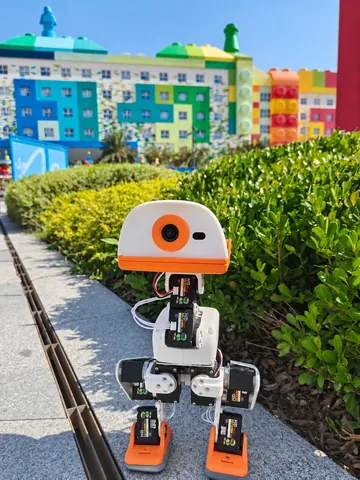</a></td>
<td><a href="https://kissqy.github.io/Microduck-kissqy/one-leg-balance.html?v=20261119-gallery#photo-06">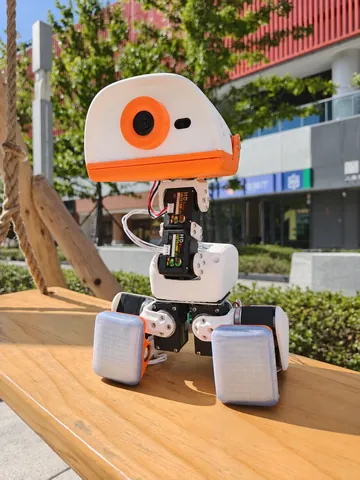</a></td>
<td><a href="https://kissqy.github.io/Microduck-kissqy/one-leg-balance.html?v=20261119-gallery#photo-01">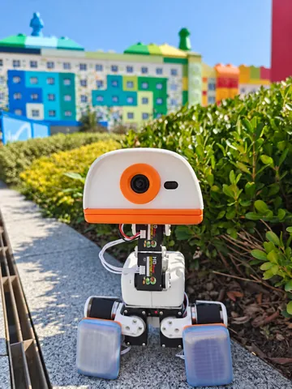</a></td>
</tr>
</table>

以上为实机视频；下方中控在线演示使用模拟数据，不连接实机或真正训练。

---

<!-- replica-choice:start -->
## 为什么选择 Microduck-kissqy？

**从 0 到进阶，一套完整的鸭鸭复刻方案。**

软件、硬件、现成运动模型、**飞特 HD1910 适配打印件**、各类教程和独立训练中控集中提供，串起从采购、打印装配、刷机配网和本机标定，到日常使用、中文 AI 与自训新动作的完整流程。

<table width="100%">
  <tr>
    <td width="400" valign="top"><b>🦆 现成动作，正常复刻无需训练</b>  提供行走、坐下站起、低头捡取、前滚翻、左右踢球，以及滑轮对称滑行、蹲下、原地转和倒地起身等动作资源。  完成装配、刷机和本机标定后，使用对应发布包的配套模型。</td>
    <td width="400" valign="top"><b>🎮 中文中控，继续体验 AI 互动</b>  从连接、舵机与 IMU 标定，到查看 3D 姿态、关节反馈、摄像头、手柄与固件维护，均有中文操作入口。R2 / V260 提供中文对话、拍照识别、音色角色与动作调用。  AI 需自行配置对应服务凭据，并保持联网。</td>
  </tr>
  <tr>
    <td width="400" valign="top"><b>🔧 配套软硬件，按同一套参考方案制作</b>  自制 HAT／IMU／HUB 的电路工程、材料清单、打印件、接线、镜像和固件集中提供，既可自行制作板卡，也可选择成品板。  参考配置为 ZERO 3W 与 15 个 HD1910；第三方板卡和机械改动需另行核对。</td>
    <td width="400" valign="top"><b>🧠 作者自训成果，进阶有训练工具</b>  提供模型来源说明与实机展示。独立训练中控支持任务与配方选择、训练队列、奖励曲线、仿真评估和 ONNX 导出。  先使用现成成果完成自己的鸭子，再按需要研究新动作。</td>
  </tr>
</table>

**本项目是社区 HD1910 动作资源的主要来源。**

fanhao 的镜像模型说明将其中 **10 个模型的作者标为 kissqy**，并记录保留原始权重。[查看对方的来源说明](https://github.com/fanhao375/microduck-replica/blob/master/software/image/overlay/usr/share/doc/microduck/%E6%A8%A1%E5%9E%8B%E8%AF%B4%E6%98%8E.txt)。

**[先看我们的优势，再看其他仓库缺少什么 →](https://kissqy.github.io/Microduck-kissqy/compare/?v=20261118-short)**

对比资料核查截至 <b>2026-11-18</b>；只对应当日公开版本。 [文字版与逐项依据](docs/MICRODUCK-COMPARISON.md) · 含官方 Microduck、陆吾 XGO-Duck、AI-FanGe、fanhao375、OpenMicroDuck 与本项目。
<!-- replica-choice:end -->

---

## 从零复刻

**正常复刻无需自行训练模型。** 配套现成动作模型，装好、刷机并完成本机标定后即可体验。

<table width="100%">
  <tr>
    <td width="400" valign="top"><a href="https://kissqy.github.io/Microduck-kissqy/build/budget.html"><b>① 我要花多少钱、买什么？</b></a>  先选预算方案，再按对应清单备齐舵机、主控、板卡与零件。 预算与采购</td>
    <td width="400" valign="top"><a href="https://kissqy.github.io/Microduck-kissqy/build/assembly.html"><b>② 我要怎么装？</b></a>  完成部位装配、3D 结构与端子接线，核对舵机安装方向。 装配与接线</td>
  </tr>
  <tr>
    <td width="400" valign="top"><a href="https://kissqy.github.io/Microduck-kissqy/build/start.html"><b>③ 我要让鸭子走起来</b></a>  刷机、配网、标定，使用配套现成模型行走。 刷机与首次行走</td>
    <td width="400" valign="top"><a href="https://kissqy.github.io/Microduck-kissqy/build/advanced.html"><b>④ 进阶玩法（可选）</b></a>  想自训新动作或学习强化学习训练流程时，再进入。 正常复刻无需先做训练</td>
  </tr>
</table>

已经完成的步骤可以直接跳过。**前三步完成正常复刻，第 4 步为可选进阶。**

[完整复刻路线](https://kissqy.github.io/Microduck-kissqy/build/) · [项目概览与完整教程](https://kissqy.github.io/Microduck-kissqy/guides/) · [从零复刻文字指南](docs/MICRODUCK-BUILD-GUIDE.md) · [材料采购清单](DUCK-SHOPPING-LIST.md) · [常见问题](docs/MICRODUCK-FAQ.md)

国内访问：[Gitee 国内仓库](https://gitee.com/kissqy/microduck-kissqy) · [R2 国内发布说明](https://gitee.com/kissqy/microduck-kissqy/releases/tag/console-studio-v260)。

---

## 下载与版本

**当前正式发布：系统镜像 R2 + Console Studio V260／control.102，开机配网 R10。**

系统镜像 R2 用于 Radxa ZERO 3W 新装或重刷，预装官方 Microduck 0.15.1、control.102、11 个 ONNX 运行模型与 R10 开机配网。连接 Wi-Fi 后使用配套 V260 中文中控，无须自行编译固件。

R2 / V260 发布资料更新于 2026-11-13。

| 需要什么 | 对应版本 | 下载入口 | 说明与源码 |
| --- | --- | --- | --- |
| **新装系统镜像** | R2 · control.102 · 配网 R10 | [下载 .img.xz](https://github.com/kissqy/Microduck-kissqy/releases/download/console-studio-v260/microduck-kissqy-zero3w-R2.img.xz) | [镜像发布说明](https://github.com/kissqy/Microduck-kissqy/releases/tag/console-studio-v260) |
| **正式版机器人中控与固件** | Studio V260 · control.102 | [运行包与固件下载](https://github.com/kissqy/Microduck-kissqy/releases/tag/console-studio-v260) | [版本文件、使用说明与独立源码](versions/v260/README.md) |
| **中控测试版** | V297 BATE · control.102 | [下载中控 ZIP](https://github.com/kissqy/Microduck-kissqy/releases/download/console-studio-v297-bate/Microduck-Console-Studio-V297-BATE.zip) | [独立专页](https://kissqy.github.io/Microduck-kissqy/console-bate/) · [版本文件](versions/v297-bate/) |
| **独立训练中控 · 可选** | R1.5.27 | [下载训练中控 ZIP](https://github.com/kissqy/Microduck-kissqy/raw/refs/heads/main/versions/v167/release-assets/Microduck-Training-Studio-R1.5.27.zip) | [训练指南](microduck-hd1910/training-console/README.zh-CN.md) |

### 已有 V167：升级到 V260 无需重刷

下载并完整解压 V260 中控，连接 ZERO 后，直接在中控内安装随包固件。需要保留本机标定与个人配置时，按[版本升级说明](versions/v260/README.md)操作；R2 镜像用于新装或确实需要重刷时。

### V297 BATE：通过 HAT 给舵机编号

**无需 URT2 调试板，即可给舵机编号和中位校准。** 测试版提供四模式工作台、HAT 舵机编号与独立硬件测试。

[中控专页与使用方法](https://kissqy.github.io/Microduck-kissqy/console-bate/) · [发布说明与下载](https://github.com/kissqy/Microduck-kissqy/releases/tag/console-studio-v297-bate)

已有 R2 / control.102 用户只需更换电脑端中控。本版实机验收待完成，V260 正式版继续保留；实际运行包从 Release 的 Assets 获取。

### 版本与验证范围

训练中控 R1.5.27 是独立工具，不与机器人中控的 V167、V260、V297 版本号混用。各版本资料在 main 的 `versions/` 目录中，无需切换分支；V260 中控源码与固件源码从 [versions/v260/](versions/v260/) 进入。

首次运动前仍需核对本机机械、舵机与 IMU 标定。[发布基线与验证范围](microduck-hd1910/docs/BASELINE.md)；文档与入口整理不扩大已有实机 Known-Good 范围。原 R1 刷卡实测记录与 V167 旧地址继续保留。

历史版本：R1 / V167

- [系统镜像 R1](https://github.com/kissqy/Microduck-kissqy/releases/download/public-image-r1/microduck-zero3w-0.15.1-R1.img.xz)：预装 control.40，开机配网 R5。
- [机器人中控 R17 V167](https://github.com/kissqy/Microduck-kissqy/raw/refs/heads/main/versions/v167/release-assets/Microduck-Console-R17-V167.zip)：随包固件 control.43；[历史固件说明](versions/v167/release-assets/README.md)。
- V167 固件与中控源码统一从 [versions/v167/](versions/v167/) 进入；V260 源码从 [versions/v260/](versions/v260/) 进入。原根目录源码保留兼容；旧根 `release-assets/` 已归并到 V167 版本目录，下载以新入口为准。

---

## 硬件与打印资料

### 🔧 自制 HAT、IMU、HUB 与香蕉取电板

板卡由作者自行设计绘制，经真机使用与迭代验证，由**嘉立创 SMT 贴片生产**。提供电路工程、材料清单与制作记录。

<table width="100%">
  <thead>
    <tr>
      <th width="25%" align="center">HAT</th>
      <th width="25%" align="center">HUB</th>
      <th width="25%" align="center">IMU</th>
      <th width="25%" align="center">香蕉板</th>
    </tr>
  </thead>
  <tbody>
    <tr>
      <td align="center"><a href="docs/assets/boards/hat-white.webp">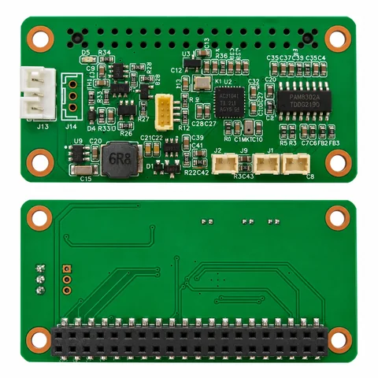</a></td>
      <td align="center"><a href="docs/assets/boards/hub-white.webp">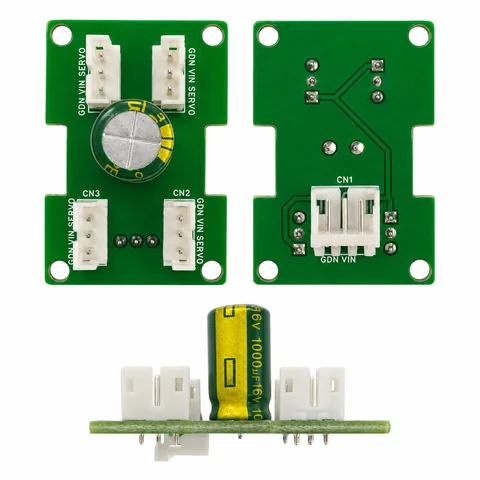</a></td>
      <td align="center"><a href="docs/assets/boards/imu-white.webp">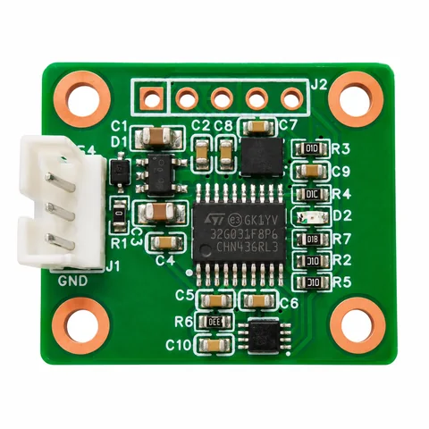</a></td>
      <td align="center"><a href="hardware/BANANA-POWER.md">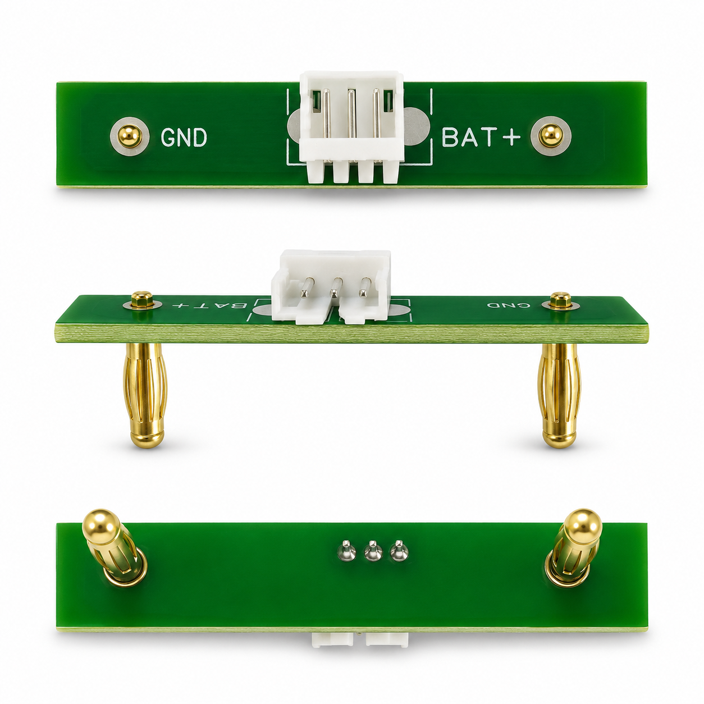</a></td>
    </tr>
  </tbody>
</table>

| 板卡 | 作用与配置 |
| --- | --- |
| **HAT** | 连接 ZERO 3W 与舵机总线，提供供电、通信及音频外围。 |
| **独立躯干 IMU** | 提供身体姿态反馈。成品 IMU 已预烧录 FT6，到手无需另行烧录；安装后仍需完成本机标定。 |
| **HUB 分线供电板** | 分接舵机与电源，带 1000 µF 缓冲电容；HUB V3 的所有接口均为 AMP2.0。 |
| **香蕉取电板** | **¥39／块**；AMP2.0 卧式接口，双香蕉插针插入电池触点，配套成品线直插 HUB V3，免焊。 [实拍与接线](hardware/BANANA-POWER.md)。 |

**配套成品线束可直插，免焊装配。** 选择成品 HAT／IMU／HUB V3、配套成品线与香蕉取电板，板卡和取电线束可直接插接。

[硬件工程与制作说明](hardware/README.md) · [HUB V3 完整工程](hardware/ProPrj_DXL_HUB_V3_2026-11-14.epro2) · [自焊 IMU 固件与烧录](hardware/IMU-FIRMWARE.md) · [IMU 手工制作视频](https://www.bilibili.com/video/BV1qapz6PERs/) · [购买 HAT／IMU／HUB 成品板](https://item.taobao.com/item.htm?id=1095121548583)

### 🖨️ 鸭子全套打印件 · 缝合怪版

整合社区优化与作者实机改进，提供**飞特 HD1910 适配的全套结构模型和参考摆盘**。支持普通脚掌与滑轮玩法，方便从打印、装配一路做到实机运行。

[MakerWorld 模型与打印配置 →](https://makerworld.com.cn/zh/models/3258815-microduck-kissqykai-yuan-feng-he-guai-ban#profileId-3849553) · [查看打印文件、摆盘预览与装配说明 →](hardware/3d-print-frankenduck/)

[打印件文字说明](hardware/3d-print-frankenduck/README.md)

---

## 中文中控与 AI

机器人中控用于连接和标定实机、查看反馈、执行运动及维护固件。当前软件界面为中文，教程按实际按钮和操作流程说明。

| 功能 | 可以做什么 |
| --- | --- |
| **连接与标定** | ZERO 3W 刷机与热点配网、查找 IP、舵机零位与方向、关节及 IMU 标定。 |
| **运动与反馈** | 实时 3D 姿态、关节／IMU 反馈、实体手柄与网页操控。 |
| **摄像头与视觉** | IMX219 摄像头、局域网 WebRTC 视频、按需拍照识别。 |
| **中文 AI 交互** | 通过豆包服务进行中文语音对话、音色与角色配置，并调用已有动作。 |
| **系统维护** | 配套固件升级、Wi-Fi 管理及设备状态查看。 |

**连接真实机器人：下载并运行本地机器人中控。** [图文使用教程：配网、找 IP、标定与操作](https://kissqy.github.io/Microduck-kissqy/console-guide.html)

[在线体验中控界面](https://kissqy.github.io/Microduck-kissqy/) · [R2 / V260 的 AI 功能与使用说明](https://github.com/kissqy/Microduck-kissqy/releases/tag/console-studio-v260)

在线演示使用模拟数据，不连接实机。中文 AI 需自行配置对应服务的凭据，并保持 ZERO 能够访问服务；不是本地离线大模型。

---

## 训练自己的动作

**独立强化学习训练中控用于自训新动作或学习训练流程。** 正常复刻与日常使用，可直接使用配套现成模型。

选择任务与配方，观察训练队列和奖励曲线，在仿真中评估检查点，再导出 ONNX 模型做实机验证。先跑通配套参考配置，再一次验证一个新变量。

[训练中控 R1.5.27 指南](microduck-hd1910/training-console/README.zh-CN.md) · [训练中控在线演示](https://kissqy.github.io/Microduck-kissqy/training/) · [下载训练中控](https://github.com/kissqy/Microduck-kissqy/raw/refs/heads/main/versions/v167/release-assets/Microduck-Training-Studio-R1.5.27.zip)

训练任务和配方不等于每个动作都已完成长训与实机验收；具体权重、来源与展示范围见[模型来源清单](microduck-hd1910/docs/MODEL-PROVENANCE.md)。

---

## 使用范围与授权

**硬件适配范围：仅适配本仓库开源版本的 HAT、IMU、HUB。** 第三方板卡、不同舵机或机械改动，需要重新核对兼容性。

本仓库未授权任何商业组织。商业使用请先[联系作者](docs/assets/purchase-wechat-qr.jpg)，并遵守[分项许可](LICENSE)。

- **原创软件与自训模型：** 明确适用本项目个人非商业条款的原创中控、工具、文档及 HD1910 自训模型，仅供个人学习、研究与非商业使用；商业／组织用途须书面授权。
- **原创板卡设计：** 作者享有权利的原创设计与工程资料限个人非商业复刻；商业复制生产、销售或集成须事先取得书面授权。见[板卡设计许可](hardware/LICENSE)。
- **官方与第三方内容：** 包括作者已按 Apache 发布的适配代码在内，其余内容遵循各自许可；不因本页介绍改变原有许可证。

[软件与自训模型权利说明](microduck-hd1910/docs/SOFTWARE-MODEL-RIGHTS.md) · [模型来源清单](microduck-hd1910/docs/MODEL-PROVENANCE.md) · [个人非商业许可](microduck-hd1910/LICENSES/Personal-NonCommercial.txt) · [第三方说明](microduck-hd1910/docs/THIRD-PARTY.md)

### 作者记录与交流

这是作者基于官方 Microduck 完成的个人复刻与开发项目，包含 AI 辅助编程。希望这些资料帮你少走弯路，让自己的小鸭动起来。欢迎 Star、交流和反馈。[作者的学习记录](docs/AUTHOR-JOURNEY.md)

[常见问题](docs/MICRODUCK-FAQ.md) · [历史问题与 PR 归档](docs/GitHub-Issues-PR-Archive-20261116.md)

<table align="center">
  <tr>
    <td align="center" valign="top" width="50%">
      <b>❤️ 支持作者</b>  
      
    </td>
    <td align="center" valign="top" width="50%">
      <b>💬 联系作者</b>  
       
      微信扫码联系作者。 点击二维码查看原图。
    </td>
  </tr>
</table>
