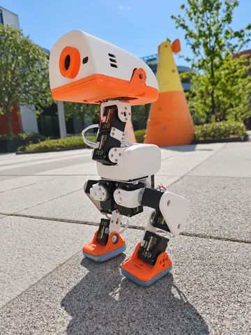
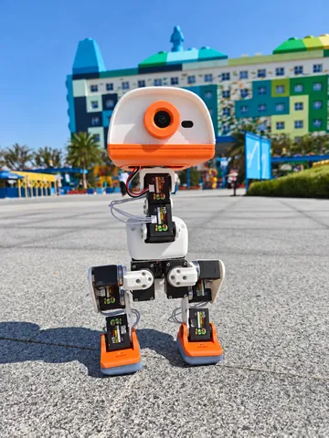
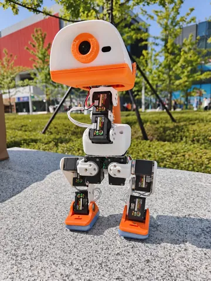
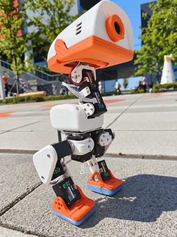
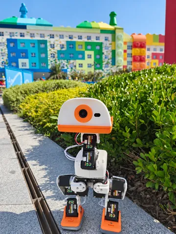
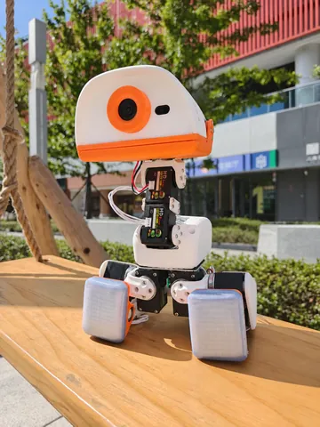
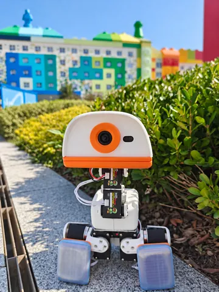

**简体中文** | [English](README.en.md)

# 🦆 Microduck 飞特 HD1910 复刻 · 从零做一只会走的机器人鸭

**Microduck-kissqy 是 kissqy 基于 [Pollen Robotics Microduck](https://github.com/pollen-robotics/microduck) 0.15.1 完成的飞特 HD1910 双足机器人鸭复刻项目。** 参考硬件为 **Radxa ZERO 3W + 15 个飞特 HD1910 舵机**，提供系统镜像、中文机器人中控、配套现成 ONNX 动作模型、独立强化学习训练中控、自制 HAT／IMU／HUB 和全套 3D 打印件。

**正常复刻无需训练。配套现成动作模型，装好、刷机并完成本机标定后即可体验。**

<table>
  <tr>
    <td width="50%" align="left"><a href="https://kissqy.github.io/Microduck-kissqy/build/budget.html"><b>① 我要花多少钱、买什么？</b></a> 先选预算方案，再按对应清单备齐零件。</td>
    <td width="50%" align="left"><a href="https://kissqy.github.io/Microduck-kissqy/build/assembly.html"><b>② 我要怎么装？</b></a> 部位装配、3D 结构与端子接线。</td>
  </tr>
  <tr>
    <td align="left"><a href="https://kissqy.github.io/Microduck-kissqy/build/start.html"><b>③ 我要让鸭子走起来</b></a> 刷机、配网、标定，使用现成模型行走。</td>
    <td align="left"><a href="https://kissqy.github.io/Microduck-kissqy/build/advanced.html"><b>④ 进阶玩法（可选）</b></a> <b>正常复刻无需训练。</b>想自训新动作或学习训练流程时，再进入。</td>
  </tr>
</table>

[📚 Microduck 完整复刻教程](https://kissqy.github.io/Microduck-kissqy/guides/) · [🚀 从零复刻路线](https://kissqy.github.io/Microduck-kissqy/build/) · [🎮 机器人中控演示](https://kissqy.github.io/Microduck-kissqy/) · [📖 中控使用教程](https://kissqy.github.io/Microduck-kissqy/console-guide.html) · [❓ 常见问题](docs/MICRODUCK-FAQ.md)

## 🏆 单脚独立 · 自训新突破

作者自训的单脚平衡动作已在飞特 HD1910 实机上演示。下方视频展示真实机器人表现；训练、装配和标定资料均可从本仓库继续查阅。

四群二维码在 2026 年 11 月 20 日前有效。

## 🎬 更多实机视频

<table>
<tr>
<td width="10%"><video src="https://github.com/user-attachments/assets/5cc34fe4-1858-485c-ae48-40f5e1c6180d" controls></video></td>
  <td width="10%"><video src="https://github.com/user-attachments/assets/3f519ac0-e443-4638-9ad6-9476ee76a386" controls></video></td>
<td width="10%"><video src="https://github.com/user-attachments/assets/008bb58b-7bbd-4de7-9687-9b6ef2d42ed7" controls></video></td>
  <td width="10%"><video src="https://github.com/user-attachments/assets/0a3edb38-0c25-429a-b552-94ea04881bf3" controls></video></td>
  <td width="10%"><video src="https://github.com/user-attachments/assets/0ec5b46b-1ec0-483a-a95d-3b3f307e155f" controls></video></td>
  <td width="10%"><video src="https://github.com/user-attachments/assets/d09a6bfe-7a28-4266-ba90-de2b331472ad" controls></video></td>
  <td width="10%"><video src="https://github.com/user-attachments/assets/a604c0e0-af01-413f-ab00-99ccd26db8d5" controls></video></td>
  <td width="10%"><video src="https://github.com/user-attachments/assets/4508d91c-e91c-40f4-8c3e-5ca5a3f959c3" controls></video></td>
  <td width="10%"><video src="https://github.com/user-attachments/assets/fd0dfafd-dd02-4852-940c-33706c287e9d" controls></video></td>
  <td width="10%"><video src="https://github.com/user-attachments/assets/693a3272-d814-42f6-86b3-be5cb3b35b0f" controls></video></td>
</tr>
</table>

[🎬 查看全部实机视频 →](https://kissqy.github.io/Microduck-kissqy/one-leg-balance.html#more-videos)

<b>📷 小鸭出游</b> · <a href="https://kissqy.github.io/Microduck-kissqy/one-leg-balance.html#photo-gallery">7 张照片 · 点击进入滑动相册 →</a>

<table>
<tr>
<td></td>
<td></td>
<td></td>
<td></td>
<td></td>
<td></td>
<td></td>
</tr>
</table>

以上为实机视频；下方中控在线演示使用模拟数据，不连接实机或真正训练。

> [!WARNING]
> 仅适配本仓库开源版本的 **HAT、IMU、HUB**。
>
> 本仓库未授权任何商业组织。商业使用请[联系作者](https://github.com/kissqy/Microduck-kissqy/blob/main/docs/assets/purchase-wechat-qr.jpg)，并遵守[分项许可](https://github.com/kissqy/Microduck-kissqy/blob/main/LICENSE)。

## ✨ 会走、会翻，还有更多玩法

这是一只会**走路、坐下、捡东西、踢球、前滚翻**的小鸭。装上滑轮，还能探索**对称滑行、蹲下、原地转和倒地起身**等动作。实体手柄就能控制，配套现成模型与中文机器人中控，方便从第一次行走逐步体验更多动作。

**系统镜像 R2 为当前下载入口**，预装 Microduck 0.15.1、control.102、运动模型与 R10 开机配网。刷入 Radxa ZERO 3W、连接 Wi-Fi 后，使用配套 V260 中文中控，无须自行编译固件。原 R1 的刷卡实测记录保留在历史版本中。

## 🧭 三步完成复刻

**[① 预算与采购](https://kissqy.github.io/Microduck-kissqy/build/budget.html) → [② 装配与接线](https://kissqy.github.io/Microduck-kissqy/build/assembly.html) → [③ 让鸭子走起来](https://kissqy.github.io/Microduck-kissqy/build/start.html)**

完成这三步即可使用配套模型体验已有动作，已完成的步骤可以直接跳过。[进阶玩法](https://kissqy.github.io/Microduck-kissqy/build/advanced.html)供自训新动作或学习训练流程时选用。

## 项目提供什么

| 内容 | 已有资料与入口 |
| --- | --- |
| 飞特 HD1910 实机与现成动作模型 | 行走、坐下站起、捡取、踢球、前滚翻及滑轮动作；[实机视频与单脚平衡](https://kissqy.github.io/Microduck-kissqy/one-leg-balance.html)、[模型来源与验证范围](microduck-hd1910/docs/MODEL-PROVENANCE.md) |
| 系统镜像与中文机器人中控 | ZERO 3W 刷机、热点配网、舵机与 IMU 标定、实时 3D 姿态、IMX219 摄像头与 WebRTC、手柄控制、固件维护；[中控使用教程](https://kissqy.github.io/Microduck-kissqy/console-guide.html) |
| 独立强化学习训练中控 | 任务与配方选择、训练队列、奖励曲线、仿真评估和 ONNX 导出；[训练中控说明](microduck-hd1910/training-console/README.zh-CN.md) |
| 自制电路板与完整装配资料 | HAT 供电通信与音频板、独立躯干 IMU、HUB 分线供电板；[硬件工程](hardware/README.md)、[材料采购清单](DUCK-SHOPPING-LIST.md)、[3D 打印 STL／3MF](hardware/3d-print-frankenduck/)、[装配接线教程](https://kissqy.github.io/Microduck-kissqy/build/assembly.html) |

## 下载与版本

**当前发布：系统镜像 R2 + Console Studio V260／control.102，开机配网 R10。** 更新于 2026-11-13。两个版本均在 main 的 `versions/` 目录中，无需切换分支。原 V167 源码与运行包的旧地址继续兼容。

| 版本目录 | 配套固件 | 系统镜像 | 入口 |
| --- | --- | --- | --- |
| V260 · 当前发布 | control.102 | R2 · 配网 R10 | [versions/v260/](versions/v260/) |
| V167 · 历史版本 | control.43 | R1 预装 control.40；V167 随包固件为 control.43 | [versions/v167/](versions/v167/) |

训练中控 R1.5.27 为独立工具，不与机器人中控的 V167、V260 版本号混用。

| 当前发布版本 | 用途与下载 |
| --- | --- |
| 系统镜像 R2 · Microduck 0.15.1 / control.102 | 新装 ZERO 3W：[下载 .img.xz](https://github.com/kissqy/Microduck-kissqy/releases/download/console-studio-v260/microduck-kissqy-zero3w-R2.img.xz) · [镜像发布说明](https://github.com/kissqy/Microduck-kissqy/releases/tag/console-studio-v260) |
| 中文机器人中控 Studio V260 · 随包固件 control.102 | 连接、标定与控制实机：[前往发布下载](https://github.com/kissqy/Microduck-kissqy/releases/tag/console-studio-v260) · [文件与使用说明](https://github.com/kissqy/Microduck-kissqy/blob/main/versions/v260/README.md) |
| V260 中控源码与固件源码 | [独立版本源码](https://github.com/kissqy/Microduck-kissqy/tree/main/versions/v260) · [运行包与源码说明](https://github.com/kissqy/Microduck-kissqy/blob/main/versions/v260/README.md) |
| 强化学习训练中控 R1.5.27 · 可选 | 训练与评估新动作：[下载 ZIP](https://github.com/kissqy/Microduck-kissqy/raw/refs/heads/main/versions/v167/release-assets/Microduck-Training-Studio-R1.5.27.zip) |

R2 已预装 control.102 与 11 个 ONNX 运行模型。首次运动前仍需核对本机机械与 IMU 标定；已有系统升级时，使用 V260 中控安装本版随包固件。[发布基线与验证范围](microduck-hd1910/docs/BASELINE.md)；本次发布整理不扩大已记录的实机 Known-Good 范围。

历史版本：R1 / V167

- [系统镜像 R1](https://github.com/kissqy/Microduck-kissqy/releases/download/public-image-r1/microduck-zero3w-0.15.1-R1.img.xz)：预装 control.40，开机配网 R5。
- [机器人中控 R17 V167](https://github.com/kissqy/Microduck-kissqy/raw/refs/heads/main/versions/v167/release-assets/Microduck-Console-R17-V167.zip)：随包固件 control.43；[历史固件说明](versions/v167/release-assets/README.md)。
- V167 固件与中控源码统一从 [versions/v167/](versions/v167/) 进入；V260 源码从 [versions/v260/](versions/v260/) 进入。原根目录源码保留兼容；旧根 `release-assets/` 已归并到 V167 版本目录，下载以新入口为准。

首次制作按 [刷机与首次行走教程](https://kissqy.github.io/Microduck-kissqy/build/start.html) 下载和操作；所需文件就在对应步骤。

[📥 系统镜像 R2](https://github.com/kissqy/Microduck-kissqy/releases/download/console-studio-v260/microduck-kissqy-zero3w-R2.img.xz) · [📥 机器人中控 V260](https://github.com/kissqy/Microduck-kissqy/releases/tag/console-studio-v260) · [V260 固件下载](versions/v260/README.md) · [自焊 IMU 烧录](hardware/IMU-FIRMWARE.md)

## 🎮 中文机器人中控

连接与标定鸭子，查看实时 3D 姿态、关节／IMU 反馈和摄像头，使用实体手柄或网页操控，并维护配套固件。

**[在线体验界面](https://kissqy.github.io/Microduck-kissqy/) · [图文使用教程：配网、找 IP、标定与操作](https://kissqy.github.io/Microduck-kissqy/console-guide.html)**

在线演示使用模拟数据。连接实机时下载并运行本地机器人中控。

## 🖨️ 鸭子全套打印件 · 缝合怪版

整合社区优化与作者实机改进，提供**全套结构模型和参考摆盘**。支持普通脚掌与滑轮玩法，方便从打印、装配一路做到实机运行。

[查看打印文件、摆盘预览与装配说明 →](hardware/3d-print-frankenduck/)

## 🔧 自制 HAT、IMU 与 HUB 电路板

HAT 连接 ZERO 3W 与舵机总线，提供供电、通信及音频外围；独立躯干 IMU 提供身体姿态反馈；HUB 分接舵机与电源，并带 1000 µF 缓冲电容。板卡由作者自行设计绘制，经真机使用与迭代验证，由**嘉立创 SMT 贴片生产**。提供电路工程、材料清单与制作记录。

**成品 IMU 已预烧录 FT6，到手无需另行烧录；安装后仍需完成本机标定。** 作者享有权利的原创设计与工程资料限个人非商业复刻，商业复制生产、销售或集成须事先取得书面授权。[板卡设计许可](hardware/LICENSE)

[硬件工程与制作说明](hardware/README.md) · [IMU 手工制作视频](https://www.bilibili.com/video/BV1qapz6PERs/) · [购买 HAT／IMU／HUB 成品板](https://item.taobao.com/item.htm?id=1095121548583)

## ❤️ 分享给大家，也尊重原创

这是作者基于官方 Microduck 完成的个人复刻与开发项目，包含 AI 辅助编程。希望这些资料帮你少走弯路，让自己的小鸭动起来。欢迎 Star ⭐、交流和反馈。[作者的学习记录](docs/AUTHOR-JOURNEY.md)

明确适用本项目个人非商业条款的原创中控、工具、文档及 HD1910 自训模型，仅供个人学习、研究与非商业使用，商业／组织用途须书面授权；包括作者已按 Apache 发布的适配代码在内，其余内容遵循各自许可。[软件与自训模型权利说明](microduck-hd1910/docs/SOFTWARE-MODEL-RIGHTS.md) · [模型来源清单](microduck-hd1910/docs/MODEL-PROVENANCE.md) · [分项许可](LICENSE) · [个人非商业许可](microduck-hd1910/LICENSES/Personal-NonCommercial.txt) · [第三方说明](microduck-hd1910/docs/THIRD-PARTY.md)

## 🧠 进阶玩法（可选）· 训练自己的动作

**正常复刻和日常使用无需训练，直接使用配套现成模型即可。** 只有想自己训练新动作，或学习强化学习训练流程时，再使用独立训练中控：选择任务与配方、观察训练奖励、在仿真中评估，再导出模型进行实机验证。

[训练中控 R1.5.27 指南](microduck-hd1910/training-console/README.zh-CN.md) · [在线演示](https://kissqy.github.io/Microduck-kissqy/training/) · [下载训练中控](https://github.com/kissqy/Microduck-kissqy/raw/refs/heads/main/versions/v167/release-assets/Microduck-Training-Studio-R1.5.27.zip)

<table align="center">
  <tr>
    <td align="center" valign="top" width="50%">
      <b>❤️ 支持作者</b>  
      
    </td>
    <td align="center" valign="top" width="50%">
      <b>💬 联系作者</b>  
       
      微信扫码联系作者。 点击二维码查看原图。
    </td>
  </tr>
</table>

