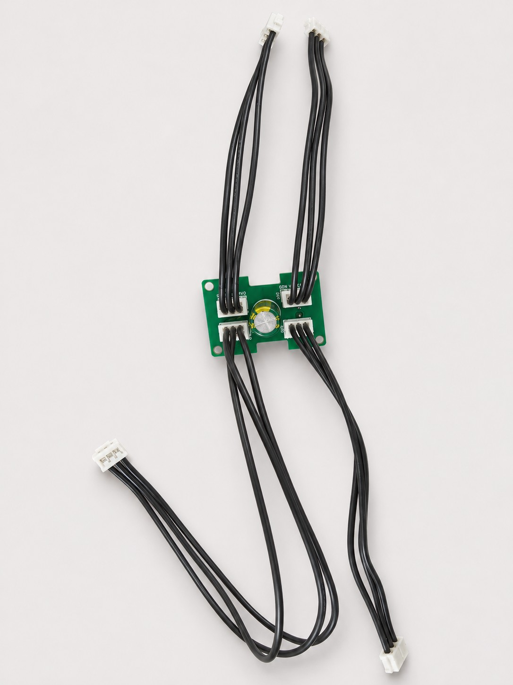
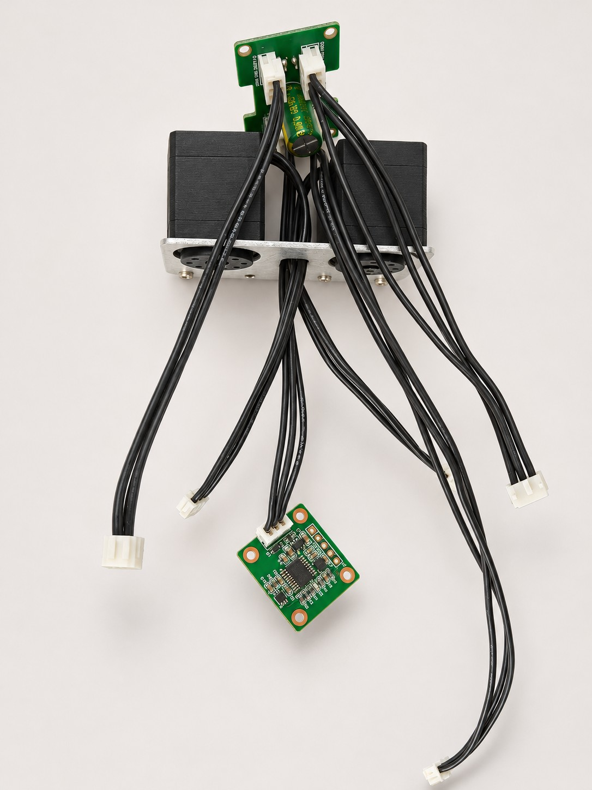
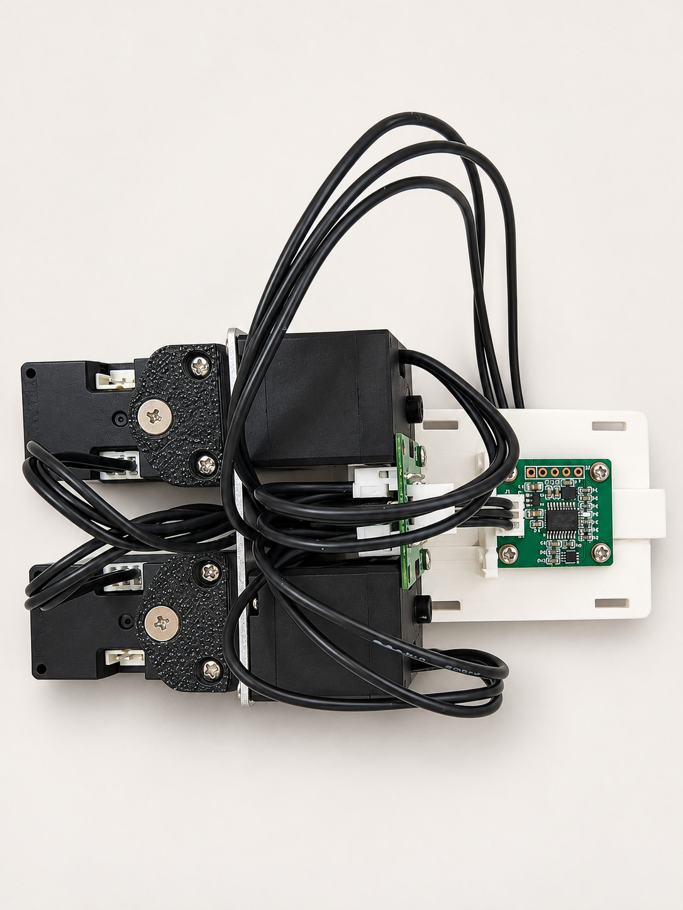
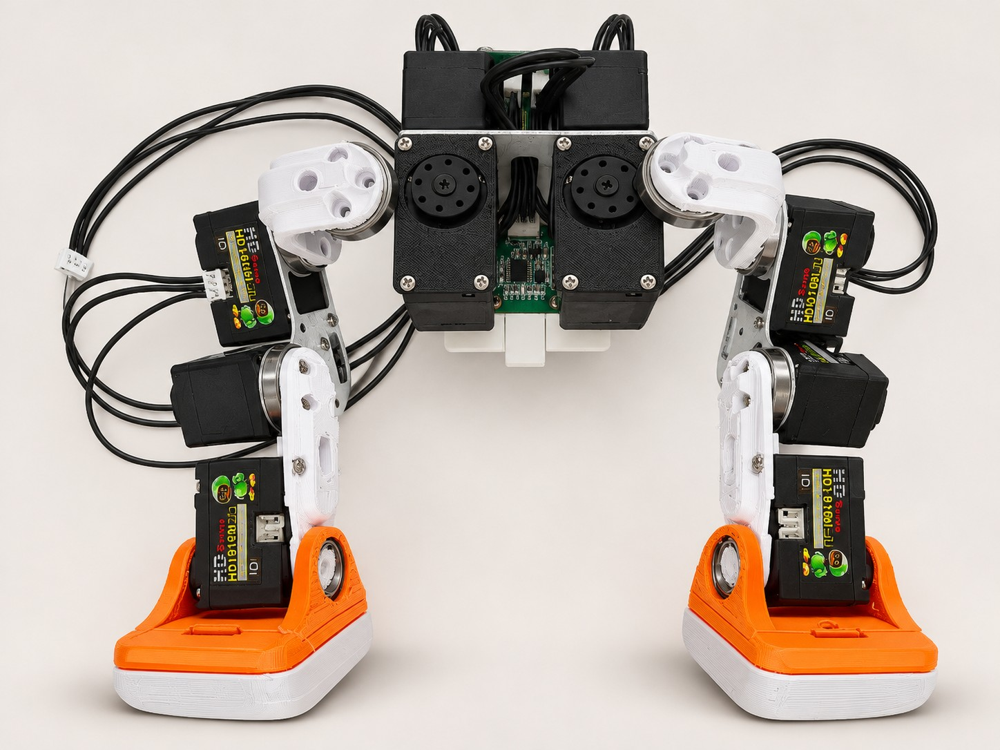
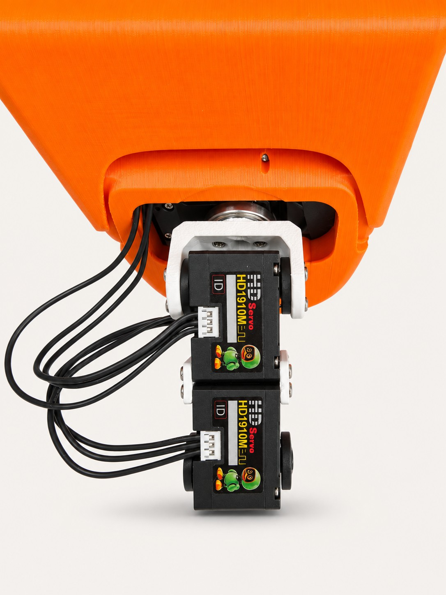

[简体中文](BODY-ASSEMBLY.md) | **English**

# Torso, legs and head/neck connections · photo guide

These photos cover the four-way HUB harness, torso prewiring, battery-holder and IMU mounting, the leg/torso assembly and the head/neck connection. Assemble with power disconnected. Follow the connector signals and the actual mounting positions.

[Web assembly guide (Chinese)](https://kissqy.github.io/Microduck-kissqy/build/assembly.html#body-photos) · [Inside the head](HEAD-ASSEMBLY.en.md) · [3D reference](https://kissqy.github.io/Microduck-kissqy/assembly.html)

## 01 · Prepare the four HUB branches

Seat four three-wire harnesses in the HUB. The branches serve the head/neck, left leg, right leg and IMU. Choose cable lengths for their installed locations.

The four bus ports share the same electrical nets; branch-to-port positions are not fixed. Match GND, power and DATA signals rather than relying on the all-black wire colors.

[Original photo](assets/body-assembly/originals/01-hub-harness.jpg)

## 02 · Prewire the torso and leave the branches accessible

Connect the HUB, torso servos and IMU branch as shown. Route the harnesses through the bracket gaps before installing the battery holder, while the wiring is still accessible.

This is the prewiring stage: the IMU is temporarily loose. Secure it to the battery-holder mounting position in the next step before operation.

[Original photo](assets/body-assembly/originals/02-body-prewire.jpg)

## 03 · Secure the battery holder and IMU, then tuck the wiring

Install the battery holder on the torso and fasten the IMU flat against its locating position on the backplate, in the specified orientation. Tuck spare cable to the sides, clear of the battery slide and latch.

Secure the board and plugs before tucking spare cable. Keep wiring clear of servos, bearings and moving brackets, and match the IMU orientation in the 3D assembly reference.

[Original photo](assets/body-assembly/originals/03-imu-holder.jpg)

## 04 · Join both legs to the torso

Attach the assembled legs to the torso. Compare the white brackets, metal support plates and foot orientation with the photograph, then check each joint position and ID.

Left and right refer to the robot itself: right leg 10–14, left leg 20–24. Leave slack across joints, with no cable trapped between brackets.

[Original photo](assets/body-assembly/originals/04-legs-body.jpg)

## 05 · Connect the head and neck, leaving cable slack

Join the head shell to the white neck bracket, checking the bracket, bearing and fastener positions. Route the black bus harness along the side with a relaxed bend for head rotation and pitch movement.

Do not trap spare cable between the head-shell opening and the bracket. This photo shows the head/neck connection; the neck assembly must still be joined to the torso.

[Original photo](assets/body-assembly/originals/05-head-neck.jpg)

## Match the branch connections

| Branch | Connection reference |
| --- | --- |
| Head/neck | HAT → 34 → 33 → 32 → 31 → 30 → HUB |
| Right leg | HUB → 10 → 11 → 12 → 13 → 14 |
| Left leg | HUB → 20 → 21 → 22 → 23 → 24 |
| IMU | HUB → IMU bus connector J1 |

The four HUB bus ports share their nets. Port-to-branch positions in a photo are not mandatory. With an all-black harness, check GND, power and DATA by connector signals rather than wire color.

[HUB hardware and power connections](../hardware/README.en.md) · [Full build guide](MICRODUCK-BUILD-GUIDE.en.md)
