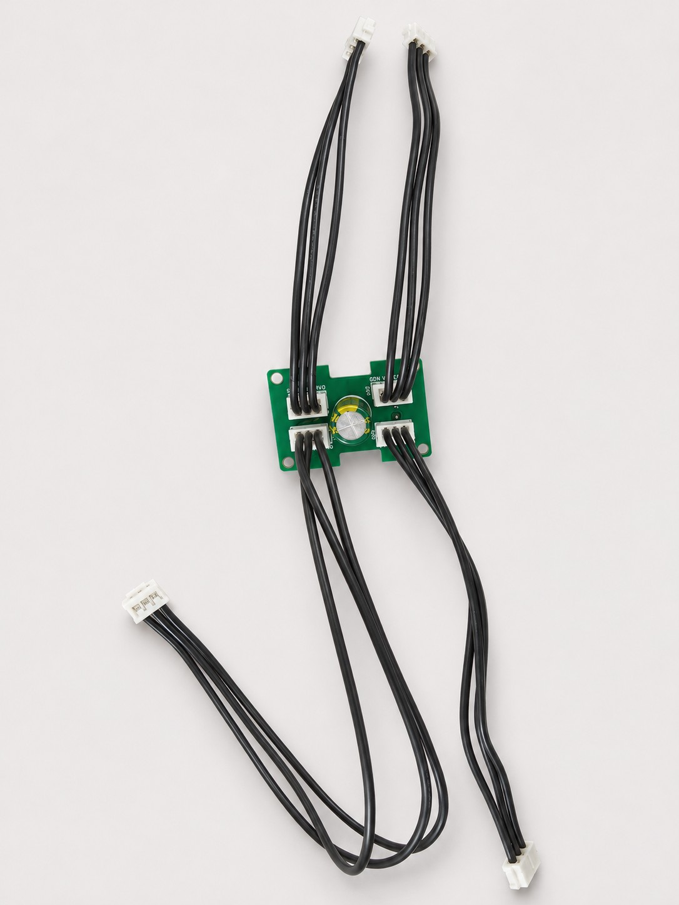
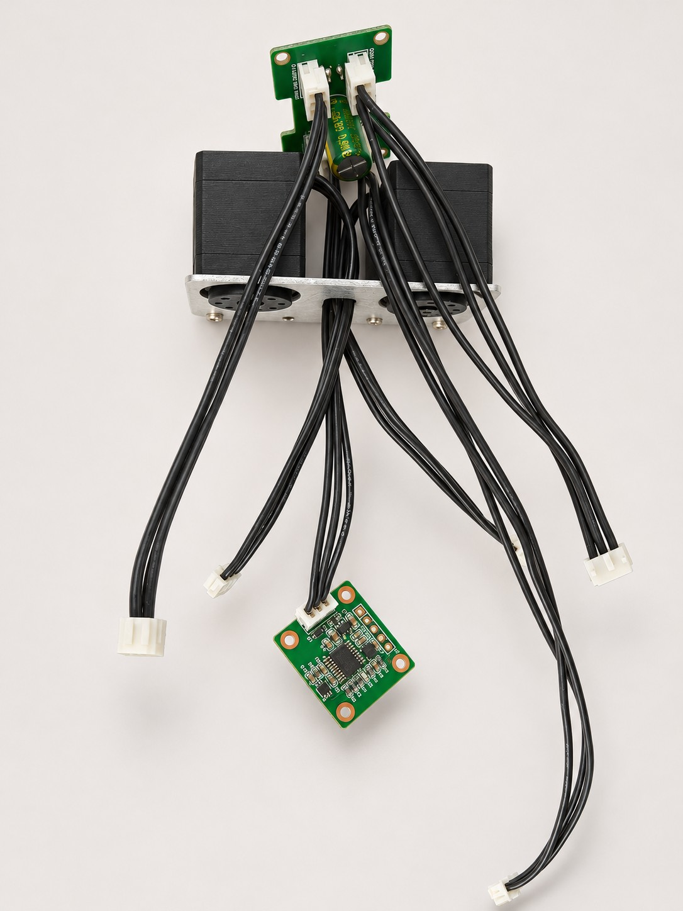
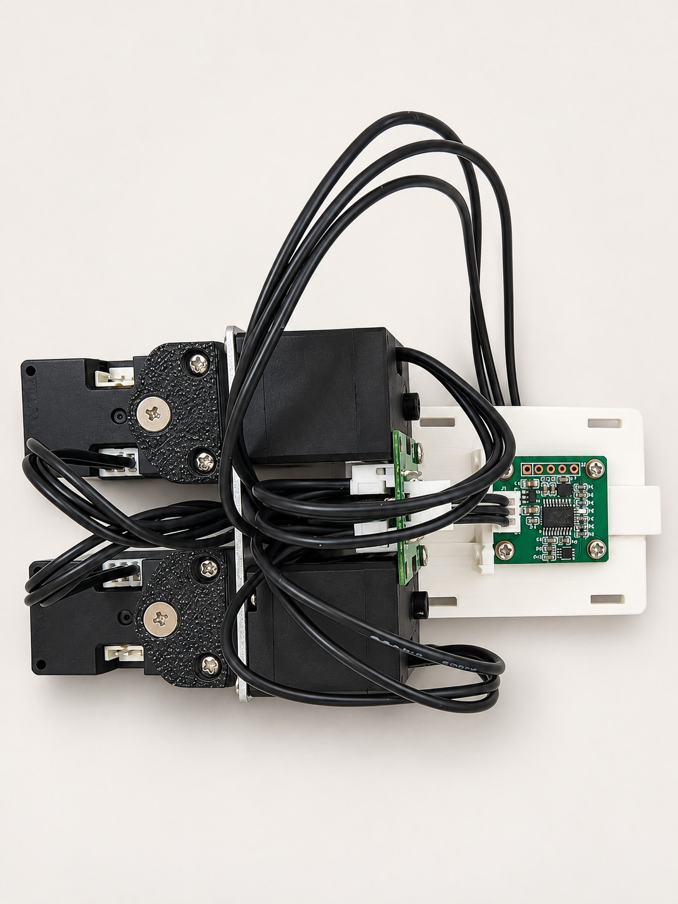
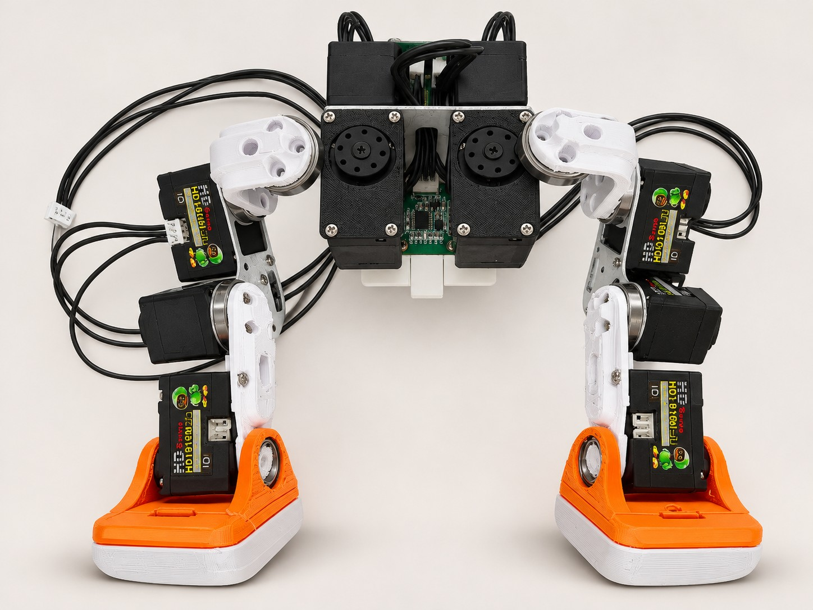
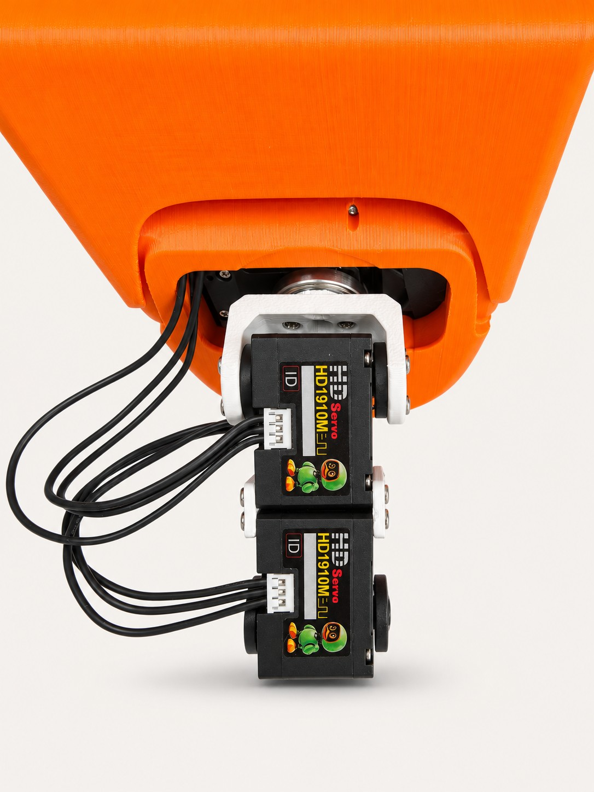

**简体中文** | [English](BODY-ASSEMBLY.en.md)

# 躯干、双腿与头颈连接 · 装配实拍

这组实拍补齐 **HUB 四路分线 → 躯干预接线 → 电池仓与 IMU 固定 → 双腿合装 → 头颈连接**。断电后装配，按接口信号与实际安装位核对。

**版本说明：本页保留旧版 HUB 实拍，用于安装位置、分线与理线参考。HUB V3 全部接口统一为 AMP2.0，使用配套成品线束插接。配套香蕉取电板也采用 AMP2.0，暂未上架，预计 2026-11-16 前后上架；配齐成品板、线束与香蕉板后，可全插接免焊装配。**

[在线查看对应装配章节](https://kissqy.github.io/Microduck-kissqy/build/assembly.html#body-photos) · [头部内部安装五步实拍](HEAD-ASSEMBLY.md) · [3D 装配参考](https://kissqy.github.io/Microduck-kissqy/assembly.html)

## 01 · 先接好 HUB 四路分线

将四组三芯线束接入 HUB，插头插到底。四路总线分别用于头颈、左腿、右腿和 IMU，按实际装配位置安排线长。

四个总线口电气共网，不限定哪一个口接哪条支路。全黑线束按 GND、电源、DATA 信号核对，不凭线色判断。

## 02 · 躯干总成预接线，先留出各支路

参照实拍将 HUB、躯干舵机和 IMU 支路预先接好，先把线束从支架空隙中引出，再装电池仓，避免固定后难以穿线。

这张图是预接线阶段：IMU 暂未固定，下一步要装到电池仓定位位，不能悬空运行。

## 03 · 固定电池仓与 IMU，收好余线

将电池仓装到躯干总成，把 IMU 贴合固定在背板定位位，保持规定的安装方向。线束沿两侧收纳，给电池滑入和卡扣动作留出空间。

板卡与插头固定后再整理余线，避开舵机、轴承和连接件的活动区；IMU 的朝向与 3D 装配说明一致。

## 04 · 两条腿与躯干合装

两腿分别装好后，与躯干总成连接。对照实拍检查白色连接件、金属支撑板和脚掌朝向，再核对各关节的位置与编号。

左右以鸭子自身为准：右腿 10–14，左腿 20–24。跨关节的线束保留活动余量，不要拉紧或夹在连接件之间。

## 05 · 连接头部与颈部，预留线束活动量

将头壳与白色颈部支架连接，核对连接件、轴承和螺丝位置。黑色总线线束从支架侧面引出，给转头和俯仰保留自然弯曲的余量。

不要把余线夹在头壳开口与支架之间。本图为头颈连接参考，颈部总成仍需继续与躯干连接。

## 对照支路连接关系

| 支路 | 连接参考 |
| --- | --- |
| 头颈 | HAT → 34 → 33 → 32 → 31 → 30 → HUB |
| 右腿 | HUB → 10 → 11 → 12 → 13 → 14 |
| 左腿 | HUB → 20 → 21 → 22 → 23 → 24 |
| IMU | HUB → IMU 总线端子 J1 |

照片中旧版 HUB 的四个总线口电气共网，不把照片中的端口位置规定为固定支路。全黑线束按 GND、电源、DATA 信号核对，不按线色判断。

[HUB 硬件与取电说明](../hardware/README.md) · [返回复刻总教程](MICRODUCK-BUILD-GUIDE.md)
