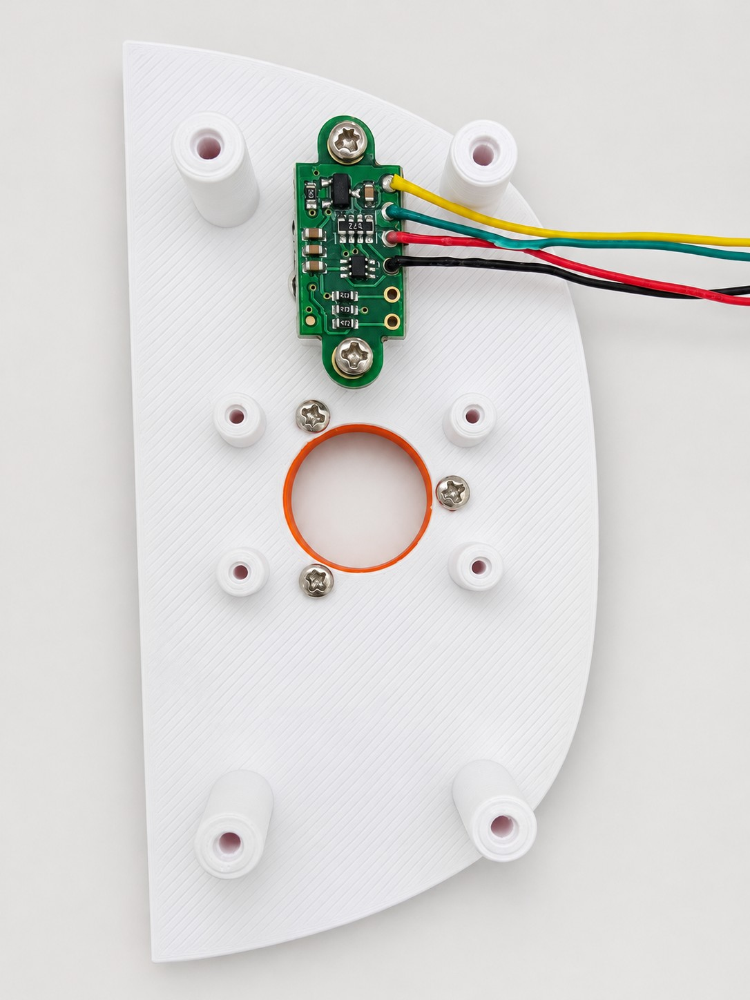
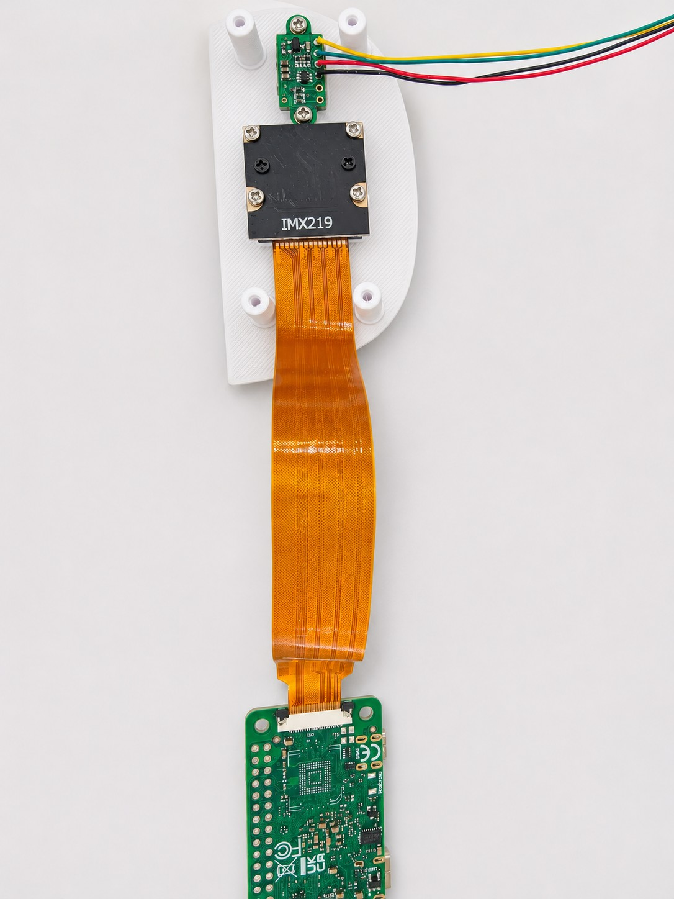
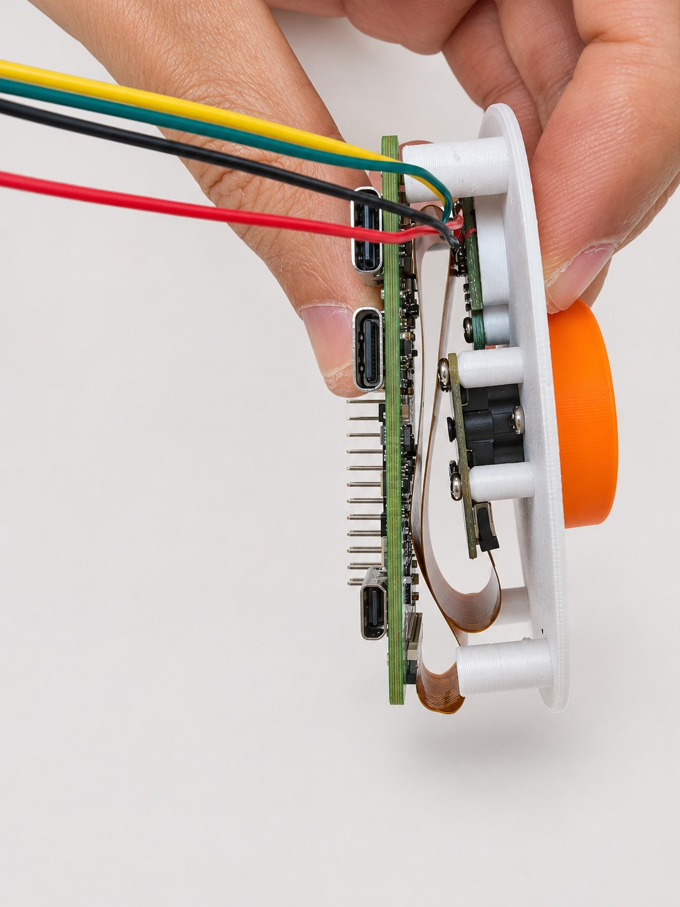
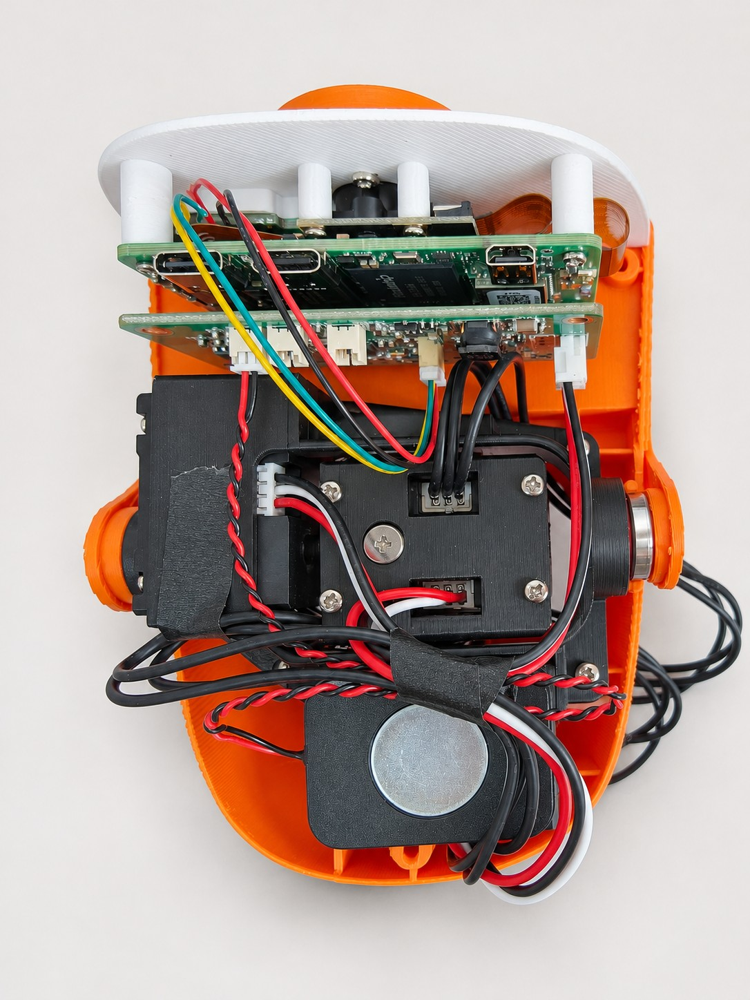

[简体中文](HEAD-ASSEMBLY.md) | **English**

# Head assembly and wiring · photo guide

Follow the real assembly photos: ToF → IMX219 → ZERO 3W → HAT → cable routing. Assemble with power disconnected. Select the face-panel print for your IMX219 camera variant.

[Open the web photo guide (Chinese)](https://kissqy.github.io/Microduck-kissqy/build/assembly.html#head-photos) · [3D head reference](https://kissqy.github.io/Microduck-kissqy/assembly.html?part=head)

## 01 · Mount the ToF module

Fasten the ToF module to its mounting points inside the face panel. Route its four wires to the side, leaving room for the camera and the boards above it.

In this photo, the module pads run top to bottom: yellow VIN, green GND, red SCL, black SDA.

[Original photo](assets/head-assembly/originals/01-tof-mount.jpg)

## 02 · Install the IMX219 and its ribbon cable

Align the camera with the face opening and secure its four mounting points. Connect the camera ribbon to the ZERO's CSI connector and close the latch after seating it fully.

Choose the face-panel print for your camera variant. Check the actual connector to determine ribbon contact orientation.

[Original photo](assets/head-assembly/originals/02-camera-ribbon.jpg)

## 03 · Mount the ZERO and leave room for the ribbon

Mount the ZERO on the face-panel standoffs. Use this side view to check the space behind the camera. Let the ribbon bend naturally through the gap, clear of screws and standoffs.

Keep the ribbon relaxed without sharp creases. Check the orientation of the 40-pin header and the HAT's mating socket.

[Original photo](assets/head-assembly/originals/03-zero-clearance.jpg)

## 04 · Connect the ToF and speaker to the HAT

Connect the four-wire ToF harness to HAT J5 and the red/black speaker lead to J1. J2 and J9 are microphone connectors. Check the mating orientation before joining the HAT and ZERO.

Match connector numbers and signal names. The ToF and speaker pin tables are below.

[Original photo](assets/head-assembly/originals/04-hat-wiring.jpg)

## 05 · Fit the head shell and secure the wiring

Fit the stacked ZERO/HAT assembly and speaker into the head. Tuck spare cable into the side gaps and secure it as shown. Leave slack for the servos, mouth and opening the cover.

Before closing: keep the ribbon clear of standoffs, wiring clear of moving parts, and plugs free of tension.

[Original photo](assets/head-assembly/originals/05-head-overview.jpg)

## ToF and speaker pinout

HAT J5 is the ToF connector (SH1.0 / 4P). The order of the module pads differs from the HAT pin numbering; match signals using this table.

| HAT J5 pin | Wire in these photos | HAT signal | ToF module pad |
| --- | --- | --- | --- |
| 1 | Green | GND | GND |
| 2 | Yellow | 3V3 (3.3 V) | VIN |
| 3 | Black | SDA | SDA |
| 4 | Red | SCL | SCL |

The speaker connects to HAT J1 (HP1.25 / 2P).

| HAT J1 pin | Wire in these photos | Speaker signal |
| --- | --- | --- |
| 1 | Red | SPK_R_P (+) |
| 2 | Black | SPK_R_N (−) |

**The black speaker wire is the SPK_R_N differential output, not GND.** J2 and J9 are microphone connectors. Wire colors describe this harness; check pin numbers and signals when changing cables.

[HAT connector reference](../hardware/AMP2.0-VERSION.en.md#tof-and-speaker-wiring-photo) · [Full build guide](MICRODUCK-BUILD-GUIDE.en.md)
