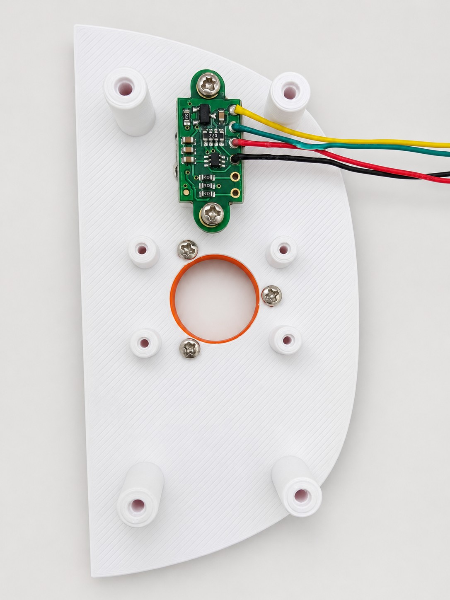
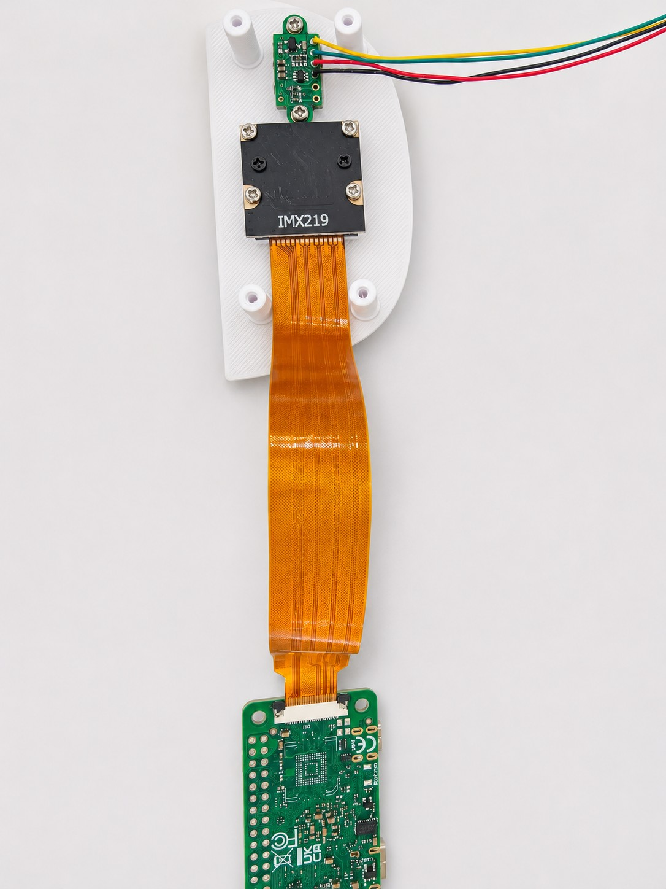
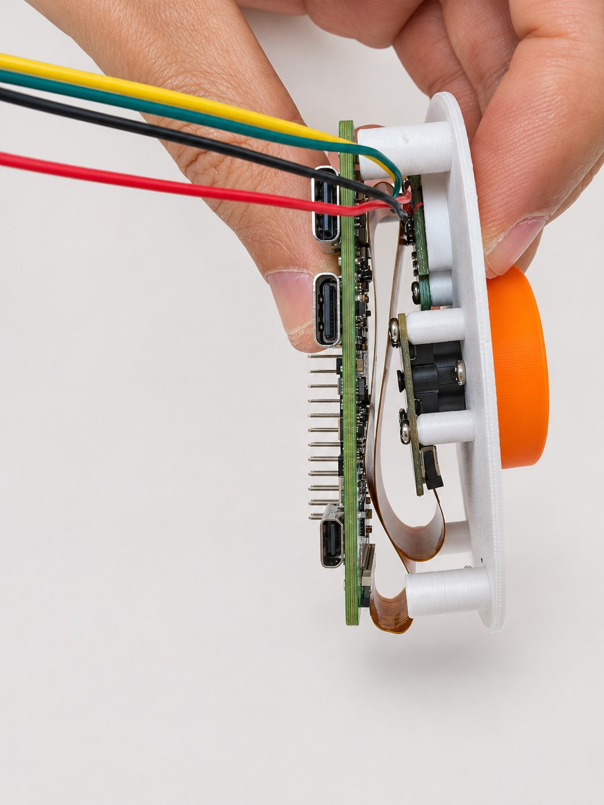
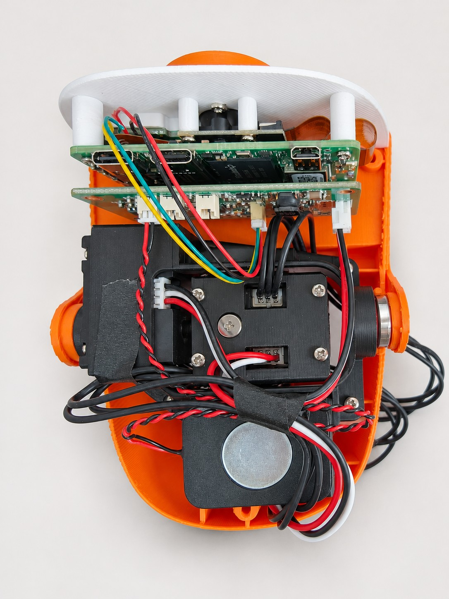

**简体中文** | [English](HEAD-ASSEMBLY.en.md)

# 头部安装与接线 · 五步实拍

从鸭脸内侧开始，按 **ToF → IMX219 → ZERO 3W → HAT → 整理线束** 的顺序完成。断电后装配；鸭脸打印件需与实际 IMX219 摄像头版本对应。

[在线查看五步实拍](https://kissqy.github.io/Microduck-kissqy/build/assembly.html#head-photos) · [打开头颈 3D 参考](https://kissqy.github.io/Microduck-kissqy/assembly.html?part=head)

## 01 · 先固定 ToF 模块

将 ToF 固定在鸭脸内侧的小板安装位，四根线从侧面引出，给摄像头和上层板卡留出空间。

按本图朝向，模块焊孔自上而下：黄 VIN、绿 GND、红 SCL、黑 SDA。

## 02 · 安装 IMX219 与摄像头排线

摄像头对准鸭脸开孔，按四角安装位固定。将摄像头排线接到 ZERO 的 CSI 接口，确认插入到位、锁扣扣好。

先选与摄像头版本对应的鸭脸打印件；排线接触面按实际接口确认。

## 03 · 固定 ZERO，留出排线弯曲空间

将 ZERO 装到鸭脸立柱上，参照侧视图检查摄像头与主控之间的间距。排线沿空隙自然折回，避开螺丝和立柱。

排线不绷紧、不折成死角；核对 40 针排针与 HAT 配对座的朝向。

## 04 · 连接 HAT 的 ToF 与喇叭

四芯 ToF 线束接 HAT J5，红黑喇叭线接 J1。J2、J9 为麦克风接口；外围接好后，再核对 HAT 与 ZERO 的配对朝向。

按接口编号和信号名核对线序；ToF 与喇叭的完整针序见下方。

## 05 · 装入头壳，整理并固定线束

将叠装好的 ZERO／HAT 和喇叭装入头部，余线收进两侧空隙，参照照片固定。给舵机、嘴部活动和开盖留出余量。

合盖前检查：排线不卡立柱，线束不碰活动件，插头未被拉扯。

## ToF 与喇叭针序

**ToF 接 HAT J5（SH1.0 / 4P）**。模块焊孔顺序与 HAT 针序不同，按信号对应接线。

| HAT J5 针号 | 本组照片线色 | HAT 信号 | ToF 模块焊孔 |
| --- | --- | --- | --- |
| 1 | 绿色 | GND | GND |
| 2 | 黄色 | 3V3（3.3 V） | VIN |
| 3 | 黑色 | SDA | SDA |
| 4 | 红色 | SCL | SCL |

**喇叭接 HAT J1（HP1.25 / 2P）。**

| HAT J1 针号 | 本组照片线色 | 喇叭信号 |
| --- | --- | --- |
| 1 | 红色 | SPK_R_P（＋） |
| 2 | 黑色 | SPK_R_N（−） |

**喇叭黑线是 SPK_R_N 差分输出，不是 GND。** J2、J9 为麦克风接口。线色对应本组实拍，换线束时按针号和信号核对。

[HAT 接口完整说明](../hardware/AMP2.0-VERSION.md#tof-与喇叭实拍接线) · [返回复刻总教程](MICRODUCK-BUILD-GUIDE.md)
