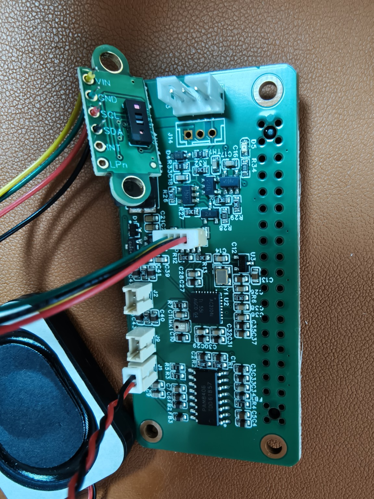

[简体中文](AMP2.0-VERSION.md) | **English**

# HAT / IMU · AMP2.0 connector version

**Both connector versions remain available. Choose for your wiring.** This page covers the **HAT October 15, 2026 and IMU November 13, 2026 AMP2.0 projects**; the [original EH2.5 projects and procurement tables](README.en.md) are retained.

## Download projects

| Hardware | Project | This version |
| --- | --- | --- |
| **HAT · AMP2.0** | [Download October 15 project](https://github.com/kissqy/Microduck-kissqy/raw/refs/heads/main/hardware/ProPrj_HAT_REVA_SCH_2026-10-15.epro2) | AMP2.0 bus connectors, HP1.25 speaker / microphone connectors, added D5 LED and R34 1kΩ resistor. |
| **IMU · AMP2.0** | [Download November 13 project](https://github.com/kissqy/Microduck-kissqy/raw/refs/heads/main/hardware/ProPrj_imu_to_dxl_RevA_V1_2026-11-13.epro2) | J1 bus connector uses AMP2.0; J2 remains the SWD 1×5 header. |

The author's project files are published unchanged and contain both schematic and PCB data. The HAT has **86 schematic / 86 PCB components** and the IMU **25 / 25**. Exact parts, quantities, and file SHA256 hashes are listed in [AMP2.0-BOM.json](AMP2.0-BOM.json).

## Connectors and added parts

Select the **exact model and pitch** below. EH2.5 sockets, housings, and terminals in the original procurement tables belong to the original version; this version uses the following connectors.

| Purpose | Reference | Exact part / specification | Project supplier ID | Qty per HAT + IMU set |
| --- | --- | --- | --- | ---: |
| **AMP2.0 bus socket** | HAT **J13, J14**; IMU **J1** | **CJT A2007WV-3P**, 3P, 2.0 mm, through-hole | [C225336](https://www.lcsc.com/product-detail/C225336.html) | **3** |
| **HP1.25 audio socket** | HAT **J1, J2, J9** | **CJT A1251WV-2P**, 2P, 1.25 mm, through-hole | [C225090](https://www.lcsc.com/product-detail/C225090.html) | **3** |
| **Added green LED** | HAT **D5** | **LTST-C190KGKT**, 0603, RX indicator | [C125094](https://www.lcsc.com/product-detail/C125094.html) | **1** |
| **Added current-limiting resistor** | HAT **R34** | **0603WAF1001T5E**, **1kΩ**, 0603 | [C21190](https://www.lcsc.com/product-detail/C21190.html) | **1** |

Use mating **AMP2.0 3P / HP1.25 2P** cable connectors and wire by the project pin numbers. R34 uses the same 1kΩ part as the IMU's existing R7, so one HAT + IMU set uses **2 resistors** of this model. Historical prices and the procurement Excel still describe the original version; original socket prices have not been reused for the new parts.

## Pin assignments

These assignments come from this version's PCB nets. Identify pins by their pad numbers.

| Connector | Pin 1 | Pin 2 | Pin 3 |
| --- | --- | --- | --- |
| HAT J13 / J14 · AMP2.0 | GND | BATT_IN | DXL_DATA |
| IMU J1 · AMP2.0 | GND | DXL_VDD | DXL_DATA |
| HAT J1 · speaker HP1.25 | SPK_R_P | SPK_R_N | — |
| HAT J2 · left microphone HP1.25 | GND | MIC_EXT_L_BIAS | — |
| HAT J9 · right microphone HP1.25 | GND | MIC_EXT_R_BIAS | — |

The added indicator path is **`GPIO15_UART_RX → R34 (1kΩ) → D5 → GND`**, providing a hardware RX indication on the HAT. HAT R33 remains **0Ω** and TH1 **100R PTC** in this project.

IMU J2 remains **1=3V3, 2=SWDIO, 3=GND, 4=SWCLK, 5=NRST**. See the [FT6 flashing and checks guide](IMU-FIRMWARE.en.md). This publication adds the connector project variant.

**IMU update, 2026-11-13:** J1 footprint pads 1 and 3 exchange physical positions. Electrical numbering remains **1=GND, 2=DXL_VDD, 3=DXL_DATA**. Follow the updated PCB connector orientation when matching the cable; the SWD J2 pinout is unchanged. [2026-10-15 historical project](ProPrj_imu_to_dxl_RevA_V1_2026-10-15.epro2) remains available.

## ToF and speaker wiring photo

See the [five-photo head assembly guide](../docs/HEAD-ASSEMBLY.en.md) for ToF mounting, the IMX219 ribbon, ZERO clearance and cable routing inside the head.

**Connect the ToF module to HAT J5 (SH1.0 / 4P), and the speaker to HAT J1 (HP1.25 / 2P).** From top to bottom, the ToF module pads on the left of the photo are **VIN, GND, SCL, SDA**, using **yellow, green, red, black** wires. INT and LPn are unconnected in this photo. Match the HAT pins below; the module pad order is different from the J5 pin order.

| HAT J5 pin | Wire in photo | HAT signal | ToF module pad |
| --- | --- | --- | --- |
| 1 | Green | GND | GND |
| 2 | Yellow | 3V3 (3.3 V) | VIN |
| 3 | Black | GPIO02_I2C_SDA | SDA |
| 4 | Red | GPIO03_I2C_SCL | SCL |

| HAT J1 pin | Wire in photo | Speaker signal |
| --- | --- | --- |
| 1 | Red | SPK_R_P (+) |
| 2 | Black | SPK_R_N (−) |

With the photo oriented as shown, the lowest **J1 speaker connector has black above red**. The black J1 wire is **SPK_R_N, a differential speaker output, not GND**. J2 and J9 are microphone inputs. Wire colors describe this photo; match signals and pin numbers when using another cable.

[Online assembly guide: photo and pin assignments](https://kissqy.github.io/Microduck-kissqy/build/assembly.html#hat-wiring)

[Both hardware versions](README.en.md) · [Duck shopping guide](../DUCK-SHOPPING-LIST.en.md) · [Homepage](../README.en.md)

