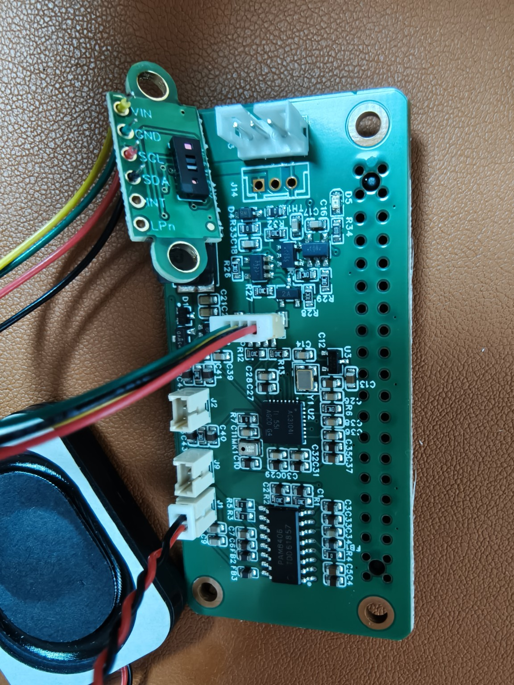

**简体中文** | [English](AMP2.0-VERSION.en.md)

# HAT / IMU · AMP2.0 接口版

**两种接口版本并行提供，按自己的线束选择。** 本页为 **2026-10-15 的 AMP2.0 版**；[原版 EH2.5 工程与采购表](README.md) 继续保留。

## 下载工程

| 硬件 | 工程 | 本版内容 |
| --- | --- | --- |
| **HAT · AMP2.0** | [下载 2026-10-15 工程](https://github.com/kissqy/Microduck-kissqy/raw/refs/heads/main/hardware/ProPrj_HAT_REVA_SCH_2026-10-15.epro2) | 总线 AMP2.0，喇叭 / 麦克风 HP1.25，新增 D5 LED 与 R34 1kΩ 电阻。 |
| **IMU · AMP2.0** | [下载 2026-10-15 工程](https://github.com/kissqy/Microduck-kissqy/raw/refs/heads/main/hardware/ProPrj_imu_to_dxl_RevA_V1_2026-10-15.epro2) | J1 总线接口改为 AMP2.0；J2 仍为 SWD 1×5。 |

工程按作者提供的文件原样发布，均包含原理图和 PCB。源文件中 HAT 为 **86 个原理图器件 / 86 个 PCB 器件**，IMU 为 **25 / 25**；完整型号、用量及文件 SHA256 见 [AMP2.0-BOM.json](AMP2.0-BOM.json)。

## 选购接口和新增器件

按下面的**完整型号和间距**选择。原版采购页中的 EH2.5 插座、胶壳和端子属于原版，AMP2.0 版使用本表对应接口。

| 用途 | 位号 | 型号 / 规格 | 工程料号 | 一套 HAT + IMU 用量 |
| --- | --- | --- | --- | ---: |
| **AMP2.0 总线插座** | HAT **J13、J14**；IMU **J1** | **CJT A2007WV-3P**，3P、2.0 mm、直插 | [C225336](https://www.lcsc.com/product-detail/C225336.html) | **3** |
| **HP1.25 音频插座** | HAT **J1、J2、J9** | **CJT A1251WV-2P**，2P、1.25 mm、直插 | [C225090](https://www.lcsc.com/product-detail/C225090.html) | **3** |
| **新增绿色 LED** | HAT **D5** | **LTST-C190KGKT**，0603，RX 指示 | [C125094](https://www.lcsc.com/product-detail/C125094.html) | **1** |
| **新增限流电阻** | HAT **R34** | **0603WAF1001T5E**，**1kΩ**、0603 | [C21190](https://www.lcsc.com/product-detail/C21190.html) | **1** |

线束的配套插头也按本版的 **AMP2.0 3P / HP1.25 2P** 选择，按工程针号接线。R34 与 IMU 原有 R7 使用同一 1kΩ 型号，整套两块板共用该型号 **2 只**。原版的历史价格及采购 Excel 继续对应原版；这里列出新版型号和用量，没有套用原版插座报价。

## 接口针序

以下针序读取自本版 PCB 网络；按焊盘针号辨认方向。

| 接口 | 1 脚 | 2 脚 | 3 脚 |
| --- | --- | --- | --- |
| HAT J13 / J14 · AMP2.0 | GND | BATT_IN | DXL_DATA |
| IMU J1 · AMP2.0 | GND | DXL_VDD | DXL_DATA |
| HAT J1 · 喇叭 HP1.25 | SPK_R_P | SPK_R_N | — |
| HAT J2 · 左麦克风 HP1.25 | GND | MIC_EXT_L_BIAS | — |
| HAT J9 · 右麦克风 HP1.25 | GND | MIC_EXT_R_BIAS | — |

新增指示灯链路为 **`GPIO15_UART_RX → R34（1kΩ）→ D5 → GND`**，属于 HAT 硬件 RX 指示。HAT 的 R33 在本工程仍为 **0Ω**，TH1 为 **100R PTC**。

IMU 的 J2 针序保持 **1=3V3、2=SWDIO、3=GND、4=SWCLK、5=NRST**；烧录与检查入口见 [IMU FT6 固件指南](IMU-FIRMWARE.md)。本次发布为接口工程更新。

## ToF 与喇叭实拍接线

**ToF 接 HAT J5（SH1.0 / 4P）；喇叭接 HAT J1（HP1.25 / 2P）。** 上图 ToF 模块左侧焊孔自上而下是 **VIN、GND、SCL、SDA**，对应 **黄、绿、红、黑**；INT、LPn 在本图中留空。HAT 端按下表针号对应，不把模块焊孔顺序当作 J5 针序。

| HAT J5 针号 | 本图线色 | HAT 信号 | ToF 模块焊孔 |
| --- | --- | --- | --- |
| 1 | 绿色 | GND | GND |
| 2 | 黄色 | 3V3（3.3 V） | VIN |
| 3 | 黑色 | GPIO02_I2C_SDA | SDA |
| 4 | 红色 | GPIO03_I2C_SCL | SCL |

| HAT J1 针号 | 本图线色 | 喇叭信号 |
| --- | --- | --- |
| 1 | 红色 | SPK_R_P（＋） |
| 2 | 黑色 | SPK_R_N（−） |

按上图朝向，最下方的 **J1 喇叭插座是上黑、下红**。J1 黑线为 **SPK_R_N 差分输出，不是 GND**；J2、J9 为麦克风接口。线色仅对应这张实拍，换线束时以信号和针号为准。

[在线装配页：查看实拍与线序](https://kissqy.github.io/Microduck-kissqy/build/assembly.html#hat-wiring)

[两种版本工程总入口](README.md) · [鸭子采购总清单](../DUCK-SHOPPING-LIST.md) · [项目首页](../README.md)
