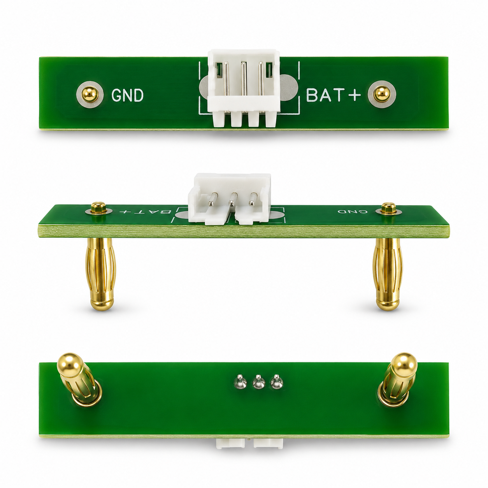
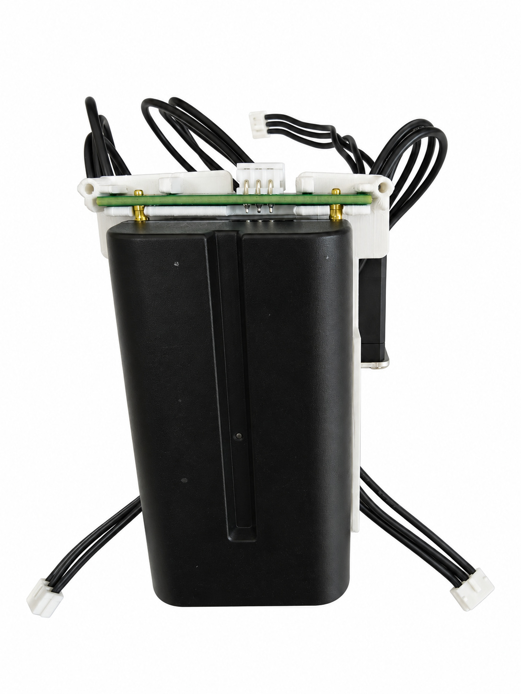
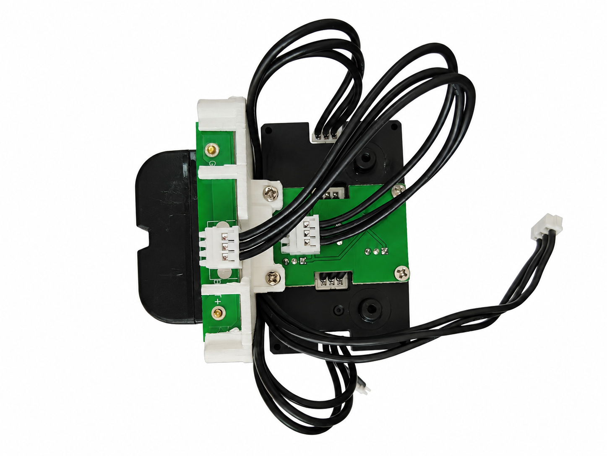

# Banana battery power board · AMP2.0

The new banana power board is **¥39 each**, with a right-angle AMP2.0 connector and a matching premade cable to HUB V3 for solder-free assembly.

## Installation and wiring

Insert the two gold banana contacts into the NP-F550 battery contacts, with the PCB at the top of the printed holder. Keep the white right-angle connector accessible.

Connect the matching premade power cable to HUB V3 CN1: VIN → pin 2, GND → pin 3; pin 1 is NC. Match actual silkscreen and continuity, not wire color. The third housing position is not servo DATA.

| Battery contact end | Cable routing and rear mounting |
| --- | --- |
|  |  |

[3D assembly](https://kissqy.github.io/Microduck-kissqy/assembly.html?component=hub) · [Shopping list](../DUCK-SHOPPING-LIST.en.md)

The 3D board is an assembly display approximation based on these photographs and the recorded board envelope; it is not a fabrication model.
