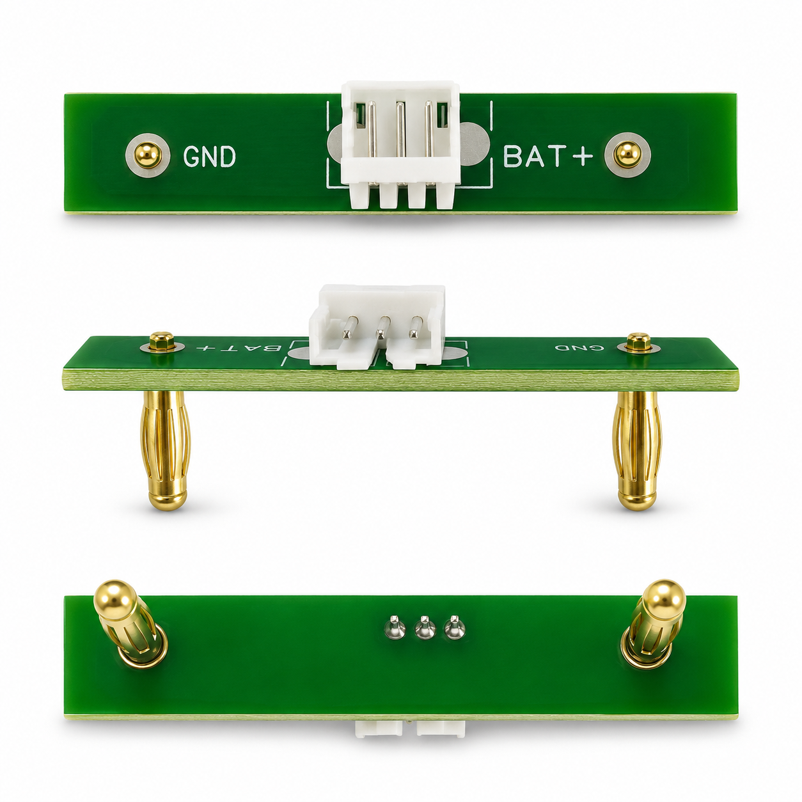
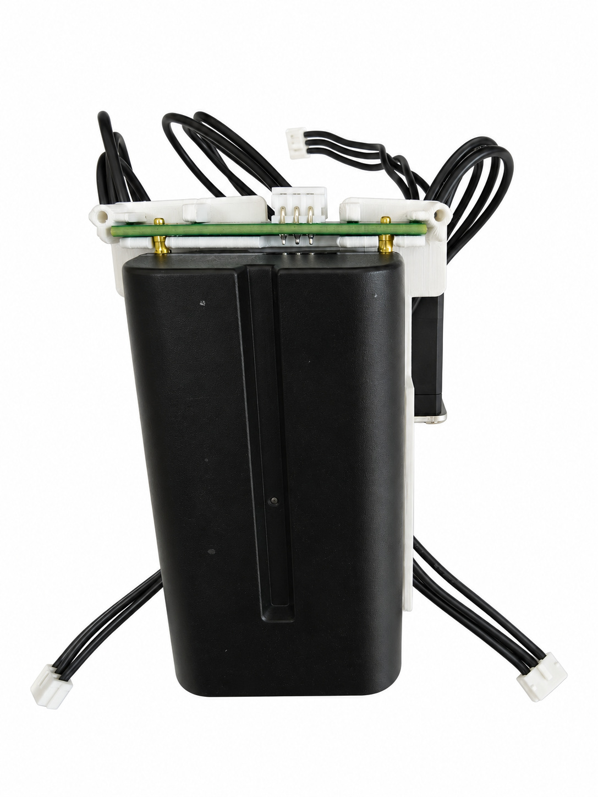
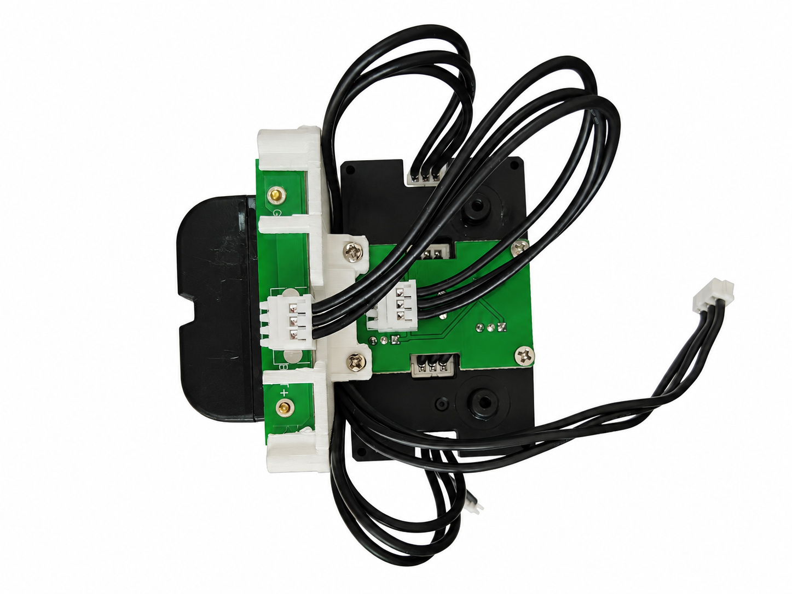

# 香蕉取电板 · AMP2.0

新版香蕉取电板 **¥39／块**，AMP2.0 卧式接口，配套成品线直插 HUB V3，免焊装配。

## 安装与接线实拍

将两根金色香蕉插针插入 NP-F550 电池触点，PCB 位于打印电池仓顶部，白色卧式插口留出插线空间。

配套成品电源线连接 HUB V3 的 CN1：VIN → 2 脚，GND → 3 脚，1 脚 NC 留空。按实板丝印及导通关系核对，不凭全黑线束的颜色判断；三针外壳不代表接入舵机 DATA。

| 电池触点端 | 插线与背面安装 |
| --- | --- |
|  |  |

[3D assembly](https://kissqy.github.io/Microduck-kissqy/assembly.html?component=hub) · [Shopping list](../DUCK-SHOPPING-LIST.md)

3D 板卡根据实拍与已记录板框尺寸自行建模，用于装配展示，不作为加工图。
