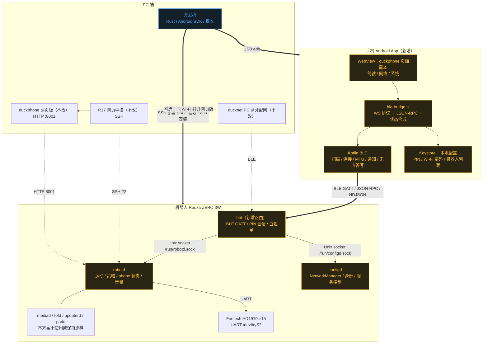
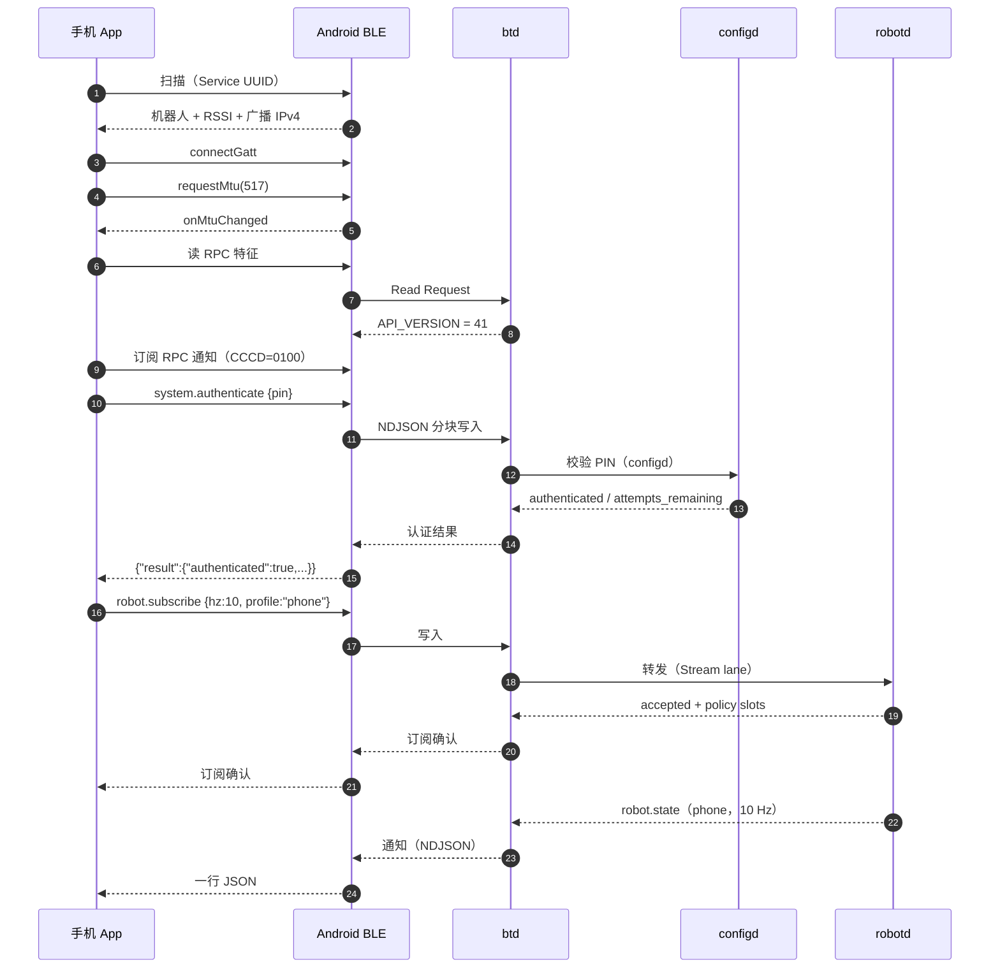
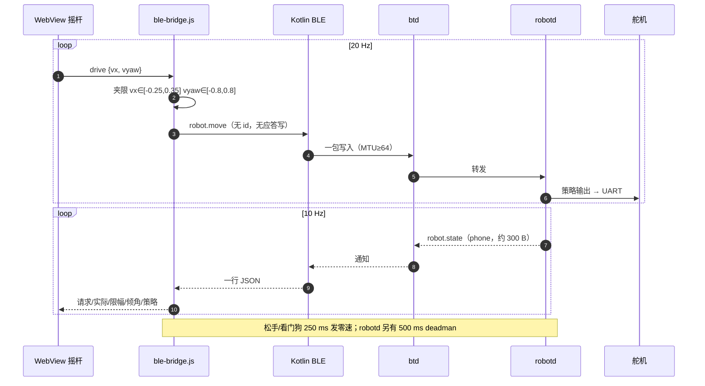
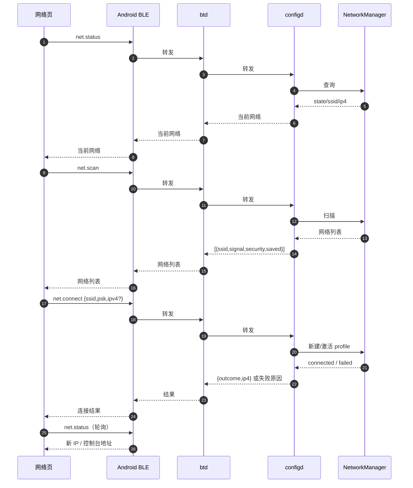
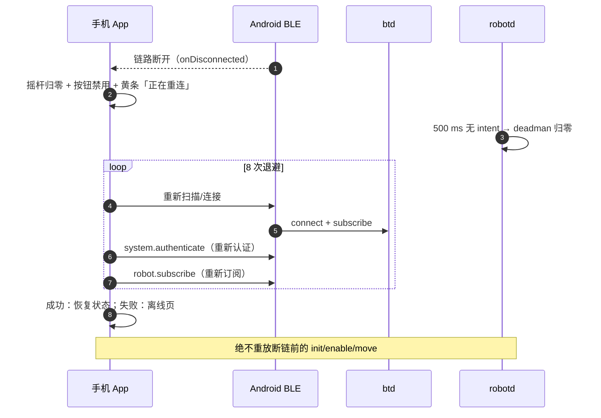
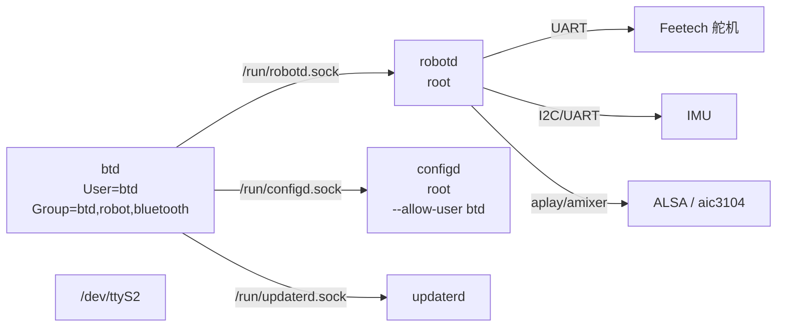
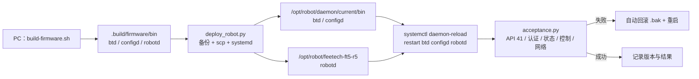
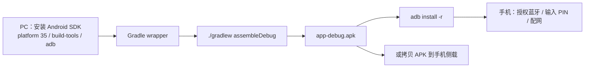
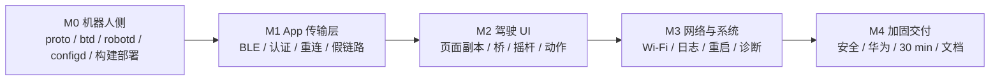

# 手机控制 Microduck · 蓝牙版实现设计

> 2026-11-26 · 设计已审核 · 实现开始
> 目标：把 duckphone 的手机网页控制能力 + ducknet 的蓝牙配网能力，做成一个 Android 蓝牙 App；**原网页版一行不改，继续在 `:8001` 运行**。
>
> 配套文档：
> [改造方案](./duckphone-ble-plan.zh-CN.md) ·
> [功能清单](./duckphone-ble-features.zh-CN.md) ·
> [UI 设计](./duckphone-ble-ui.zh-CN.md) ·
> [实现计划与分工](./duckphone-ble-implementation-plan.zh-CN.md) ·
> [可点击原型](../../duckphone-ble/design/prototype.html)

---

## 0. 结论先行

| 项 | 结论 |
| --- | --- |
| 手机端 | 新增 Android APK：Kotlin 原生 BLE + WebView 复用现有页面（独立副本），不修改原网页版 |
| 机器人端 | 改造 `duck-ipc-proto` / `btd` / `robotd` / `configd`；新增 phone 精简状态、音量、停/启 padd；把 `btd` 正式纳入固件构建与部署 |
| PC 端 | **现有 R17 中控、duckphone 网页版、ducknet 全部不改**；新增开发/部署/验收脚本；PC 仍可作 BLE 验收客户端 |
| 通讯 | 手机 ↔ 机器人：BLE GATT + NDJSON + JSON-RPC；机器人内部：Unix socket；PC ↔ 机器人：SSH/HTTP/BLE；PC ↔ 手机：USB adb |
| 关键约束 | 20 Hz 控制必须**无应答写 + 一包发完**；遥测必须用 **300 B 级 phone 精简状态**；全量 3.9 KB 帧不走 BLE |
| 最大工程量 | Android 原生 BLE 会话层 + robotd phone 状态 + btd 路由/构建部署 |
| 当前缺口 | Android SDK / adb / Gradle 未安装；Zig 0.15.1 未安装（cargo-zigbuild 已有）；其余 Rust/JDK/gh 已具备 |

---

## 1. 三端定义与职责

### 1.1 手机 App 端（新增）

| 项 | 内容 |
| --- | --- |
| 运行位置 | Android 手机（华为 Mate 40 Pro 为首先验证机型） |
| 形态 | 独立 APK，Kotlin + 原生 `android.bluetooth`，WebView 承载页面 |
| 职责 | BLE 扫描/连接/认证/重连；驾驶、头部、策略、声音；机器人 Wi-Fi 配置；系统信息/日志/重启；本地加密保存 PIN/密码 |
| 不负责 | 摄像头、3D、舵机标定、固件升级、云端、iOS |
| 关键约束 | 不修改原网页版；页面是 `duckphone-ble/` 内的独立副本 |

### 1.2 机器人端（改造）

| 项 | 内容 |
| --- | --- |
| 硬件 | Radxa ZERO 3W（AIC8800 Wi-Fi/BT 共射频） |
| 运行位置 | 板载 Debian/Armbian，systemd |
| 现有守护进程 | `btd`（BLE GATT → JSON-RPC）、`robotd`（运动/策略/遥测）、`configd`（网络/身份）、`updaterd`、`mediad`、`tofd`、`padd` |
| 本次改造 | `btd` 放开驾驶/遥测/声音/音量/服务控制路由；`robotd` 增加 phone 精简状态与音量；`configd` 增加停/启 padd；把 btd/configd 纳入正式构建与部署 |
| 不改造 | 运动控制、策略推理、舵机标定、固件升级、原网页版 |

### 1.3 PC 端（三种角色，均不破坏现有功能）

| 角色 | 具体是什么 | 本次是否改造 |
| --- | --- | --- |
| **开发机** | 本工作区 Linux：Rust 交叉编译、Android APK 构建、部署、验收 | 新增脚本与环境，不改现有程序 |
| **现有网页中控** | R17 V167 `firmware/console`，通过 SSH 连机器人 | **不改** |
| **现有手机网页版** | duckphone `:8001`（LAN PWA） | **不改** |
| **PC 蓝牙配网** | ducknet（Bleak/Tk） | **不改**；继续可用，也是 BLE 验收参考 |

> PC 端不是新 App 的运行时依赖。手机 App 不经过 PC；PC 只负责构建、安装、验收和保留旧的备用入口。
> **PC 端本次不新增蓝牙驾驶 App**：ducknet 继续负责 PC 蓝牙配网，R17 / duckphone 继续负责 PC/局域网控制；如果以后要 PC 蓝牙驾驶，可复用同一桥接层，但不在本次范围。

---

## 2. 总体架构



**一句话**：驾驶和配网的运行时链路只有 `手机 ↔ BLE ↔ btd ↔ robotd/configd`；Wi-Fi 只承载机器人自己的网络，PC 只负责构建/安装/验收和保留旧入口。

---

## 3. 三端通讯详解

### 3.1 手机 ↔ 机器人：BLE GATT

#### 3.1.1 无线契约

| 项 | 值 |
| --- | --- |
| Service UUID | `6f5d2a10-3b47-4c8e-9a1f-2d7e8c4b6019` |
| RPC 特征 UUID | `6f5d2a11-3b47-4c8e-9a1f-2d7e8c4b6019` |
| 方向 | 同一特征：**写**请求、**订阅**回答/通知；连接后**读**一次取 API 版本 |
| 编码 | NDJSON（一行一个 JSON），分块后以 `\n` 结束 |
| 分块 | 请求按 `MTU-3` 切；回答按 `min(MTU-3, 512)` 切 |
| 认证 | `system.authenticate {pin}`；失败返回剩余次数；断开即丢弃会话 |
| 版本 | 本次目标 `API_VERSION = 41`；App 要求 ≥ 41 |

#### 3.1.2 手机端 BLE 参数

| 参数 | 选择 | 原因 |
| --- | --- | --- |
| 扫描 | 按 Service UUID 过滤 | 不依赖名字；同时解析广播 IPv4 |
| 连接 | `connectGatt(TRANSPORT_LE)` + `requestConnectionPriority(HIGH)` | 降低连接间隔 |
| MTU | `requestMtu(517)` | 控制帧一包发完；状态帧 1–2 包 |
| 写方式 | **控制用 `WRITE_TYPE_NO_RESPONSE`**；命令请求可用有应答写 | 实测有应答 541 ms/帧，无应答 3 ms/帧 |
| 通知 | 写 CCCD `0x2902 = 01 00` | 同特征收回答 |
| 重连 | 0.5/1/2/4 s 退避，每轮 8 次 | AIC8800 共射频会成串断开 |
| 后台 | `onPause` 先发零速再断开；驾驶时 `KEEP_SCREEN_ON` | 不做后台驾驶 |

#### 3.1.3 JSON-RPC 消息类型

| 类型 | 例子 | 是否等回答 |
| --- | --- | --- |
| 请求 | `{"jsonrpc":"2.0","id":7,"method":"robot.init","params":{}}` | 是 |
| 通知 | `{"jsonrpc":"2.0","method":"robot.move","params":{"vx":0.15,"vy":0,"vyaw":0.2}}` | 否（20 Hz 控制） |
| 订阅 | `{"jsonrpc":"2.0","id":1,"method":"robot.subscribe","params":{"hz":10,"profile":"phone"}}` | 先回 accepted，再持续推送 |
| 通知流 | `{"jsonrpc":"2.0","method":"robot.state","params":{...}}` | 无 id |

#### 3.1.4 方法清单（本次相关）

| 分类 | 方法 | 通道 | 本次变化 |
| --- | --- | --- | --- |
| 连接 | `system.authenticate` | 请求 | 已允许 |
| 遥测 | `robot.subscribe {hz:10, profile:"phone"}` | 订阅 | **新增 profile** |
| 健康 | `robot.health` | 请求 1 Hz | 已允许 |
| 驾驶 | `robot.move` / `robot.head` | 通知 20 Hz | **新允许** |
| 停止 | `robot.stop` | 请求 | **新允许** |
| 卸力 | `robot.relax` | 请求（长按后） | **新允许** |
| 站立/接管 | `robot.init` / `robot.enable` | 请求 | 已允许 |
| 重启舵机 | `robot.rebootMotors` | 请求 | 已允许 |
| 策略 | `robot.policies` / `robot.loadPolicy` / `robot.do` | 请求 | 已允许 |
| 声音 | `robot.sound` | 请求 | **新允许** |
| 音量 | `robot.volume` | 请求 | **新增方法** |
| 网络 | `net.status` / `net.scan` / `net.connect` / `net.forget` | 请求 | 已允许 |
| 系统 | `system.info` / `system.services` / `system.logs` / `system.setName` / `system.reboot` | 请求 | 已允许 |
| 停 padd | `system.serviceAction {unit:"padd",action:"stop"}` | 请求 | **新增方法** |
| 手柄状态 | `pad.status` | 请求 | 已允许 |

#### 3.1.5 连接/认证/订阅时序



#### 3.1.6 驾驶 + 遥测时序



#### 3.1.7 机器人 Wi-Fi 配置时序



#### 3.1.8 断链/重连时序



### 3.2 机器人内部通讯



- `btd` 只做传输与路由，不拥有状态；不直接碰硬件。
- `robotd` 是唯一运动控制者；phone 状态只是同一 tick 的精简序列化。
- `configd` 以 root 运行，负责网络、身份、服务控制；`btd` 通过 `--allow-user btd` 获得有限的变更权限。
- `robotd` 与 `configd` 的 Unix socket 都是 `0660 root:robot`；`btd` 的 `robot` 组是它能通信的原因。

### 3.3 PC ↔ 机器人

| 链路 | 用途 | 现状 | 本次 |
| --- | --- | --- | --- |
| SSH 22 | 部署、日志、`robotctl`、标定 | 已有 | 新增部署脚本使用 |
| HTTP `:8001` | duckphone 网页版 | 已有 | **不改** |
| BLE | ducknet 配网、Bleak 验收 | 已有 | 新增 acceptance/probe 脚本 |
| USB 串口 `/dev/ttyACM0` | Wi-Fi/SSH 全挂时最后手段 | 已有 | 不变 |
| R17 中控 | SSH 网页中控 | 已有 | **不改** |

> PC 的 BLE 验收与手机 App 使用同一 GATT/JSON-RPC 协议，所以 PC 脚本是手机端最好的回归工具。

### 3.4 PC ↔ 手机

| 链路 | 用途 | 说明 |
| --- | --- | --- |
| USB adb | 安装 APK、看 logcat、截图 | 需要手机开启开发者模式/USB 调试 |
| 文件传输 |  sideload APK | 华为可关掉「纯净模式」后安装 |
| 无运行时网络 | App 不依赖 PC | 手机只和机器人通信 |

### 3.5 手机 ↔ 机器人 Wi-Fi（可选，不是控制链路）

- 如果手机和机器人在同一 Wi-Fi，可以打开 `http://<机器人IP>:8001` 使用原网页版。
- 蓝牙 App **不通过** Wi-Fi 控制机器人；Wi-Fi 只用于：
  - 显示机器人自己的联网状态；
  - 配置机器人 Wi-Fi；
  - 复制/打开网页版地址。
- 机器人没网时，蓝牙 App 仍能驾驶和配网；这是双链路设计的核心。

### 3.6 通讯矩阵（一页看清）

| 源 → 目的 | 链路 | 协议 | 用途 | 是否运行时依赖 |
| --- | --- | --- | --- | --- |
| 手机 → 机器人 | BLE GATT | NDJSON + JSON-RPC | 驾驶、遥测、配网、系统维护 | **是（主链路）** |
| 手机 → 机器人 | Wi-Fi HTTP :8001 | HTTP + WebSocket | 可选打开原网页版 | 否 |
| 手机 → 机器人 | Wi-Fi/SSH | SSH | 不提供；App 不使用 | 否 |
| 机器人内部 | Unix socket | JSON-RPC 行 | btd → robotd/configd/updaterd | 是 |
| 机器人内部 | UART `/dev/ttyS2` | Feetech 协议 | robotd → 15 个舵机 | 是 |
| PC → 机器人 | SSH 22 | SSH/命令行 | 部署、日志、robotctl | 开发/运维 |
| PC → 机器人 | HTTP :8001 | HTTP + WebSocket | duckphone 网页版（不改） | 旧入口 |
| PC → 机器人 | BLE | NDJSON + JSON-RPC | ducknet 配网、Bleak 验收 | 开发/验收 |
| PC → 机器人 | USB `/dev/ttyACM0` | 串口 | Wi-Fi/SSH 全挂时救急 | 运维 |
| PC → 手机 | USB adb | adb | 安装 APK、logcat、截图 | 开发/安装 |
| PC → 手机 | 文件传输 | APK | 侧载 | 安装 |
| 手机 → PC | — | — | 无 | — |

> **运行时只有一条控制链路**：手机 ↔ BLE ↔ 机器人。PC 不参与；Wi-Fi 不参与控制。

---

## 4. 现有系统改造清单

### 4.1 机器人端（按文件）

| 文件/模块 | 改造 | 说明 |
| --- | --- | --- |
| `duck-ipc-proto/src/lib.rs` | `API_VERSION` 40 → **41** | App 握手要求 ≥41 |
| 同上 | `SubscribeParams` 增加 `profile: Option<StateProfile>` | `profile:"phone"` 走精简帧 |
| 同上 | 新增 `Call::RobotVolume` / `method::ROBOT_VOLUME` | 音量/静音 |
| 同上 | 新增 `Call::SystemServiceAction` / `method::SYSTEM_SERVICE_ACTION` | 仅 padd 的 stop/start |
| 同上 | 确认 `NetConnectParams.ipv4` 存在 | 固定 IP 依赖 `feat/desktop-ble-provisioning` 的字段 |
| `btd/src/route.rs` | 放开 `RobotMove` / `RobotHead` / `RobotStop` / `RobotRelax` / `RobotSound` / `RobotVolume` / `SystemServiceAction`；`RobotSubscribe` 仅 `profile=phone` 允许 | 白名单逐条加注释；保持 `pose/mouth/look/setMode/shutdown` 拒绝 |
| `btd/src/route.rs` 测试 | 更新「mutating calls」清单 + profile 分支测试 | 防止未来新增方法漏路由 |
| `robotd/src/main.rs` | `robot.subscribe` 按 profile 序列化 phone 帧 | 复用同一 tick，不新增传感器读取 |
| 同上 | 新增 `robot.volume`：`amixer` 读/写、`alsactl store` 持久化 | 控制名沿用 duckphone：`PCM Playback Volume`、`Line Playback Switch` |
| `configd/src/...` | 新增 `system.serviceAction`，白名单只允许 `padd` 的 stop/start | root 执行 `systemctl` |
| `tools/build-firmware.sh` | 构建列表加入 `btd`、`configd`；产物列表加入两者 | 目前只构建 robotd/robotctl/padd/sounds/gamesir-xboxd |
| `firmware/btd/systemd/` | 确认 `btd.service`、`sysusers.d/btd.conf` 安装 | 板上已手工部署，本次正式化 |
| `firmware/configd/systemd/` | 确认 `configd.service --allow-user btd` | 板上已存在 |
| 部署路径 | `btd`/`configd` → `/opt/robot/daemon/current/bin/`；`robotd` → `/opt/robot/feetech-ft5-r5/robotd` | 具体见 §6.1 |
| 不改 | 运动控制、策略推理、里程计、标定、固件升级、原网页版 | 保持最小改动 |

**分支基线**：`feat/desktop-ble-provisioning` 已包含 `btd`/`configd`/ducknet/`ipv4`；新分支 `dev` 从它拉出，或先合并到 `dev`。不要从缺少 `ipv4` 的旧分支直接改，否则固定 IP 会被整条请求拒绝。

### 4.2 手机端（新增）

| 文件/模块 | 内容 |
| --- | --- |
| `duckphone-ble/android/` | Kotlin 工程：`MainActivity`、`BleClient`、`RobotLink`、`JsBridge` |
| `duckphone-ble/assets/duckphone/` | 从原版**单向复制**的页面 + 新增 `ble-bridge.js` |
| `duckphone-ble/tools/sync-web.sh` | 从原版单向复制基线，不回写 |
| `duckphone-ble/README.md` | 工程说明、构建、安装 |
| 不改 | `firmware/duckphone/`、`firmware/console/static/` |

### 4.3 PC 端（新增脚本，不改旧程序）

| 文件 | 用途 |
| --- | --- |
| `firmware/duckphone-ble/tools/acceptance.py` | Bleak 真机验收：认证、phone 状态、控制写、音量、停 padd、网络、重连 |
| `firmware/duckphone-ble/tools/probe_ble.py` | 只读探针：方法可用性、RTT、吞吐、MTU |
| `firmware/duckphone-ble/tools/deploy_robot.py` | 构建产物部署 + 备份 + 重启 + 自动验收 + 回滚 |
| `firmware/duckphone-ble/tools/build_apk.sh` | Android 构建封装（检查 SDK/Gradle） |
| `firmware/duckphone-ble/tools/install_apk.sh` | `adb install -r` + 启动 |
| `firmware/duckphone-ble/tools/setup_pc.sh` | 检查/安装 Python venv（Bleak）、Chrome、adb 提示 |
| 不改 | R17 中控、duckphone、ducknet |

### 4.4 明确不改

- 原网页版 `firmware/duckphone/` 与 `firmware/console/static/`；
- R17 中控的 SSH/HTTP 逻辑；
- ducknet 的协议与 UI；
- 舵机标定文件、`robotd.toml` 运动参数、策略权重；
- 固件升级 / 恢复出厂 / 改 PIN 的现有边界。

### 4.5 改造一览（按端）

| 端 | 新增 | 修改 | 明确不改 |
| --- | --- | --- | --- |
| 手机 App | Android 工程、BLE 会话、JS 桥、页面副本、Keystore 存储 | 无旧代码可改（新项目） | 原网页版 |
| 机器人 | `robot.volume`、`system.serviceAction`、phone profile、API 41、btd 路由 | `duck-ipc-proto`、`btd`、`robotd`、`configd`、`build-firmware.sh`、systemd 打包 | 运动/策略/标定/升级逻辑 |
| PC | 验收/部署/构建脚本、venv | 无 | R17 中控、duckphone、ducknet |
| 原网页版 | 无 | 无 | 全部保持不变 |

---

## 5. 代码与文档仓库方案

### 5.1 目录结构（只改 kissqy `dev`）

```text
Microduck-kissqy/                         # 只改这个仓库的 dev 分支
└── microduck-hd1910/
    ├── firmware/
    │   ├── docs/design/
    │   │   ├── duckphone-ble-plan.zh-CN.md            # 改造方案
    │   │   ├── duckphone-ble-features.zh-CN.md        # 功能清单
    │   │   ├── duckphone-ble-ui.zh-CN.md              # UI 设计
    │   │   ├── duckphone-ble-implementation.zh-CN.md  # 本文
    │   │   └── duckphone-ble-implementation-plan.zh-CN.md  # 实现计划/进度
    │   ├── duckphone-ble/                # 新增：手机蓝牙 App
    │   │   ├── android/                  # Kotlin 工程
    │   │   ├── assets/duckphone/         # 页面副本（从 ../duckphone 单向复制）
    │   │   ├── design/
    │   │   │   ├── prototype.html        # 可点击原型
    │   │   │   └── screens/*.png          # 原型截图
    │   │   ├── tools/
    │   │   │   ├── sync-web.sh
    │   │   │   ├── acceptance.py
    │   │   │   ├── probe_ble.py
    │   │   │   ├── deploy_robot.py
    │   │   │   ├── build_apk.sh
    │   │   │   ├── install_apk.sh
    │   │   │   └── setup_pc.sh
    │   │   └── README.zh-CN.md
    │   ├── btd/src/route.rs              # 路由
    │   ├── robotd/src/main.rs            # phone 状态 + 音量
    │   ├── configd/src/...               # serviceAction
    │   ├── duck-ipc-proto/src/lib.rs     # API 41 + 新方法
    │   ├── duckphone/                    # 原网页版（不改）
    │   ├── console/                      # R17 中控（不改）
    │   ├── ducknet/                      # PC 蓝牙配网（不改）
    │   └── tools/build-firmware.sh       # 加入 btd/configd
    └── tools/build-firmware.sh           # 现有入口（如需同步）
```

- **权威副本**：以上路径都在 kissqy 仓库 `dev` 分支；`ops/` 不再维护副本，只保留一个指针 `ops/docs/手机控制-蓝牙版-文档位置.md`。
- **构建产物**：`microduck-hd1910/.build/firmware/bin/`、`microduck-hd1910/.build/apk/`（gitignore）。
- **不改**：`firmware/duckphone/`、`firmware/console/`、`firmware/ducknet/`。

### 5.2 分支与提交

| 项 | 规则 |
| --- | --- |
| 分支 | **只改 `dev`**；不要新开特性分支，也不要切到旧分支 |
| 基线 | 当前 `dev` 已包含 duckphone、ducknet、btd、configd、ipv4；直接在其上改 |
| 提交拆分 | ① proto/API 41；② btd 路由 + 测试；③ robotd phone 状态 + 音量；④ configd serviceAction；⑤ 构建/部署脚本；⑥ Android 工程 + 页面；⑦ 文档/验收 |
| 文档 | 设计文档在 `firmware/docs/design/`；App 说明在 `duckphone-ble/README.zh-CN.md` |
| 不提交 | `console/logs/`、`.build/`、APK 中间产物、`/tmp` 文件、PIN/密码 |
| 推送 | 按用户要求推 `fork/dev`；不擅自 force push |

### 5.3 产物与命名

| 产物 | 位置 | 命名 |
| --- | --- | --- |
| 机器人二进制 | `microduck-hd1910/.build/firmware/bin/` | `btd`、`configd`、`robotd` |
| 调试 APK | `microduck-hd1910/.build/apk/` | `duckphone-ble-debug-<date>.apk` |
| 发布 APK | `release-assets/` | `Microduck-Phone-BLE-R1.apk`（用户签名后） |
| 验收报告 | `firmware/docs/design/` | `duckphone-ble-acceptance.zh-CN.md` |

---

## 6. 部署方案

### 6.1 机器人固件



**前置条件**

- 机器人已上电、SSH 可达（`duck@192.168.110.240`）。
- **机器人已坐下或扶稳**：`systemctl restart robotd` 会让关节卸力。
- `btd`/`configd` 现有二进制与 unit 已备份。
- 分支包含 `ipv4` 的 configd/proto。

**构建**

```bash
cd Microduck-kissqy/microduck-hd1910
bash tools/build-firmware.sh
# 产物：.build/firmware/bin/{robotd,btd,configd}
```

- 需要 Rust 1.99.0、cargo-zigbuild 0.23.4、Zig 0.15.1、libudev 交叉 sysroot。
- 当前机器：Rust/cargo-zigbuild/libudev 已具备，**Zig 未安装**；脚本可用 `ziglang` Python 包或系统 Zig。
- 如果 `btd`/`configd` 并入主构建脚本的成本高，可先复用 `ducknet/deploy_ble_provisioning.sh`（当前 `dev` 分支）的构建步骤，再把产物接入本部署流程；最终仍建议统一到 `build-firmware.sh`。

**部署（建议脚本化）**

```bash
firmware/duckphone-ble/tools/deploy_robot.py \
  --target duck@192.168.110.240 \
  --build-dir Microduck-kissqy/microduck-hd1910/.build/firmware/bin \
  --apply
```

脚本步骤：

1. 检查 SSH、`systemctl is-active btd robotd configd`、磁盘；
2. 备份现有 `btd`/`configd`/`robotd` 为 `.bak-<timestamp>`；
3. 拷贝二进制；安装 `btd.service`、`configd.service`、`sysusers.d/btd.conf`；
4. `systemd-sysusers`、`systemctl daemon-reload`；
5. `restart configd btd robotd`（顺序：configd → btd → robotd）；
6. 等待 5 s，检查 `is-active` 与 `robotctl health`；
7. 运行 `acceptance.py`；
8. 失败则恢复 `.bak` 并重启。

**手工验证**

```bash
ssh duck@192.168.110.240 'systemctl is-active btd configd robotd; robotctl health'
firmware/duckphone-ble/tools/acceptance.py --target duck@192.168.110.240 --scan-time 8
```

**回滚**

```bash
# 脚本 --rollback，或手工
ssh duck@192.168.110.240 'sudo cp /opt/.../btd.bak-<ts> /opt/.../btd && sudo systemctl restart btd'
```

### 6.2 手机 APK

> **部署顺序**：先升级机器人到 API 41，再安装/连接新 App；否则 App 握手会拒绝旧固件（API 40）。



**环境**

- JDK 21（已具备）。
- Android SDK（**当前未安装**）：`platform-tools`、`platforms;android-35`、`build-tools;35.0.0`。
- Gradle wrapper（随工程，首次联网下载）。
- 不需要 NDK（无原生 C/Rust 代码）。
- 依赖尽量少：AndroidX Core/AppCompat/WebKit；BLE 用系统 `android.bluetooth`；JSON 用系统 `org.json`。

**工程参数（建议）**

| 项 | 值 |
| --- | --- |
| applicationId | `com.microduck.phone` |
| minSdk | 26（Android 8） |
| compileSdk / targetSdk | 35 |
| 语言 | Kotlin + 原生 Android |
| WebView | `WebViewAssetLoader` 提供本地资源 |
| 版本号 | `versionName` 与 App 文档一致；`versionCode` 递增 |

**构建/安装**

```bash
cd Microduck-kissqy/microduck-hd1910/firmware/duckphone-ble/android
./gradlew assembleDebug
adb install -r app/build/outputs/apk/debug/app-debug.apk
```

- 华为：关闭「纯净模式」，允许未知来源；首次授予蓝牙/附近设备权限。
- Android 12+：`BLUETOOTH_SCAN`（`neverForLocation`）+ `BLUETOOTH_CONNECT`；Android 11 及以下需要定位权限。
- 发布：用户提供 keystore，`assembleRelease`，版本号与 API 41 对齐。

### 6.3 PC 开发/验收环境

| 项 | 命令/说明 |
| --- | --- |
| Python 验收 | `python3 -m venv .venv-ble && .venv-ble/bin/pip install bleak dbus-fast` |
| 只读探针 | `firmware/duckphone-ble/tools/probe_ble.py` |
| 真机验收 | `firmware/duckphone-ble/tools/acceptance.py` |
| 原型预览 | 浏览器打开 `firmware/duckphone-ble/design/prototype.html` |
| 固件构建 | `bash Microduck-kissqy/microduck-hd1910/tools/build-firmware.sh` |
| APK 构建 | `firmware/duckphone-ble/tools/build_apk.sh` |
| GitHub（需要时） | `gh` 已登录；按项目规则推 `fork` |

### 6.4 回滚

| 层 | 回滚 |
| --- | --- |
| 机器人 | 恢复 `.bak` 二进制/unit；`systemctl restart`；原网页版不受影响 |
| 手机 | 卸载 APK；原网页版仍可用 |
| PC | 删除 `.venv-ble`/脚本；R17/duckphone/ducknet 未改 |

> 回滚机器人到 API 40 后，新 App 会提示版本不匹配（≥41）；此时继续用原网页版，或同时回滚 App。

---

## 7. 依赖清单

### 7.1 机器人端

| 依赖 | 版本/状态 | 用途 |
| --- | --- | --- |
| Rust | 1.99.0（已具备） | 编译 btd/robotd/configd |
| cargo-zigbuild | 0.23.4（已具备） | aarch64 交叉编译 |
| Zig | 0.15.1（**未安装**） | zig cc 交叉 C 工具链 |
| Rust target | `aarch64-unknown-linux-gnu`（已具备） | 板端目标 |
| libudev-dev | 已具备 | btd 的 vendored libdbus 交叉构建 |
| libudev ARM64 sysroot | build 脚本固定记录 | 板端链接 |
| BlueZ / bluer | 0.17.4（btd 依赖） | BLE GATT 服务 |
| dbus / vendored libdbus | 0.9（btd 依赖） | BlueZ D-Bus |
| NetworkManager | 板上已安装 | configd 的 Wi-Fi 后端 |
| ALSA `amixer` / `alsactl` | 板上已有 | 音量/静音 |
| systemd | 板上已有 | btd/configd/robotd 服务 |
| 新增 Rust crate | **预计 0 个** | 音量/服务控制用 `std::process`；状态/路由用现有 serde |

### 7.2 手机端

| 依赖 | 版本/状态 | 用途 |
| --- | --- | --- |
| JDK | 21（已具备） | Gradle/AGP |
| Android SDK Platform | 35（**未安装**） | 编译 |
| Android Build Tools | 35.0.0（**未安装**） | aapt2/d8/apksigner |
| Android Platform Tools | `adb`（**未安装**） | 安装/日志 |
| Gradle | 8.x（wrapper 下载） | 构建 |
| Kotlin | 2.x（Gradle 插件） | 原生代码 |
| AndroidX Core / AppCompat | 最新稳定 | Activity/兼容 |
| AndroidX WebKit | 1.12.x | `WebViewAssetLoader` |
| Android BLE | 系统 API | `BluetoothLeScanner` / `BluetoothGatt` |
| Android Keystore | 系统 API | PIN/Wi-Fi 密码加密 |
| `org.json` | 系统内置 | JSON-RPC |
| 第三方 BLE 库 | **不引入** | 原生 API 足够，减少依赖 |
| 第三方 UI 框架 | **不引入** | 复用现有 HTML/CSS |

### 7.3 PC 端

| 依赖 | 版本/状态 | 用途 |
| --- | --- | --- |
| Python | 3.12（已具备） | 验收/探针 |
| Bleak | ≥3.1 | BLE 客户端 |
| dbus-fast | Bleak 依赖 | BlueZ D-Bus |
| websocket-client | 已安装（验收/原型测试） | CDP/测试辅助 |
| Chrome/Chromium | 已具备 | 原型预览/截图 |
| `gh` | 2.45（已具备） | GitHub（需要时） |
| `ssh`/`scp` | 已具备 | 部署 |
| `adb` | 随 Android SDK | 安装 APK |
| `zig` | 未安装 | 固件交叉编译 |

### 7.4 本机现状（2026-11-26 检查）

| 项 | 状态 | 备注 |
| --- | --- | --- |
| Rust 1.99.0 / cargo | ✅ | 已安装 |
| `aarch64-unknown-linux-gnu` target | ✅ | 已安装 |
| cargo-zigbuild 0.23.4 | ✅ | 已安装 |
| Zig 0.15.1 | ❌ | 未安装；可用 `ziglang` Python 包或系统 Zig |
| libudev-dev | ✅ | 已安装 |
| JDK 21 | ✅ | 已安装 |
| Android SDK / adb / Gradle | ❌ | 未安装；需 `sdkmanager` 与 Gradle wrapper |
| Python 3.12 | ✅ | 已安装 |
| Bleak / dbus-fast | ❌（系统） | 仅临时 venv；需建项目 venv |
| Chrome / Chromium | ✅ | 原型与截图 |
| `gh` | ✅ | 2.45 |
| SSH | ✅ | 可连 `duck@192.168.110.240` |
| 磁盘 | ✅ | `/home` 剩余约 236 G |
| 板子 | ✅ | `btd`/`configd`/`robotd` active；API 40；PIN `000000`；未强制配对 |

> 两个主要缺口是 **Android SDK** 和 **Zig**。它们属于“AI 可以执行安装命令、但需要用户确认 license/联网/磁盘”的项。

---

## 8. 测试与验收

### 8.1 机器人侧

| 测试 | 内容 | 通过条件 |
| --- | --- | --- |
| `cargo test -p btd` | 路由白名单、profile 分支、通知静默 | 全部通过 |
| `cargo test -p robotd` | phone 帧字段/大小、音量、订阅 | 全部通过 |
| `cargo test -p configd` | serviceAction 白名单 | 全部通过 |
| 交叉编译 | `btd`/`robotd`/`configd` | 产物可执行、无缺库 |
| 板上启动 | `systemctl is-active` + `robotctl health` | 三个服务 active |

### 8.2 PC 验收（Bleak）

| # | 项目 | 通过条件 |
| --- | --- | --- |
| A1 | 扫描/连接/读版本 | API 41；连接 ≤10 s |
| A2 | PIN 认证 | 成功；错误显示剩余次数 |
| A3 | phone 状态 | 10 Hz，单帧 ≤400 B |
| A4 | 20 Hz 控制写 | 连续 200 帧无写入错误 |
| A5 | 停下/卸力 | stop 归零；relax 长按语义由 App 保证 |
| A6 | 音量 | 写 60 / 静音 / 回读一致 |
| A7 | 停 padd | `systemctl is-active padd` → inactive |
| A8 | 网络 | `net.status`/`net.scan`/`net.connect` 正常 |
| A9 | 日志 | `system.logs` 截断/内容正常 |
| A10 | 断链 | 拔远/关蓝牙 → 500 ms 内归零；重连恢复 |
| A11 | 30 min | 无累积丢帧、无泄漏、CPU <70°C |

### 8.3 手机侧

| 测试 | 内容 |
| --- | --- |
| JVM 单元 | 分块/重组、JSON-RPC id、超时、重连、夹限、看门狗 |
| 假链路 | 录制的真实帧回放，UI 不接蓝牙也能跑 |
| 真机 | 华为 Mate 40 Pro：权限、锁屏、字体、全屏、振动 |
| 安全 | PIN/密码不入日志；Keystore 加密；错误次数 |

### 8.4 安全验收

- 默认 PIN `000000` 必须提示；建议先 `robotctl system set-pin`。
- 未加密链路显示警告；Wi-Fi 密码经过 BLE 时提示风险。
- 可选 `btd --require-pairing`：Android 真机验证后再开。
- 危险动作：卸力长按、重启二次确认、标定只读。
- 断链/进程被杀：零速；不重放。

---

## 9. 里程碑与 AI / 用户分工

### 9.1 里程碑



| 阶段 | 交付 | 门槛 |
| --- | --- | --- |
| M0 | 机器人二进制 + 部署脚本 + Bleak 验收 | phone 状态 10 Hz、20 Hz 写稳定 10 min |
| M1 | Android 工程 + BLE 会话 + 假链路测试 | 真机连接/认证/重连 |
| M2 | 主界面复用 + 站立/接管/摇杆/头部/停下/卸力 | 吊架 A1–A5 |
| M3 | 策略条 + 声音/音量 + 网络 + 系统 | duckphone 验收表重跑 |
| M4 | 安全 + 华为 + APK + 文档 | 30 min 连续、断链零速、可回滚 |

### 9.2 AI 可以完全独立完成

- 全部设计/实现文档、架构图、时序图、原型；
- 机器人端 Rust 代码：proto、btd 路由、robotd phone 状态/音量、configd serviceAction；
- 机器人端单元测试、路由测试；
- Android 工程：Kotlin BLE、JSON-RPC、JS 桥、WebView、权限、Keystore；
- 页面副本、桥接脚本、构建/部署/验收脚本；
- 只读 BLE 探针与验收（扫描/认证/状态/日志/音量回读）；
- 交叉编译（Zig 安装完成后）；
- APK 构建（Android SDK 安装完成后）；
- 部署到机器人（用户确认后）、服务重启、回滚；
- 原型截图、文档链接、README。

> AI 可以独立完成**只读验收**：扫描、连接、PIN 认证、`system.info`、`robot.health`、phone 状态、`system.logs`、`net.status`、`net.scan`、音量回读。凡是会让关节上力、移动、卸力或重启舵机的动作，AI 只准备命令与验收表，由用户执行或在场。

### 9.3 需要用户配合

| 事项 | 为什么需要用户 | AI 能帮到哪一步 |
| --- | --- | --- |
| 安装 Android SDK / 接受 license | license 与磁盘策略是用户的 | 给出 `sdkmanager` 命令与路径，检查结果 |
| 安装 Zig 0.15.1 | 需要联网/系统权限 | 尝试 `pip install ziglang` 或给二进制安装步骤 |
| **固件部署 / 重启 robotd** | 会让关节卸力、机器人可能倒下 | 准备脚本、备份、命令；等用户确认再执行 |
| **任何会动机器人的测试** | 必须有人扶住/看护 | 提供验收步骤、观察指标；用户执行或在场 |
| 站立 / 接管 / 摇杆 / 卸力 / 重启舵机 | 真机安全 | 只做只读验收；动作由用户操作 |
| 输入 PIN / 设置新 PIN | 安全策略 | 提示 `robotctl system set-pin` |
| 提供 Wi-Fi SSID/密码 | 真实网络 | 实现连接流程；用户输入/确认 |
| 手机安装 APK / USB 调试 | 物理设备 | 提供 APK 与 adb 命令；用户授权 |
| 华为专项测试（锁屏/后台/字体/振动） | 真机手感 | 提供测试清单；用户操作 |
| 发布签名 keystore | 属于用户 | 提供 `assembleRelease` 配置；用户给 keystore/密码 |
| 物理断电/上电/电池固定 | 硬件 | 给出步骤；用户操作 |
| GitHub commit/push/PR | 项目规则要求明确指令 | 按用户指令执行；不擅自推送 |
| 是否开启 BLE 配对 | 安全取舍 | 给出测试结果与建议；用户决定 |

---

## 10. 风险与缓解

| 风险 | 影响 | 缓解 | 责任 |
| --- | --- | --- | --- |
| AIC8800 共射频，BLE 成串断开 | 驾驶中断 | 8 次退避重连；断链零速；记录重连次数 | AI + 用户 |
| btd 开机约 73 s 才可用 | App 启动时扫不到 | 连接页提示「蓝牙未就绪」+ 重试；不要误判为机器人故障 | AI |
| 20 Hz 控制丢帧 | 手感差 | 无应答写 + 一包发完 + MTU 517 + 高优先级 | AI |
| 全量状态 3.9 KB 过大 | 状态滞后 | phone 精简状态 10 Hz | AI |
| 固件改动回归 | 机器人异常 | 最小路由白名单 + 测试 + 备份 + 回滚 | AI + 用户 |
| robotd 重启导致卸力 | 机器人倒下 | 部署前要求坐下/扶稳；用户确认 | 用户 |
| 未加密链路 | PIN/密码可被旁听 | 首次改 PIN；Android 验证后开配对 | 用户决定 |
| Android SDK/Gradle 下载失败 | 无法构建 APK | 使用镜像/代理；分步检查；可先出工程再构建 | 用户 + AI |
| Zig 缺失 | 无法交叉编译 | 安装 `ziglang` 或系统 Zig | 用户 + AI |
| WebView 本地资源/存储 | 页面异常 | `WebViewAssetLoader` + `domStorageEnabled` | AI |
| 网页版与 App 同时驾驶 | 指令互相覆盖 | 黄条提示 + 停用入口；文档说明 | AI + 用户 |
| `robot.loadPolicy` 重写配置 | 槽位 key 丢失 | 既有问题；验收时复查 7 个槽位 | AI + 用户 |
| 华为后台限制 | 切后台断链 | 前台驾驶；断链零速；不追求后台 | 用户 |

---

## 11. 需要确认的决策

1. 分支基线：从 `feat/desktop-ble-provisioning` 拉 `dev`，还是先合到 `dev`？
2. 手机端页面：接受「原版复制 + 新增 BLE 页面」，还是要求完全重写一套 UI？
3. 安全：首版是否开启 `btd --require-pairing`？默认 PIN 是否要求用户先改？
4. `system.serviceAction` 白名单：只允许 `padd`，还是也允许停用 `duckphone`（网页中控冲突时）？
5. 发布方式：APK 只做调试侧载，还是需要正式签名/版本号？
6. Wi-Fi 固定 IP：必须保留 ducknet 的 `ipv4` 扩展，还是首版只做 DHCP？
7. 真机测试安排：机器人何时可以坐下/扶稳，允许重启 `robotd`？
8. PC 端是否需要蓝牙驾驶客户端？本次建议**不做**，PC 继续 ducknet / R17 / duckphone；如需要，可复用同一桥接层另开项目。

---

## 12. 参考

- [改造方案](./duckphone-ble-plan.zh-CN.md)
- [功能清单](./duckphone-ble-features.zh-CN.md)
- [UI 设计](./duckphone-ble-ui.zh-CN.md)
- [可点击原型](../../duckphone-ble/design/prototype.html)
- BLE 契约：[gatt.rs](../../duck-ble/src/gatt.rs)、[framing.rs](../../duck-ble/src/framing.rs)
- 路由：[btd/src/route.rs](../../btd/src/route.rs)
- 会话：[btd/src/session.rs](../../btd/src/session.rs)
- 状态帧：[robotd/src/main.rs](../../robotd/src/main.rs#L3987-L4060)
- 协议：[duck-ipc-proto/src/lib.rs](../../duck-ipc-proto/src/lib.rs)
- 构建：[build-firmware.sh](../../../tools/build-firmware.sh)
- 现有网页版：[duckphone](../../duckphone)
- PC 蓝牙配网：[ble-provisioning-app.md](./ble-provisioning-app.md)（ducknet 在分支 `feat/desktop-ble-provisioning`）
