# 手机控制 Microduck · 蓝牙版 UI 设计

> 2026-11-26 · v1 · 面向 Android 竖屏 App
> 对应功能清单：[蓝牙版功能清单](./duckphone-ble-features.zh-CN.md)
> 对应改造方案：[蓝牙版改造方案](./duckphone-ble-plan.zh-CN.md)
> 三端实现与部署：[蓝牙版实现设计](./duckphone-ble-implementation.zh-CN.md)
>
> **硬约束：原网页版 duckphone 不修改、不删除、继续在 `http://<板子IP>:8001` 独立运行。**
> 本文设计的是另一个客户端：独立 APK、独立页面文件、共享同一套设计语言。

---

## 1. 设计目标

1. **驾驶优先**：打开 App、连上机器人，第一屏就是驾驶；网络/系统设置不抢驾驶空间。
2. **两条链路分开**：**手机蓝牙**（手机 ↔ 机器人）与**机器人 Wi-Fi**（机器人 ↔ 路由器）永远分开显示；蓝牙连上不代表机器人有网。
3. **一条 App 两件事**：蓝牙既是驾驶通道，也是 Wi-Fi 坏掉时唯一的救急入口。
4. **原版延续**：颜色、字号、圆角、按钮语义沿用 duckphone，用户不需要重新学习。
5. **状态永远可见**：顶部同时回答三个问题——**蓝牙连上了吗、机器人好吗、机器人有网吗**。
6. **危险动作慢一拍**：卸力长按、重启二次确认、站立提示、策略门禁，全部保留。
7. **单手竖屏**：主操作在拇指区；网络/系统列表可滚动，不要求横屏。
8. **两版并存**：蓝牙版不假设网页版不存在；检测到冲突时明确提示。

---

## 2. 与原网页版的关系

| 维度 | 原网页版 duckphone | 蓝牙版 App |
| --- | --- | --- |
| 入口 | 手机浏览器 `http://IP:8001` | Android APK |
| 传输 | HTTP + WebSocket（局域网） | BLE GATT（JSON-RPC） |
| 页面 | `firmware/duckphone/static/` | 独立页面文件，**不修改原目录** |
| 设计语言 | 深色 + 鸭黄 + 等宽数字 | 沿用 |
| 驾驶页布局 | 顶栏 / 策略条 / 摇杆 / 2×2 / 底栏 | 沿用，仅顶栏增加 BLE/网络入口 |
| 网络配置 | 无 | 新增（来自 ducknet） |
| 系统维护 | 仅维护抽屉 | 新增机器人中心（连接/网络/系统） |
| 同时使用 | 可以，但不建议同时驾驶 | 冲突提示 |

> 如果后续为了省工作量复用原版 CSS，也是**复制到蓝牙版目录**，不回头改原版。

---

## 3. 信息架构

```text
App
├── 连接页（未连接 / 首次 / 切换机器人）
│   ├── 扫描列表
│   ├── PIN 输入
│   ├── 连接进度
│   └── 错误 / 权限 / 蓝牙关闭
│
├── 驾驶页（默认）
│   ├── 顶栏
│   │   ├── 蓝牙 chip（蓝牙 · 机器人名 + BLE 信号）→ 机器人中心·连接
│   │   ├── 状态区（策略 / 电量 / Hz / 电机 / 主控 / 告警）→ 状态详情
│   │   ├── Wi-Fi chip（机器人 Wi-Fi · SSID / 未联网 + 信号）→ 机器人中心·网络
│   │   └── 全屏
│   ├── 警示条（padd / 低电量 / 限幅 / 倒地 / 温度 / 环路 / 控制源冲突 / 重连）
│   ├── 策略条（收起 / 展开）
│   ├── 摇杆区（行走 / 头部）
│   ├── 动作区（站立 / 接管·交还 / 停下 / 卸力）
│   ├── 底栏（速度档 / 倾角 / 声音 / 维护）
│   └── 弹层：状态、声音、维护、告警详情、只读、离线
│
├── 机器人中心（全屏，从顶栏进入）
│   ├── 连接
│   │   ├── 当前连接卡片
│   │   ├── 已保存机器人
│   │   └── 扫描其他机器人
│   ├── 网络
│   │   ├── 当前网络卡片
│   │   ├── Wi-Fi 列表
│   │   ├── 连接网络（密码 + 固定 IP）
│   │   └── 忘记网络
│   └── 系统
│       ├── 身份 / 改名
│       ├── 服务状态
│       ├── 日志
│       ├── 重启
│       ├── 高级诊断
│       └── 帮助 / 关于
│
└── 全局：Toast、确认弹层、Android 返回键
```

**没有底部 Tab。**

原因：驾驶页已经有一整列动作按钮和底栏，再加 56–64 dp 的 Tab 会挤压摇杆；原版的弹层/抽屉模式已经能承载设置。网络入口用顶栏常驻 chip 保证「一眼看到、一点进入」。

---

## 4. 视觉系统

### 4.1 色板

沿用原版 tokens，新增语义：

| token | 值 | 用途 |
| --- | --- | --- |
| `--bg` | `#14161A` | 页面底 |
| `--panel` | `#1D2026` | 卡片/按钮 |
| `--panel-hi` | `#232832` | 按下/hover/浮层 |
| `--line` | `#2E3440` | 分隔线 |
| `--text` | `#F2F4F7` | 主文字 |
| `--muted` | `#9AA3AF` | 次级 |
| `--dim` | `#5C6470` | 禁用 |
| `--duck` | `#FFC53D` | 主强调、摇杆、选中、扫描 |
| `--duck-soft` | `rgba(255,197,61,.16)` | 选中底 |
| `--ok` | `#3DDC97` | 已连接、已接管、Wi-Fi 正常 |
| `--warn` | `#FFC53D` | 限幅、弱信号、未联网 |
| `--danger` | `#FF5A52` | 停下、卸力、错误、重启 |
| `--info` | `#5AA9FF` | 只读、BLE 连接中、链接 |
| `--link-line` | `rgba(90,169,255,.35)` | BLE 流程步骤线 |

**状态映射**

| 对象 | 颜色 |
| --- | --- |
| BLE 已连接 | `--ok` |
| BLE 连接中 / 认证中 / 重连中 | `--duck` 或 `--info` + 动画 |
| BLE 离线 | `--dim` |
| Wi-Fi 已连接 | `--ok` |
| Wi-Fi 未连接 | `--warn` |
| Wi-Fi 不可用 | `--danger` |
| 机器人行走 | `--ok` 药丸 |
| 待命 / 回 HOME | `--duck` 药丸 |
| 卸力 / 倒地 | `--danger` 药丸 |

### 4.2 字体

| 级别 | 字号 / 行高 | 字重 | 用途 |
| --- | --- | --- | --- |
| Display | 28 / 34 | 700 | 连接页标题、网络 SSID |
| H2 | 20 / 26 | 600 | 页面标题、主按钮 |
| H3 | 16 / 22 | 600 | 卡片标题、列表主行 |
| Body | 15 / 22 | 400 | 正文 |
| Data | 18 / 20 | 700 | IP、电压、Hz、速度 |
| Caption | 12 / 16 | 500 | 单位、时间、说明 |
| Mono | 12 / 18 | 400 | 日志、JSON、MAC |

字体栈：`system-ui, "HarmonyOS Sans SC", "Noto Sans SC", "Source Han Sans SC", sans-serif`；数字 `tabular-nums`。

### 4.3 间距 / 圆角 / 触控

- 间距基数 4：`4 / 8 / 12 / 16 / 24 / 32`。
- 圆角：chip `999`，按钮 `16`，卡片 `20`，弹层 `24`。
- 触控最小 44 dp，主动作 56–72 dp。
- 弹层阴影：`0 12px 40px rgba(0,0,0,.45)`。
- 安全区：顶部状态栏 + 底部手势区；不使用刘海区域放关键按钮。

### 4.4 图标

线性图标，24×24，stroke 2，圆角端点：

`蓝牙`、`信号 4 格`、`Wi-Fi`、`锁`、`扫描`、`机器人`、`刷新`、`复制`、`眼睛`、`右箭头`、`下箭头`、`终端`、`电源`、`日志`、`信息`、`警告`、`关闭`、`全屏`。

信号条规则（BLE 与 Wi-Fi 共用）：

| 强度 | 格数 | 颜色 |
| --- | --- | --- |
| RSSI ≥ -55 / 信号 ≥ 75% | 4 | `--ok` |
| -70…-55 / 50–75% | 3 | `--ok` |
| -85…-70 / 25–50% | 2 | `--warn` |
| < -85 / < 25% | 1 | `--danger` |

### 4.4.1 应用图标（启动器）

- 自适应图标，108 dp 画布；主体为用户提供的机器人插画（白色贴纸描边）。
- 背景品牌黄 `#FFC53D`；前景位图 `drawable-xxxhdpi/ic_launcher_foreground.png`（432×432，
  主体约 62% 居中），四周留圆形遮罩余量；源图 `duckphone-ble/design/app-icon-source.png`，
  选型预览 `design/app-icon-preview.png`。
- 由 `mipmap-anydpi-v26/ic_launcher.xml` / `ic_launcher_round.xml` 组合；最小 SDK 26，
  不需要额外 PNG 兜底。

### 4.5 视觉预览（原型截图）

> 以下截图由 [prototype.html](../../duckphone-ble/design/prototype.html) 在 390×844 视口渲染，假数据，不连接机器人。

| 连接页 | 驾驶页 | 网络页 | 系统页 |
| --- | --- | --- | --- |
| 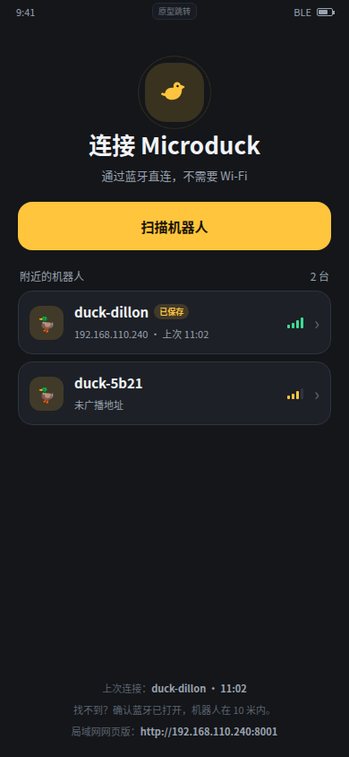 | 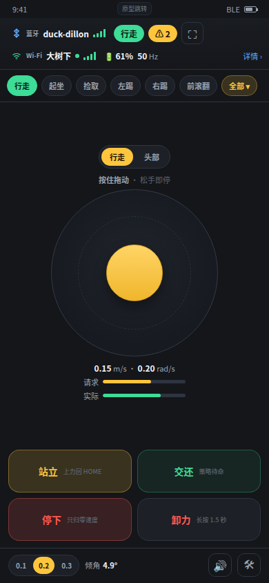 | 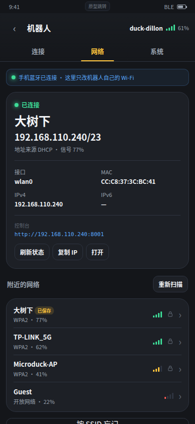 | 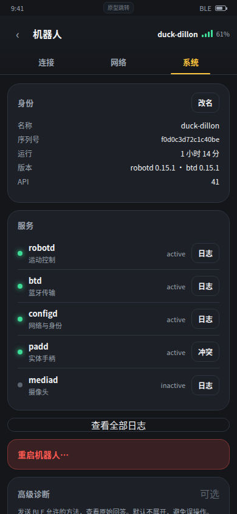 |

| PIN 输入 | 控制源冲突 | Wi-Fi 连接 | 日志 |
| --- | --- | --- | --- |
| 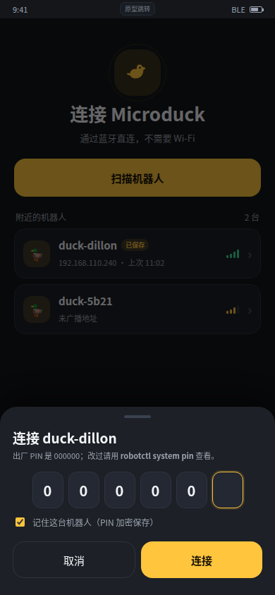 | 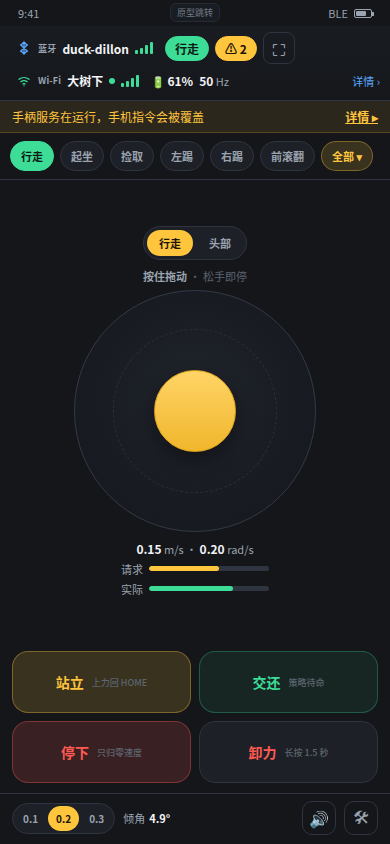 | 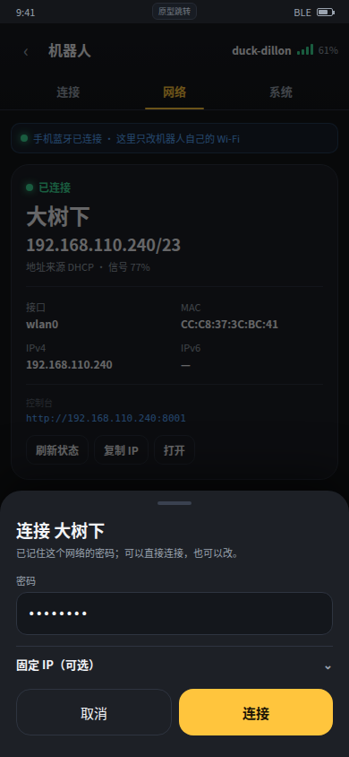 | 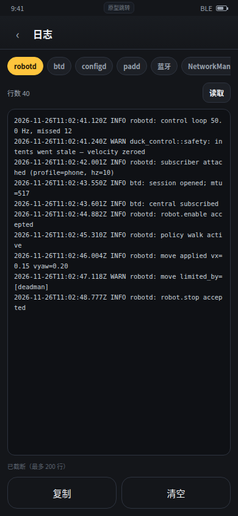 |

| 蓝牙已连 · 机器人未联网 | 网络未联网 | 状态详情（链路） | 声音面板 |
| --- | --- | --- | --- |
| 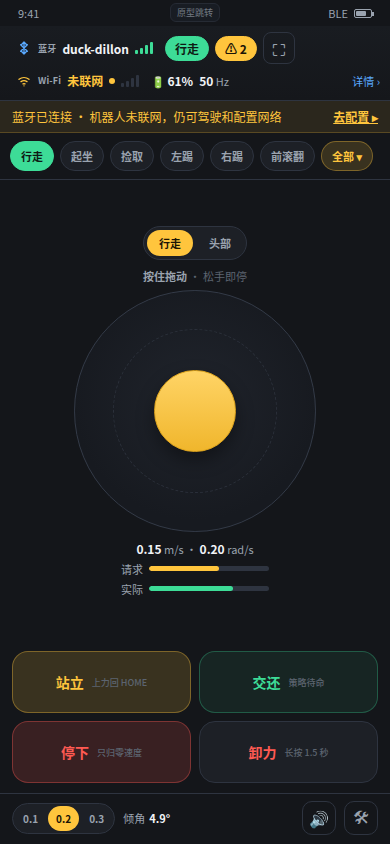 | 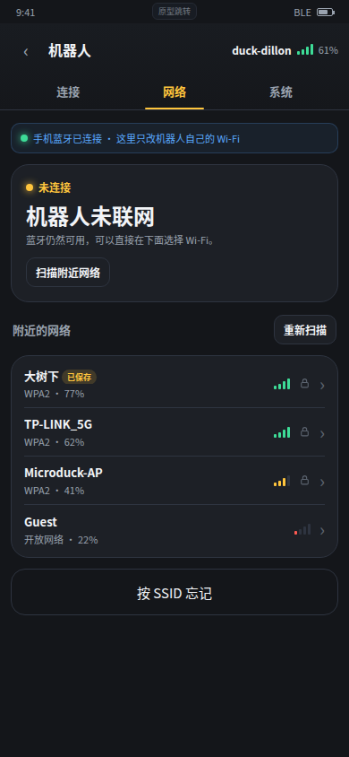 | 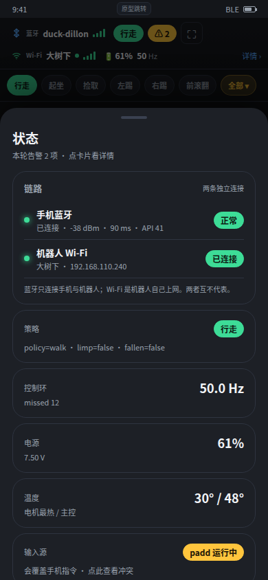 | 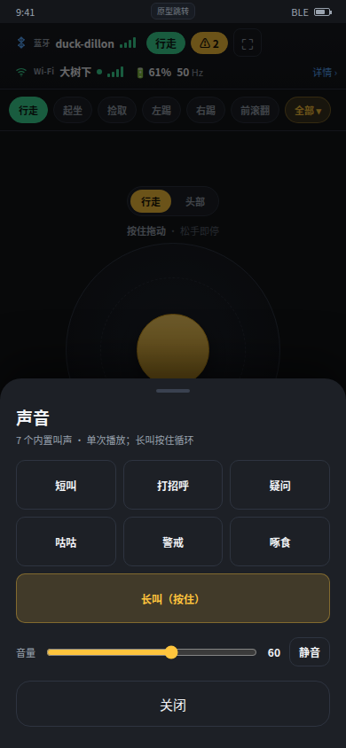 |

| 维护面板 | 离线 | 机器人连接 | 连接页 |
| --- | --- | --- | --- |
| 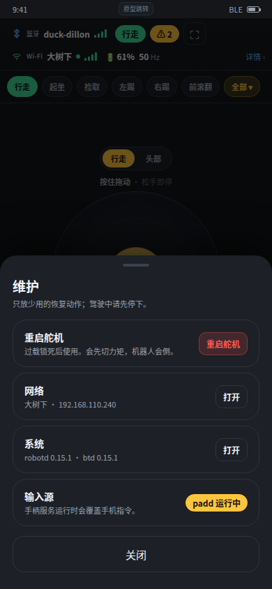 | 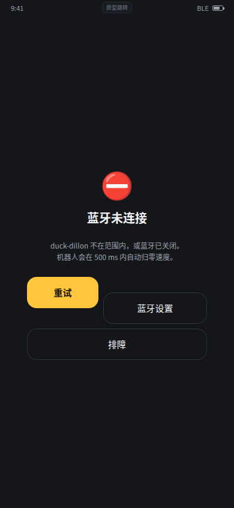 | 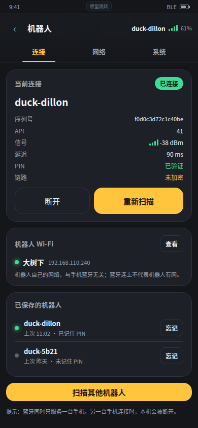 |  |

---

## 5. 屏幕规格

### 5.1 连接页 · 扫描（S01）

```text
┌──────────────────────────────────────────────┐
│                                              │
│                   🦆                         │
│              连接 Microduck                  │
│        通过蓝牙直连，不需要 Wi-Fi             │
│                                              │
│         ┌────────────────────────┐           │
│         │      扫描机器人        │           │
│         └────────────────────────┘           │
│                                              │
│  附近的机器人                    2 台         │
│  ┌────────────────────────────────────────┐  │
│  │ 🦆 duck-dillon          ▂▄▆  -38 dBm › │  │
│  │    192.168.110.240 · 已保存            │  │
│  └────────────────────────────────────────┘  │
│  ┌────────────────────────────────────────┐  │
│  │ 🦆 duck-5b21            ▂▄   -71 dBm › │  │
│  │    未广播地址                          │  │
│  └────────────────────────────────────────┘  │
│                                              │
│  上次连接：duck-dillon · 11:02               │
│                                              │
│  找不到？确认蓝牙已打开，机器人在 10 m 内。  │
│  局域网网页版：http://192.168.110.240:8001   │
└──────────────────────────────────────────────┘
```

- 背景：`--bg` + 中心极淡的鸭黄雷达环（2 s 呼吸，可关闭动效）。
- 扫描中：按钮变成「停止扫描」，列表位置显示 3 行骨架屏 + 环形进度。
- 列表行：72 dp 高；左图标 36 dp；主行 16/600；副行 12 `--muted`；右侧信号 + 箭头。
- 已保存：名称后一个小 `已保存` chip（`--duck-soft`）。
- 空状态：`没有找到机器人` + `重新扫描` + `打开蓝牙设置`。
- 底部网页版入口：只在广播里拿到 IPv4 时显示；点击复制，长按打开浏览器。

**状态**

| 状态 | 展示 |
| --- | --- |
| 蓝牙未打开 | 居中卡片：`蓝牙未打开` + `去打开`（系统设置） |
| 无权限 | `需要蓝牙权限才能扫描` + `去授权` |
| 扫描中 | 骨架 + 雷达 |
| 无结果 | 空状态 + 提示 |
| 扫描失败 | 错误卡片 + `重试` + `排障` |

### 5.2 连接页 · PIN（S02）

```text
┌──────────────────────────────────────────────┐
│  连接 duck-dillon                            │
│                                              │
│  PIN                                         │
│  ┌────┐┌────┐┌────┐┌────┐┌────┐┌────┐        │
│  │ 0  ││ 0  ││ 0  ││ 0  ││ 0  ││ 0  │        │
│  └────┘└────┘└────┘└────┘└────┘└────┘        │
│                                              │
│  出厂 PIN 是 000000；改过请用 robotctl        │
│  system pin 查看。                            │
│                                              │
│  [✓] 记住这台机器人（PIN 加密保存）           │
│                                              │
│  ┌──────────────┐  ┌──────────────────────┐  │
│  │     取消     │  │        连接          │  │
│  └──────────────┘  └──────────────────────┘  │
└──────────────────────────────────────────────┘
```

- 底部弹层，圆角 24，最大高度 70%。
- 6 格输入：每格 44×52，`Data` 字号；调用系统数字键盘；支持粘贴。
- 默认值：最后一次成功的 PIN；没有则空，不预填 `000000`，但提示出厂值。
- 错误：格子变红 + 抖动 200 ms + `PIN 错误，还可重试 2 次`。
- 用尽：关闭 sheet，回扫描页，提示 `尝试过多，请稍后再试`。
- 「记住」默认开；关闭则不落盘。

### 5.3 连接页 · 进度（S03）

```text
┌──────────────────────────────────────────────┐
│                  连接中…                     │
│                                              │
│   ✓  找到 duck-dillon                        │
│   ✓  蓝牙链路已建立                          │
│   ✓  发现 Microduck 服务                     │
│   ●  正在验证 PIN                            │
│   ○  订阅机器人状态                          │
│                                              │
│              [ 取消 ]                        │
└──────────────────────────────────────────────┘
```

- 5 步固定：扫描 → 连接 → 发现服务 → 认证 → 订阅。
- 每步 32 dp；当前步转圈；完成打勾；失败标红并给出原因。
- 超过 20 s：显示 `连接较慢，可能被另一台手机占用` + `继续等待` / `取消`。

### 5.4 驾驶页 · 顶栏（S05）

```text
┌────────────────────────────────────────────────┐
│ 🔵 蓝牙 duck-dillon ▂▄▆  [行走]  [⚠2]    [⛶]  │
│ 📶 Wi-Fi 大树下 ▂▄▆  🔋61%  50Hz  电机30° 主控48°│
└────────────────────────────────────────────────┘
```

- **蓝牙 chip**（第一行左）：蓝牙图标 + `蓝牙` + 机器人名（最多 10 字）+ BLE 4 格。这是**手机 ↔ 机器人**的链路。点击 → 机器人中心·连接。
  - 已连接：绿色信号条；连接中/重连中：黄色 + 转圈；未连接：灰色。
- **Wi-Fi chip**（第二行左）：Wi-Fi 图标 + `Wi-Fi` + SSID（最多 8 字）+ 信号。这是**机器人 ↔ 路由器**的链路，**不是手机的 Wi-Fi**。点击 → 机器人中心·网络。
  - 已连接：绿色；未联网：`Wi-Fi 未联网` + 黄色点；Wi-Fi 不可用：`Wi-Fi 不可用` + 红色。
- **两个 chip 绝不合并**：蓝牙绿 + Wi-Fi 黄 = 「能驾驶，但机器人没网」，这是最常见也最容易被误解的组合。
- **状态区**：策略药丸、告警数、电量、Hz、电机温度、主控温度；点击 → 状态详情。
- **全屏**：最右，32×32。
- 两行总高 68–72 dp；≤400 宽时隐藏电机/主控两项，数值仍可在状态详情看到。
- 原版顶栏的「连接点 + 策略 + 电量…」全部保留，只是把「连接」拆成**蓝牙**与**机器人 Wi-Fi** 两个 chip。

### 5.5 驾驶页 · 主体（S05）

布局与 duckphone 一致：

```text
┌──────────────────────────────────────────────┐
│ 顶栏                                          │
├──────────────────────────────────────────────┤
│ 警示条（最多一条，可点详情）                   │
├──────────────────────────────────────────────┤
│ 策略条：行走 起坐 捡取 左踢 右踢 前滚翻  ▾    │
├──────────────────────────────────────────────┤
│                                              │
│                 ┌──────────┐                 │
│                 │   摇杆   │                 │
│                 │    ●     │                 │
│                 └──────────┘                 │
│   请求 0.15 m/s · 0.20 rad/s                 │
│   实际 ▓▓▓▓▓░░░░░  ▓▓▓▓░░░░░░                │
│                                              │
│   ┌────────────┐  ┌────────────┐             │
│   │   站立     │  │  接管/交还 │             │
│   └────────────┘  └────────────┘             │
│   ┌────────────┐  ┌────────────┐             │
│   │   停下     │  │ 卸力(长按) │             │
│   └────────────┘  └────────────┘             │
├──────────────────────────────────────────────┤
│ 0.1 0.2 0.3  倾角 4.9°   🔊   🛠            │
└──────────────────────────────────────────────┘
```

新增/变化：

| 区域 | 变化 |
| --- | --- |
| 顶栏 | 增加蓝牙 chip、Wi-Fi chip（两条链路分开） |
| 警示条 | 增加「蓝牙重连中」「控制源冲突」两种 |
| 策略条 | 不变 |
| 摇杆 | 不变 |
| 动作区 | 不变 |
| 底栏 | 维护入口增加「网络与系统」快捷项 |
| 离线/只读 | 文案改为蓝牙语义 |

### 5.6 机器人中心 · 连接（S11）

```text
┌──────────────────────────────────────────────┐
│ ‹   机器人          duck-dillon  ▂▄▆  61%    │
│ ┌──────────┬──────────┬──────────┐           │
│ │  连接    │   网络   │   系统   │           │
│ └──────────┴──────────┴──────────┘           │
│                                              │
│ 当前连接                                     │
│ ┌──────────────────────────────────────────┐ │
│ │ 🦆 duck-dillon                 已连接    │ │
│ │ 序列号 f0d0c3d7… · API 41               │ │
│ │ 信号 ▂▄▆ -38 dBm · 延迟 90 ms            │ │
│ │ PIN 已验证 · 链路未加密                  │ │
│ │ [ 断开 ]                 [ 重新扫描 ]    │ │
│ └──────────────────────────────────────────┘ │
│                                              │
│ 机器人 Wi-Fi                                 │
│ ┌──────────────────────────────────────────┐ │
│ │ ● 大树下 · 192.168.110.240       [查看]  │ │
│ │ 机器人自己的网络，与手机蓝牙无关          │ │
│ └──────────────────────────────────────────┘ │
│                                              │
│ 已保存的机器人                               │
│ ┌──────────────────────────────────────────┐ │
│ │ duck-dillon   上次 11:02          [忘记] │ │
│ │ duck-5b21     上次 昨天           [忘记] │ │
│ └──────────────────────────────────────────┘ │
│                                              │
│ [ 扫描其他机器人 ]                           │
└──────────────────────────────────────────────┘
```

- 顶栏：返回、标题、当前机器人名 + 信号 + 电量。
- Segmented tabs：44 dp 高，选中 `--duck` 文字 + 下划线。
- 当前连接卡片：名称 20/700；状态 chip；序列号 mono；API 版本；信号；延迟；PIN/加密状态。
- **机器人 Wi-Fi 卡片**：SSID、IP、状态点、「查看」跳网络页；未联网时显示 `未联网 · 点此配置`。
- **两者分开**：蓝牙卡片回答「手机连上机器人了吗」，Wi-Fi 卡片回答「机器人自己上网了吗」；蓝牙连上不代表机器人有网。
- 「链路未加密」用 `--warn` 小字 + 说明 icon；点击展开解释与建议。
- 已保存列表：名称、上次时间、忘记；忘记需确认。
- 底部主按钮：扫描其他机器人 → 回连接页并自动扫描。

### 5.7 机器人中心 · 网络（S12）

```text
┌──────────────────────────────────────────────┐
│ ‹   机器人          duck-dillon  ▂▄▆  61%    │
│ ┌──────────┬──────────┬──────────┐           │
│ │  连接    │   网络   │   系统   │           │
│ └──────────┴──────────┴──────────┘           │
│ 手机蓝牙已连接 · 这里只改机器人自己的 Wi-Fi  │
│                                              │
│ ┌──────────────────────────────────────────┐ │
│ │ ● 已连接                                 │ │
│ │ 大树下                                   │ │
│ │ 192.168.110.240/23                       │ │
│ │ 地址来源 DHCP · 信号 77%                 │ │
│ │ 接口 wlan0 · MAC CC:C8:37:…              │ │
│ │ IPv6 —                                   │ │
│ │ 控制台 http://192.168.110.240:8001       │ │
│ │ [ 刷新状态 ] [ 复制 IP ] [ 打开 ]         │ │
│ └──────────────────────────────────────────┘ │
│                                              │
│ 附近的网络                    [ 重新扫描 ]   │
│ ┌──────────────────────────────────────────┐ │
│ │ 大树下              ▂▄▆  🔒  已保存    › │ │
│ │ TP-LINK_5G          ▂▄▆  🔒            › │ │
│ │ Microduck-AP        ▂▄   🔒            › │ │
│ │ Guest               ▂    ○             › │ │
│ └──────────────────────────────────────────┘ │
│                                              │
│ 已保存但不在附近？ [ 按 SSID 忘记 ]          │
└──────────────────────────────────────────────┘
```

**当前网络卡片**

- **两条链路提示**：顶部蓝色条固定写「手机蓝牙已连接 · 这里只改机器人自己的 Wi-Fi」。
- **未联网状态**：hero 换成「机器人未联网」，说明蓝牙仍可用；列表仍可扫描/连接。
- **不影响手机蓝牙**：这里所有操作只改机器人自己的 Wi-Fi，不会断开或修改手机与机器人的蓝牙链路。
- 状态 chip：已连接（绿）/ 正在连接（黄，转圈）/ 未连接（灰）/ Wi-Fi 不可用（红）。
- SSID 24/700；IP 18 mono；地址来源 12 muted。
- 信息网格：信号、接口、MAC、IPv4、IPv6、地址来源。
- 控制台地址：mono；复制成功 toast；「打开」调用系统浏览器（可选）。
- 高级：`原始 JSON` 折叠，展示完整 `net.status`，用于排障（P1）。
- 未连接时：省略 IP/MAC 等，显示 `机器人当前没有加入 Wi-Fi。蓝牙仍然可用，可以直接配置网络。`

**Wi-Fi 列表**

- 行高 64；左 SSID 16/600；右侧信号 + 锁 + 已保存 chip + 箭头。
- 排序：信号从强到弱；已保存优先同级内。
- 不支持：WEP/企业网行右侧显示 `不支持`（`--danger` 小字），点击给出原因，不发请求。
- 扫描中：骨架 + `扫描通常需要几秒`。
- 空：`没有扫描到网络` + `重试` + `靠近路由器`。

### 5.8 连接 Wi-Fi（S14）

```text
┌──────────────────────────────────────────────┐
│  连接 大树下                                 │
│                                              │
│  密码                                        │
│  ┌────────────────────────────────┐  [显示]  │
│  │ ••••••••••                     │          │
│  └────────────────────────────────┘          │
│  已记住这个网络的密码                        │
│                                              │
│  ⌄ 固定 IP（可选）                           │
│    地址  [192.168.110.240]                   │
│    掩码  [255.255.255.0]                     │
│    网关  [192.168.110.1]                     │
│    DNS   [192.168.110.1]                     │
│    [ ] 连接时使用固定地址                    │
│                                              │
│  ┌──────────────┐  ┌──────────────────────┐  │
│  │     取消     │  │        连接          │  │
│  └──────────────┘  └──────────────────────┘  │
└──────────────────────────────────────────────┘
```

- 底部弹层，圆角 24。
- 密码：48 dp 高；`显示/隐藏`；已保存时预填（显示为圆点）并提示。
- **安全提示**：链路未加密时，Wi-Fi 密码会明文经过空中；首次配置建议开启 BLE 配对，或在可信环境完成。
- 开放网络：隐藏密码框，显示 `开放网络，不需要密码`。
- 固定 IP 折叠：默认收起；展开后 4 个输入，mono；校验实时提示。
- 校验：
  - 地址/网关/DNS 必须是合法 IPv4；
  - 掩码支持 `255.255.255.0` 或 `24`；
  - 网关/DNS 可空；
  - 错误在字段下方 12 px 红字。
- 连接中：按钮转圈，禁止重复提交；关闭 sheet 时提示 `连接仍在进行，要取消吗？`。
- 结果：
  - 成功：关闭 sheet，刷新状态，toast `已连接 大树下`，IP 出现后提示「可打开控制台」。
  - 失败：sheet 内红条 + 原因 + 建议；
    - `bad_key`：`密码被拒绝，请重新输入`；
    - `not_found`：`附近没有这个网络`；
    - `timeout`：`连接超时，可以重试`；
    - `unsupported`：`这个网络类型暂不支持`。

### 5.9 忘记网络（S15）

```text
┌──────────────────────────────────────────────┐
│  忘记 大树下？                               │
│                                              │
│  机器人会删除这个 Wi-Fi 的配置。              │
│  本机记住的密码和固定 IP 也会一起删除。       │
│                                              │
│  ┌──────────────┐  ┌──────────────────────┐  │
│  │     取消     │  │     忘记（红）       │  │
│  └──────────────┘  └──────────────────────┘  │
└──────────────────────────────────────────────┘
```

- 列表内忘记：左滑或长按行 → 确认 sheet。
- 按 SSID 忘记：输入框 + 忘记按钮；用于已保存但不在视野里的网络。
- 成功后刷新列表与状态。

### 5.10 机器人中心 · 系统（S16）

```text
┌──────────────────────────────────────────────┐
│ ‹   机器人          duck-dillon  ▂▄▆  61%    │
│ ┌──────────┬──────────┬──────────┐           │
│ │  连接    │   网络   │   系统   │           │
│ └──────────┴──────────┴──────────┘           │
│                                              │
│ 身份                                         │
│ ┌──────────────────────────────────────────┐ │
│ │ 名称   duck-dillon              [改名]   │ │
│ │ 序列号 f0d0c3d72c1c40be                  │ │
│ │ 运行   1 小时 14 分                       │ │
│ │ robotd 0.15.1 · btd 0.15.1 · API 41      │ │
│ └──────────────────────────────────────────┘ │
│                                              │
│ 服务                                         │
│ ┌──────────────────────────────────────────┐ │
│ │ robotd     ● active              [日志]  │ │
│ │ btd        ● active              [日志]  │ │
│ │ configd    ● active              [日志]  │ │
│ │ padd       ● active              [日志]  │ │
│ │ mediad     ○ inactive            [日志]  │ │
│ └──────────────────────────────────────────┘ │
│                                              │
│ [ 查看全部日志 ]                             │
│ ┌──────────────────────────────────────────┐ │
│ │ 重启机器人…                    （红）     │ │
│ └──────────────────────────────────────────┘ │
│ ⌄ 高级诊断                                   │
└──────────────────────────────────────────────┘
```

- 身份卡片：名称 + 改名；序列号 mono；运行时长；版本行。
- 服务：unit 名称 + 状态药丸（active 绿 / inactive 灰 / failed 红 / activating 黄）+ 日志快捷。
- 重启：红色行；点击弹确认。
- 高级诊断：默认折叠；展开后见 5.13。

### 5.11 改名（S17）

```text
┌──────────────────────────────────────────────┐
│  改名                                        │
│  ┌────────────────────────────────────────┐  │
│  │ duck-dillon                            │  │
│  └────────────────────────────────────────┘  │
│  1–32 个字符；广播名称会立即更新。            │
│  [ 取消 ]                    [ 保存 ]        │
└──────────────────────────────────────────────┘
```

- 预填当前名称；实时计数；空/超长禁用保存。
- 成功后更新顶栏、连接卡片、保存列表；toast `已改名为 xxx`。

### 5.12 日志（S18）

```text
┌──────────────────────────────────────────────┐
│ ‹   日志                                     │
│  [robotd] [btd] [configd] [padd] [蓝牙] …    │
│  行数  [40 ▾]              [读取]            │
│ ┌──────────────────────────────────────────┐ │
│ │ 2026-11-26T11:02:… WARN …                │ │
│ │ 2026-11-26T11:02:… INFO …                │ │
│ │ …                                        │ │
│ └──────────────────────────────────────────┘ │
│  已截断（最多 200 行）                       │
│  [ 复制 ]  [ 清空 ]                          │
└──────────────────────────────────────────────┘
```

- unit 横向滚动 chips；默认 robotd。
- 行数 40/80/200。
- 日志区：mono 12/18，深底，等高 240–320；可滚动；自动换行（`word-break: break-all`），避免横向拖动。
- 截断：显示 `已截断`。
- 复制：脱敏后复制全文；清空只清本机视图。
- 自动滚动开关（默认开）：读取后滚到底部；用户上滑时暂停，回到底部恢复。
- 读取中：骨架 + `读取中…`；失败：错误条 + `重试`。

### 5.13 高级诊断（S20）

```text
┌──────────────────────────────────────────────┐
│ 高级诊断                                     │
│ 只能发 BLE 允许的方法；写操作请确认参数。     │
│ 方法  [net.status ▾]                         │
│ 参数  { }                                    │
│ [ 发送 ]                                     │
│ 回答                                         │
│ ┌──────────────────────────────────────────┐ │
│ │ { ... }                                  │ │
│ └──────────────────────────────────────────┘ │
│ [ 复制回答 ]                                 │
└──────────────────────────────────────────────┘
```

- 默认折叠在系统页底部；展开需再点一次「我了解风险」。
- 方法下拉：只列 BLE 允许的方法。
- 参数：JSON 编辑器（mono），实时校验。
- 超时提示：慢方法 60 s。
- 回答：格式化 JSON，长按复制；错误显示 code + message。

### 5.14 重启确认（S19）

```text
┌──────────────────────────────────────────────┐
│  重启机器人？                                │
│                                              │
│  会断开蓝牙连接，并让关节卸力。               │
│  请先让机器人坐下，或扶住它。                 │
│                                              │
│  ┌──────────────┐  ┌──────────────────────┐  │
│  │     取消     │  │     重启（红）       │  │
│  └──────────────┘  └──────────────────────┘  │
└──────────────────────────────────────────────┘
```

- 红色主按钮；默认焦点在取消。
- 成功后显示 `将在 3 秒后重启`，断开连接，回连接页。

### 5.15 离线 / 重连（S21）

```text
驾驶页顶部：
┌──────────────────────────────────────────────┐
│ ↻ 蓝牙断开，正在重连（3/8）…        [详情]   │
└──────────────────────────────────────────────┘

重连失败覆盖层：
┌──────────────────────────────────────────────┐
│                   ⛔                         │
│              蓝牙未连接                      │
│   duck-dillon 不在范围内，或蓝牙已关闭。      │
│                                              │
│   [ 重试 ]   [ 打开蓝牙设置 ]   [ 排障 ]     │
└──────────────────────────────────────────────┘
```

- 断链瞬间：摇杆归零、按钮禁用、顶部黄条；不弹全屏，避免打断。
- 连续失败 8 次：显示全屏离线层。
- 重连成功：黄条变绿 2 s 后消失；状态流恢复；**不重放动作**。
- 后台回来：先显示 `正在恢复连接…`，成功后恢复。

### 5.16 只读（标定模式，S22）

```text
┌──────────────────────────────────────────────┐
│                   ⚠                          │
│           机器人处于标定模式                 │
│  robotd 现在带 --commissioning 启动，        │
│  所有运动指令都会被拒绝。                    │
│  电量、温度、总线仍可查看。                   │
│                                              │
│  [ 重新检测 ]          [ 看状态 ]            │
└──────────────────────────────────────────────┘
```

- 进入条件：`robot.subscribe` 被拒且 `robot.health` 正常，或 `robot.policies.mode=commissioning`。
- 运动按钮禁用；摇杆灰；策略条灰；声音/音量可用（取决于 robotd）。
- 与离线页区分：连接是好的，只是不能动。

### 5.17 控制源冲突（S23）

```text
驾驶页警示条：
┌──────────────────────────────────────────────┐
│ ⚠ 手柄服务在运行，手机指令会被覆盖   [详情]  │
└──────────────────────────────────────────────┘
或
┌──────────────────────────────────────────────┐
│ ⚠ 网页中控也在运行，同时驾驶会互相覆盖 [详情]│
└──────────────────────────────────────────────┘
```

详情 sheet：

```text
┌──────────────────────────────────────────────┐
│  控制源冲突                                  │
│                                              │
│  这个机器人现在同时有：                       │
│  • 手机蓝牙（本机）                           │
│  • 实体手柄 padd                              │
│  • 局域网网页中控                             │
│                                              │
│  两边都会发 robot.move，后到的覆盖先到的。    │
│  请只保留一个驾驶源。                         │
│                                              │
│  [ 停用手柄服务 ]  [ 停用网页中控 ]  [ 知道了 ]│
└──────────────────────────────────────────────┘
```

- padd 检测：`system.services` / `pad.status`。
- 网页中控检测：`system.services` 增加 `duckphone` 只读项（固件补白名单）。
- 停用按钮需二次确认；停用不删除服务，可手动恢复。
- 网页版本身不做任何修改；App 只调用机器人侧的服务状态/控制接口。

### 5.18 状态详情（S06）

沿用原版 6 张卡：

| 卡片 | BLE 版差异 |
| --- | --- |
| **链路** | **两条独立行**：手机蓝牙（已连接 / -38 dBm / 90 ms / API）与机器人 Wi-Fi（大树下 / IP / 状态）；两者不合并 |
| 策略 | 不变 |
| 控制环 | 不变 |
| 电源 | 不变 |
| 温度 | 不变 |
| 输入源 | 增加「本机蓝牙」「padd」「网页中控」三种来源与冲突状态 |

> 状态详情里的「链路」卡是用户第一次能同时看到两条链路的地方；文案固定为「手机蓝牙」和「机器人 Wi-Fi」，不写「已连接」这种含糊说法。

### 5.19 声音（S07）与维护（S08）

- 声音：布局不变；7 个按钮 + 音量滑杆 + 静音；wheee 按住。
- 维护：布局不变；新增两行入口：
  - `网络`：`SSID / 未联网` → 机器人中心·网络；
  - `系统`：`robotd 0.15.1` → 机器人中心·系统。
- 排障文案改为蓝牙语义：
  - `连不上？确认蓝牙已打开、机器人在 10 m 内、没有被另一台手机占用。`

---

## 6. 组件规格

| 组件 | 规格 |
| --- | --- |
| 顶栏 chip | 44 dp 高，圆角 12，左图标 18，文字 13/600，右信号 4 格 |
| 状态药丸 | 24 dp 高，圆角 999，12/700 |
| 卡片 | `--panel`，1 px `--line`，圆角 20，padding 16 |
| 列表行 | 64–72 dp 高，左右 16 padding，底部 1 px `--line` |
| 主按钮 | 56 dp 高，圆角 16，`--duck` 底 + 深色字 |
| 次按钮 | 52 dp 高，透明底 + `--line` 描边 |
| 危险按钮 | 56 dp 高，`--danger-soft` 底 + `--danger` 字/边 |
| 底部弹层 | 顶部圆角 24，拖拽条 36×4，最大高 80%，背景 `--panel` |
| Segmented | 44 dp 高，3 等分，选中 `--duck` 文字 + 2 px 下划线 |
| PIN 格 | 44×52，圆角 12，`--panel-hi`，聚焦 `--duck` 边 |
| 密码框 | 48 dp，mono 16，右侧「显示/隐藏」 |
| IP 输入 | 48 dp，mono 16，placeholder `0.0.0.0` |
| 信号条 | 4 条，3 px 宽，间距 2，底 `--line`，亮色按强度 |
| 进度步骤 | 32 dp 行高，24 dp 圆点，连接线 2 px |
| 警示条 | 40–48 dp，左图标 16，右「详情 ▸」 |
| Toast | 顶部，圆角 12，2.6 s，success/warn/error |
| 日志 | mono 12/18，`--bg` 底，圆角 12，内边距 12 |
| 空状态 | 图标 48，标题 16/600，说明 13 muted，按钮 44 |

---

## 7. 关键流程

### 7.1 首次使用

```text
安装 → 打开
  → 蓝牙权限
  → 扫描
  → 选择机器人
  → 输入 PIN（默认 000000 提示）
  → 连接（5 步进度）
  → 网络未连接？
      是 → 自动打开 机器人中心·网络
           → 扫描 Wi-Fi → 输入密码 → 连接
           → 成功后回驾驶
      否 → 驾驶
  → 站立 → 接管 → 驾驶
```

### 7.2 日常使用

```text
打开 → 自动连上次机器人（≤5 s）
  → 驾驶页
  → 若策略未启用：点「站立」→ 等 HOME → 点「接管」
```

### 7.3 网络坏了

```text
打开 → BLE 直接连上（不依赖 Wi-Fi）
  → 顶栏「未联网」黄点
  → 点 Wi-Fi chip
  → 扫描 → 选网络 → 密码 → 连接
  → 成功后显示新 IP 与控制台地址
```

### 7.4 切换机器人

```text
顶栏蓝牙 chip → 连接 tab → 扫描其他机器人
  → 选新机器人 → PIN → 连接
  → 旧连接自动断开
```

### 7.5 断链

```text
断链 → 摇杆归零（250 ms 内无输入也会由 robotd deadman 归零）
  → 顶部黄条「正在重连」
  → 成功：恢复订阅，黄条消失
  → 8 次失败：离线层 + 重试 / 打开蓝牙设置 / 排障
```

### 7.6 控制源冲突

```text
驾驶页检测到 padd / 网页中控
  → 黄条提示
  → 详情：解释 + 停用入口
  → 停用需二次确认
  → 停用后黄条消失，继续驾驶
```

---

## 8. 状态矩阵

### 8.1 蓝牙

| 状态 | 顶栏 | 驾驶页 | 可用动作 |
| --- | --- | --- | --- |
| 未连接 | 灰点 | 连接页 | 扫描 |
| 扫描中 | — | 骨架 | 停止扫描 |
| 连接中 / 认证中 | 黄点 + 转圈 | 进度 | 取消 |
| 已连接 | 绿点 | 正常 | 全部 |
| 重连中 | 黄点 + 转圈 | 黄条，按钮禁用 | 详情、离线 |
| 离线 | 灰点 | 离线层 | 重试、设置、排障 |
| 另一台手机占用 | 灰点 | 连接页提示 | 重试、断开对方提示 |

### 8.2 机器人

| 状态 | 策略药丸 | 摇杆 | 头部 | 站立/接管 |
| --- | --- | --- | --- | --- |
| 标定模式 | 只读 | 禁用 | 禁用 | 禁用 |
| 未上力 / 未 HOME | 待命 | 禁用 | 禁用 | 站立可用 |
| 已 HOME、策略未启用 | 待命 | 禁用 | 禁用 | 接管可用 |
| walk | 行走 | 可用 | 可用 | 交还可用 |
| limp | 卸力 | 禁用 | 禁用 | 站立可用 |
| fallen | 倒地 | 禁用 | 禁用 | 站立可用（提示） |

### 8.3 网络

| 状态 | Wi-Fi chip | 网络页 |
| --- | --- | --- |
| connected | 绿 + SSID | IP/信号/MAC/控制台 |
| connecting | 黄 + 转圈 | 轮询状态 |
| disconnected | 黄 + 未联网 | 扫描入口 |
| unavailable | 红 + Wi-Fi 不可用 | 解释 NetworkManager/迁移 |
| 失败 | 黄 + 未联网 | 原因 + 重试 |

### 8.4 两条链路的组合（最容易混淆）

| 手机蓝牙 | 机器人 Wi-Fi | 含义 | UI |
| --- | --- | --- | --- |
| 已连接 | 已连接 | 能驾驶，也能通过网页版/SSH 访问 | 两个绿；无黄条 |
| 已连接 | 未联网 | **能驾驶，能配网；网页版/SSH 不可达** | 蓝牙绿 + Wi-Fi 黄 + 黄条「仍可驾驶和配置网络」 |
| 已连接 | Wi-Fi 不可用 | 能驾驶；板子的网卡/NetworkManager 有问题 | 蓝牙绿 + Wi-Fi 红 + 网络页解释 |
| 重连中 | 任意 | 暂时不能驾驶；Wi-Fi 状态不可信 | 黄条 + 动作按钮禁用 |
| 未连接 | 任意 | 不能驾驶/配网；走离线页 | 离线层 |

> **永远不用 Wi-Fi 状态去推断蓝牙状态，反之亦然。** 顶栏两个 chip、状态页「链路」卡、网络页顶部蓝条是三处固定的区分点。

---

## 9. 文案规范

| 场景 | 文案 |
| --- | --- |
| 扫描不到 | `没有找到机器人。确认蓝牙已打开，机器人在 10 米内。` |
| PIN 错 | `PIN 错误，还可重试 2 次` |
| PIN 用尽 | `尝试过多，请稍后再试` |
| 默认 PIN | `出厂 PIN 是 000000；建议先改成自己的 PIN。` |
| 版本低 | `机器人固件需要升级（API 40 < 41）` |
| 另一台手机 | `另一台手机已连接这台机器人，请先断开它。` |
| 未联网 | `机器人当前没有加入 Wi-Fi。蓝牙仍然可用。` |
| 蓝牙已连 + 机器人未联网 | `蓝牙已连接 · 机器人未联网，仍可驾驶和配置网络` |
| 机器人 Wi-Fi 断开 | `机器人当前没有加入 Wi-Fi；蓝牙不受影响。` |
| 两条链路说明 | `蓝牙只连接手机与机器人；Wi-Fi 是机器人自己上网。` |
| Wi-Fi 密码错 | `密码被拒绝，请重新输入。` |
| 找不到 SSID | `附近没有这个网络，靠近一点或检查名称。` |
| DHCP 超时 | `连接超时（没有拿到地址），可以重试。` |
| 不支持 | `这个网络类型暂不支持（WEP / 企业网）。` |
| 固定 IP 无效 | `请输入合法的 IPv4 地址。` |
| 重启 | `会断开蓝牙连接，并让关节卸力。请先让机器人坐下或扶住它。` |
| 卸力 | `长按 1.5 秒卸力；机器人会瘫倒。` |
| 控制源冲突 | `手柄服务在运行，手机指令会被覆盖。` |
| 网页中控冲突 | `网页中控也在运行，同时驾驶会互相覆盖。` |
| 标定模式 | `机器人处于标定模式，运动指令会被拒绝。` |
| 重连中 | `蓝牙断开，正在重连（3/8）…` |

---

## 10. 可访问性与安全

- 触控：所有可点区域 ≥ 44×44 dp；驾驶动作 ≥ 56 dp；停下最重。
- 对比度：主文字 ≥ 7:1，muted ≥ 4.5:1；状态不只靠颜色，配文字/图标。
- 字号：系统字体放大 1.15× 不换行、不重叠；顶栏允许折行。
- 安全区：`edge-to-edge` + `viewport-fit=cover`；底部手势区不放「停下」。
- 动效：雷达/转圈 ≤ 2 s 循环；支持系统「减少动态效果」。
- 防误触：卸力长按；重启二次确认；站立提示；策略切换门禁。
- 驾驶时屏幕常亮；切后台立即零速并断开。
- 密码/PIN：默认遮罩；可切换显示；日志与诊断回答脱敏。

---

## 11. 响应式与设备

| 视口 | 规则 |
| --- | --- |
| 414×896（基准） | 设计基准 |
| 360×640 | 顶栏第二行隐藏 IP；卡片 padding 12；摇杆 `clamp(84, 短边×0.62, 248)` |
| ≥620 宽 | 内容收成 520 单列居中（评审/平板） |
| 横屏 | 锁定竖屏；不做横屏布局 |
| 华为 Mate 40 Pro | 重点测试：WebView 高度、权限、锁屏、字体放大、振动、电池优化 |

---

## 12. 与原网页版的差异清单

| 项 | 原网页版 | 蓝牙版 |
| --- | --- | --- |
| 入口 | 浏览器 | APK |
| 顶栏 | 连接点 + 状态 | 蓝牙 chip（手机↔机器人）+ Wi-Fi chip（机器人↔路由器）+ 状态 |
| 链路语义 | 只有「已连接」 | 蓝牙与机器人 Wi-Fi 分开显示；蓝牙连上不代表机器人有网 |
| 连接 | 同 Wi-Fi 自动 | 扫描 + PIN + 进度 + 重连 |
| 网络 | 无 | 完整网络页（ducknet 能力） |
| 系统 | 维护抽屉 | 机器人中心·系统（身份/服务/日志/重启/诊断） |
| 只读 | robotd 标定 | 同 |
| 离线 | 桥断 | BLE 断 |
| 驾驶/策略/声音/告警 | 有 | 完全保留 |
| 冲突 | 多浏览器抢权 | 单手机 + padd/网页中控冲突提示 |
| 代码 | `firmware/duckphone` | 独立目录，**不改原版** |

---

## 13. 实现映射

| 屏幕 | 主要接口 |
| --- | --- |
| 连接页 | BLE 扫描、GATT 读、`system.authenticate` |
| 驾驶页 | `robot.subscribe(profile=phone)`、`robot.health`、`robot.move/head/stop` |
| 策略条 | `robot.policies`、`robot.loadPolicy`、`robot.do` |
| 声音 | `robot.sound`、`robot.volume` |
| 维护 | `robot.rebootMotors`、`system.serviceAction`、`system.services` |
| 网络 | `net.status`、`net.scan`、`net.connect`、`net.forget` |
| 系统 | `system.info`、`system.setName`、`system.services`、`system.logs`、`system.reboot` |
| 冲突 | `pad.status`、`system.services`（增加 `duckphone` 只读项） |
| 诊断 | 任意 BLE 允许方法 |

---

## 14. 验收清单

### 14.1 视觉

- [ ] 414×896 一屏不滚（驾驶页）；顶栏不裁切。
- [ ] 360×640 顶栏折行正常，动作按钮不出屏。
- [ ] 颜色/字号/圆角与原版一致；新增页面不出现第二种视觉语言。
- [ ] 弹层安全区、拖动关闭、返回键逐层关闭。

### 14.2 连接

- [ ] 扫描 8 s 内出现机器人；信号/RSSI 正确。
- [ ] PIN 正确进入驾驶；错误显示剩余次数；用尽关闭会话。
- [ ] 断链自动重连；8 次失败进入离线层。
- [ ] 切换机器人后旧连接断开，新机器人状态正确。
- [ ] API 版本低时阻断并提示。

### 14.3 驾驶

- [ ] 站立 → 接管 → 摇杆 20 Hz → 松手 ≤250 ms 归零。
- [ ] 头部仅 walk 可用；松手回正。
- [ ] 停下不卸力；卸力长按生效；重启舵机二次确认。
- [ ] 策略条切换/执行/门禁正确。
- [ ] 声音 7 个 + wheee 按住 + 音量回读。

### 14.4 网络

- [ ] 状态卡片字段完整；刷新/复制/打开可用。
- [ ] 扫描列表排序、已保存、加密图标正确。
- [ ] 连接成功刷新 IP；错误密码提示 bad_key。
- [ ] 固定 IP 保存/清除/重启后仍有效。
- [ ] 忘记网络后本机密码/静态 IP 一并删除。
- [ ] Wi-Fi 不可用/旧 configd 回退提示正确。

### 14.5 系统

- [ ] 名称/序列号/版本/运行时长正确。
- [ ] 改名后广播名与顶栏更新。
- [ ] 服务状态与 `systemctl` 一致。
- [ ] 日志读取/截断/复制/清空正常。
- [ ] 重启确认后断开并回连接页。

### 14.6 共存与安全

- [ ] 网页版仍可正常打开 `:8001`，蓝牙版不影响它。
- [ ] padd 运行时出现黄条；停用后消失。
- [ ] 网页中控运行时出现冲突提示（若固件已补检测）。
- [ ] 切后台/锁屏/杀进程 ≤500 ms 零速。
- [ ] 标定模式只读，运动按钮禁用。
- [ ] PIN/密码不出现在日志、诊断、崩溃报告。

### 14.7 双链路

- [ ] 地图：顶栏「蓝牙」chip 与「Wi-Fi」chip 文案不混用；状态页「链路」卡两行独立。
- [ ] 蓝牙已连 + 机器人未联网：Wi-Fi chip 变黄、出现黄条「仍可驾驶和配置网络」，蓝牙 chip 仍绿。
- [ ] 进入网络页时顶部蓝条写明「这里只改机器人自己的 Wi-Fi」；未联网 hero 正确。
- [ ] 配置 Wi-Fi 成功后，蓝牙连接不中断；顶栏 Wi-Fi 状态变绿。
- [ ] 蓝牙断链时走离线页，不用 Wi-Fi 状态冒充蓝牙状态。
- [ ] Wi-Fi 不可用（NetworkManager/迁移问题）与「未联网」显示不同文案与颜色。

---

## 15. 可点击原型

原型文件：[prototype.html](../../duckphone-ble/design/prototype.html)

- 纯静态、假数据、**不连接机器人、不修改原网页版**。
- 桌面浏览器打开后是 414×896 手机壳；手机浏览器打开是全屏。
- 左侧/底部「原型状态直达」可切换：
  - 扫描连接、PIN、连接中；
  - 驾驶主页、重连中、控制源冲突、**蓝牙已连 · 机器人未联网**；
  - 机器人中心·连接 / 网络 / 系统 / **网络未联网态**；
  - Wi-Fi 连接、忘记网络、日志、重启确认；
  - 状态详情、声音面板、维护面板（点 13/14/15 会弹出对应底部面板）。
- 交互：点机器人 → PIN → 连接 → 驾驶；点顶栏蓝牙/Wi-Fi chip → 机器人中心；点 Wi-Fi 行 → 连接弹层。
- 深链：`#wifi-off`（蓝牙已连但机器人未联网）、`#hub-network-off`（网络未联网）、`#sheet-status`、`#sheet-sound`、`#sheet-maint`。
- 原型只用于评审视觉与流程，不代表最终实现。
