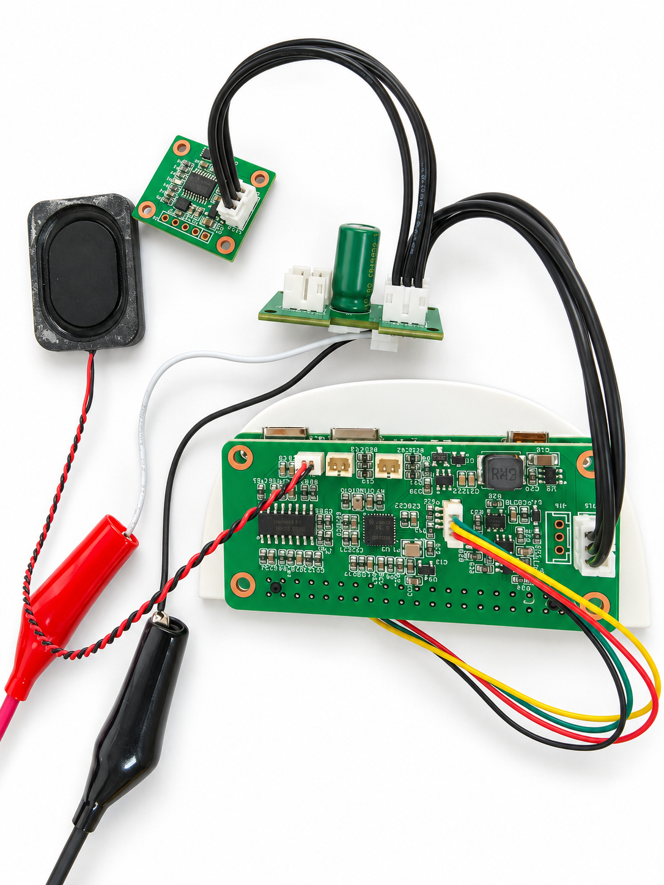
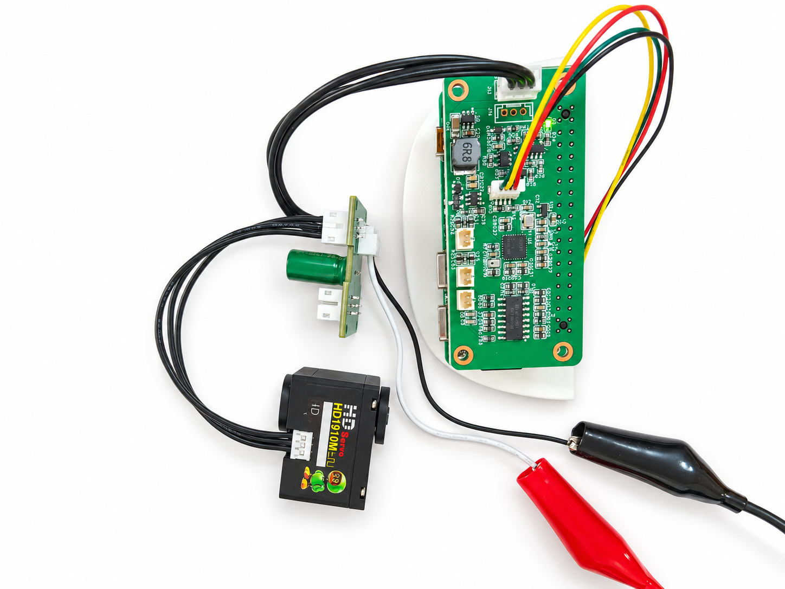

**简体中文** | [English](README.en.md)

# R3 系统镜像与 V313 中控

[下载 R3 镜像（.img.xz）](https://github.com/kissqy/Microduck-kissqy/releases/download/console-studio-v313/microduck-kissqy-zero3w-R3.img.xz) · [百度网盘](https://pan.baidu.com/s/1mGu_SiBGiYlzmvqPsVpfxw?pwd=km52)（提取码 `km52`） · [下载 V313 中控（.zip）](https://github.com/kissqy/Microduck-kissqy/releases/download/console-studio-v313/Microduck-Console-Studio-V313.zip) · [累计更新与安装图解](https://github.com/kissqy/Microduck-kissqy/releases/tag/console-studio-v313)

## 新卡装机

在 Armbian Imager 中选择 R3 压缩镜像和目标 TF 卡。刷写会覆盖整卡，确认目标并完成写入校验后，再插入 ZERO 上电。 三张新 TF 卡分别写入 R3，三张均在第一次上电时启动并开启配网热点。

R10 仅在开机时检查网络。优先连接已保存的 Wi-Fi，连不上才开启 `Microduck-kissqy` 热点（密码 `12345678`）。手机连接后打开 `http://10.42.0.1:8088`。运行中掉线不会自动开热点。

## 电脑中控与固件升级

完整解压 V313 ZIP。Windows 运行 `start.cmd`，macOS／Linux 运行 `bash start.command`，在本地中控填入 ZERO 的实际 IP 并连接。

已有 R2 卡可以保留标定和配网。用 V313 连接 ZERO，进入 **系统维护**。当前为 `control.102` 或 `control.126` 时，选择随包的 V313／`control.127`，点击 **升级所选固件**。已经是 `control.127` 的可以直接使用。 如需换用 R3 的磁盘布局，先备份标定和配置，再写入 R3 镜像。

仍在使用 V167 的用户可先按旧版迁移说明升至 control.102。 [V167 → V260](../v260/README.md)

## 测试模式：IMU / HAT / HUB 接线

先断电，按图连接 HAT、HUB、IMU 与扬声器，并核对供电极性、接口方向和实板丝印。鳄鱼夹仅为供电引线，电源主体未入镜。连接中控后进入 **IMU / HAT / HUB 测试**，依次检查 IMU 姿态、麦克风电平和扬声器鸭叫。单 IMU 测试无需舵机、编号或标定；HUB 为被动供电分线板。

[查看测试模式图解与操作](https://kissqy.github.io/Microduck-kissqy/console-v313/#hardware-tests)

## 编号模式：HAT / HUB 与单颗舵机接线

**未编号或可能重号的舵机，一次只接一颗。** 在中控进入 **舵机编号**，手动扫描、选择舵机，再保存目标关节编号。已确认编号不同的设备可以串联；全部编号完成后接回整链扫描核对，再做本机关节标定。

右腿 **10–14**，左腿 **20–24**，颈头 **30–34**；IMU 为 **200**，不作为关节舵机改号。[查看 HAT 编号四步图解](https://kissqy.github.io/Microduck-kissqy/console-v313/#numbering)

## 源码与功能

V313 中控 ZIP 内含中控 Python 与前端源码、11 个 ONNX 模型，以及原生固件源码归档 `source/Microduck-Native-Build-Source-V313.tar.gz`。 [查看四个工作模式、HAT 编号和逐设备通信](https://kissqy.github.io/Microduck-kissqy/console-v313/)
