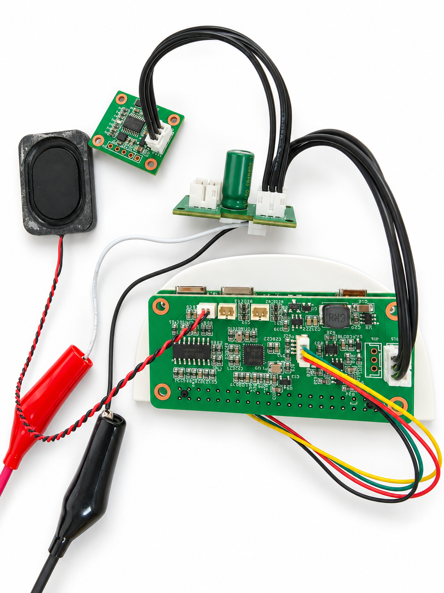
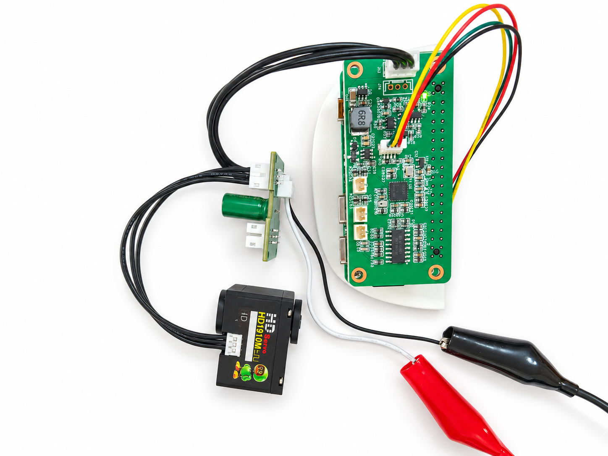

[简体中文](README.md) | **English**

# R3 system image and Console Studio V315

[R3 image (.img.xz)](https://github.com/kissqy/Microduck-kissqy/releases/download/console-studio-v313/microduck-kissqy-zero3w-R3.img.xz) · [Baidu Netdisk](https://pan.baidu.com/s/1mGu_SiBGiYlzmvqPsVpfxw?pwd=km52) (code `km52`) · [V315 console (.zip)](https://github.com/kissqy/Microduck-kissqy/releases/download/console-studio-v313/Microduck-Console-Studio-V315.zip) · [Release notes](https://github.com/kissqy/Microduck-kissqy/releases/tag/console-studio-v313)

## V315 update

- Accept the full two-byte position register instead of rejecting feedback outside a single turn.
- A position failure affects that servo only. Other servos remain available for numbering and midpoint calibration; feedback recovers automatically.
- Include the matching wiring photo when testing/numbering cannot connect to ZERO.

With control.127 already installed, replace the PC console and re-enter numbering to prepare the updated maintenance component. The R3 image remains the original image preloaded with V313; V315 updates the PC console.

## New installation

Use Armbian Imager to write the compressed R3 image to the target TF card. Flashing overwrites the card. Check the target, complete write verification, then boot the ZERO. All three freshly flashed TF cards booted and opened the setup hotspot on first power-on.

At boot, R10 tries saved Wi-Fi first. If no saved network connects, join `Microduck-kissqy` (password `12345678`) and open `http://10.42.0.1:8088`. A later disconnection does not start the hotspot automatically.

## Desktop console and firmware

Extract the whole V315 ZIP. Run `start.cmd` on Windows or `bash start.command` on macOS/Linux, then connect to your ZERO by its IP.

On an existing R2 card, connect with V315 and open **系统维护 (System Maintenance)**. If the robot runs `control.102` or `control.126`, select the bundled V315 / `control.127` firmware and click **升级所选固件 (Upgrade selected firmware)**. A robot already on `control.127` only needs the new PC console; re-enter numbering to update its maintenance component. Flashing the R3 image is required to adopt the R3 disk layout.

V167 users can follow the documented upgrade to control.102 first. [V167 → V260](../v260/README.md)

## Hardware test: IMU / HAT / HUB wiring

With power disconnected, connect the HAT, HUB, IMU and speaker as shown. Check supply polarity, connector orientation and board markings. The clips are power leads; the power source is outside the photo. In the console, open **Hardware tests** and check IMU orientation, microphone input and the speaker's duck sound. An IMU-only test needs no servos, numbering or calibration. The HUB passively distributes power and bus connections.

[Hardware-test wiring and steps](https://kissqy.github.io/Microduck-kissqy/console-v315/en.html#hardware-tests)

## Servo numbering: HAT / HUB and one servo

**Connect one servo at a time if its ID is unknown or may conflict.** Open **Servo numbering**, scan, select the servo and save its target joint ID. Devices with verified distinct IDs can be chained. After numbering, reconnect the complete chain, scan to verify IDs, then calibrate each joint on your robot.

Right leg: **10–14**; left leg: **20–24**; neck/head: **30–34**. The IMU uses **200** and must not be renumbered as a joint servo. [HAT numbering guide](https://kissqy.github.io/Microduck-kissqy/console-v315/en.html#numbering)

## Source and features

The V315 runtime ZIP includes the console Python and frontend source, the 11 ONNX models and the bundled native source archive `source/Microduck-Native-Build-Source-V313.tar.gz`. [Four workspaces, HAT numbering and per-device timing](https://kissqy.github.io/Microduck-kissqy/console-v315/en.html)
